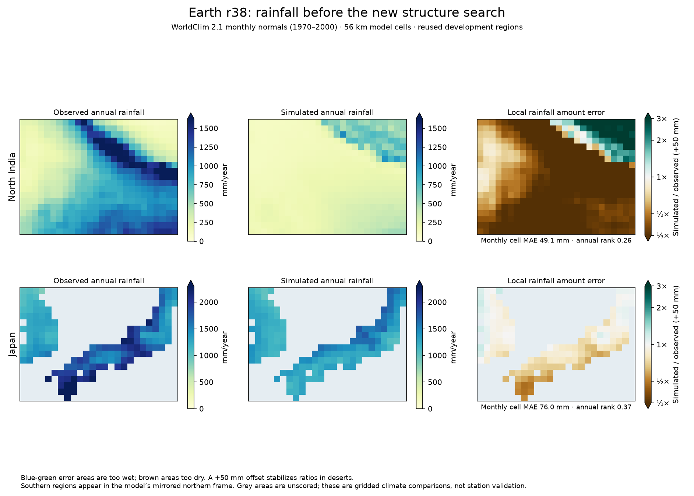
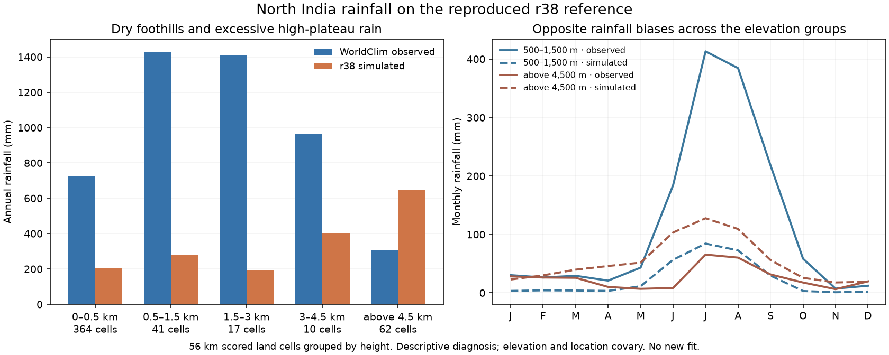
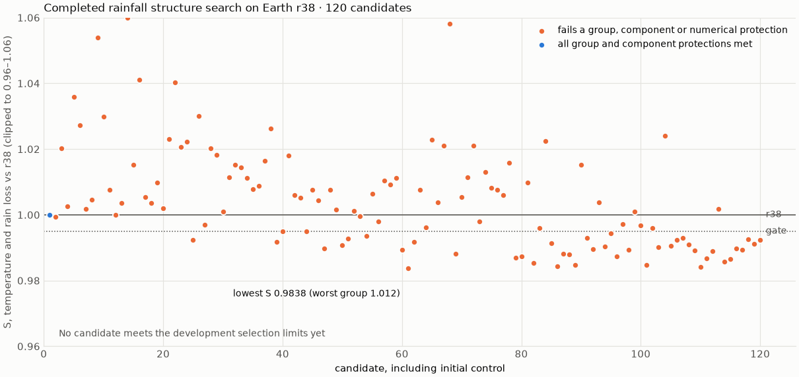

# Resume the r38 rainfall-structure campaign

The handoff's frozen plan is unchanged at
`calibration/rain_structure_20261025/plan.json`. It searches ten existing
physical settings against the 31-region gate objective, then allows at most
three eligible candidates through the paired 28 km screen. The selected
candidate takes the established six-region check once. No candidate is an
adopted r39 merely because its search score improves.

## Input recovery before candidate search

The first invocation stopped before scoring any candidate because the newer
Earth-grid preparation required WorldClim vapor pressure, absent in this
workspace. That empty setup is preserved under `setup_missing_inputs/`.
WorldClim's 5-minute vapor-pressure archive was restored and checked, along
with January WOA18 temperature profiles used to derive ocean shelf depth.
Shared global forcing caches were prepared before parallel region workers.

All **31 r38 reference regions** were rerun. Their temperature monthly MAE
and rainfall loss reproduce the earlier adopted r38 run **exactly in every
region**. Mean monthly temperature error is 1.796 °C and rainfall loss about
0.4528. The restarted search's first control also scores **S = 1.0000**.
These remain reused development regions, not independent validation.

New benchmark identities include the actual polar-fetch, ocean-connection,
cloud-reference, monsoon-descent and sea-depth fields. Previously those newer
inputs were omitted from the per-case hash. Vapor-pressure archives are now
included in the source manifest. Existing frozen results remain intact;
current campaigns use fresh output directories. This changes provenance,
not the physics or the measured r38 climate.

`scripts/guarded_gate_search.py` verifies actual regional forcing, source
hashes, starting parameters, reference certificates and exact reproduction of
the planned objective before starting/resuming a search. A snapshot was
recorded for the restarted invocation after its control reproduced r38.
The snapshot includes the search and wrapper sources and package versions.
Future resumes should use this guard rather than the unguarded historical
entry point:

```sh
OPENBLAS_NUM_THREADS=1 OMP_NUM_THREADS=1 .venv/bin/python -I scripts/guarded_gate_search.py \
  --plan calibration/rain_structure_20261025/plan.json \
  --input-reference output/rain_structure_20261025/reference_recovery \
  --out calibration/rain_structure_20261025/search --workers 2 --hours 1.85 --resume
```

The model sources and frozen plan remain fixed while the search runs.
The worker count is two for this workspace's two-core quota; political
exports temporarily share those cores. The time budget is the handoff's
1.85-hour resumable invocation budget, not an estimate of when all 120
candidates will finish.



The recovered maps show the problem the plan targets: a missing wet Himalayan
front with excessive rain farther north, and deficient rain on Japan's south
coast. Brown in the ratio panels means too dry, blue-green too wet; ratios
include a +50 mm stabilizer. No post-hoc rainfall-map correction is applied.


## Descriptive elevation diagnosis

Grouping the reproduced r38 North India scored cells by terrain height gives:

| Elevation | Cells | Simulated annual rain | Observed annual rain |
|---|---:|---:|---:|
| 0–500 m | 364 | 203 mm | 727 mm |
| 500–1,500 m | 41 | 277 mm | 1,428 mm |
| 1,500–3,000 m | 17 | 195 mm | 1,407 mm |
| 3,000–4,500 m | 10 | 403 mm | 963 mm |
| Above 4,500 m | 62 | 650 mm | 308 mm |

The foothills and high plateau have opposite biases. This motivates examining
ascent, crest airflow and vapor removal together; increasing all precipitation
would worsen the existing plateau excess. These are native 56 km development
cells with constant projected area. Elevation and location covary, so the
comparison is descriptive and cannot isolate the cause. The bins were inspected
before this plot was written; this is not a new predeclared acceptance test.

`plot_rainfall_elevation.py` uses the verified cached cells without another
climate run. The diagnostic JSON records source and plotting-code hashes.




## Completed search: retain r38

The declared budget is complete: **120 evaluations, including the reference
control and 119 new parameter sets**. The original invocation stopped cleanly
at 105; the guarded resume ran the remaining 15 with exactly the same scientific
sources, packages, observed inputs and reference identity. The end-of-campaign
guard passed. All 120 regional evaluations completed numerically.

No new candidate satisfies every frozen search-screen criterion. No candidate
advances to a finer-grid or established-six check, and no r39 is adopted.
The automatic `best_params.json` is a rejected research candidate, not a model
to publish. Full regional errors remain in the archived `evals.jsonl`.

The best penalized candidate is zero-based evaluation **110**:

- S = 0.986824, versus 1.000000 for r38.
- Temperature monthly MAE 1.791453 °C, versus 1.796389 °C.
- Rainfall loss 0.442081, versus 0.452768 (a 2.36% reduction).
- Group scores: training 1.002713, former holdout
  1.000445, mid-latitude 0.983615,
  dev12 0.972911. The first two exceed 1 and disqualify it.

The lowest unprotected overall S is 0.983759, at evaluation
60; it also fails the regional protections. A better combined average
does not establish a campaign winner or physical realism. The small protected-
group regressions are acceptance failures under this plan, not evidence that
the corresponding planet is physically impossible.

`review_rain_structure_search.py` independently recomputes recorded scores from
the regional errors, rejects incomplete/tampered/nonfinite records, verifies
variable bounds and the unchanged input manifest, and selects at most three
eligible finalists in the declared order. Its five tests include cases where
better averages conceal a worse group or temperature component. This complete
review selects none; details are in `final_review/review.json` and
`final_review/campaign.json`.



The useful next experiment is a physically motivated terrain closure on a
common fine terrain reference, with matched coarse/fine controls. Merely
extending this same search or relaxing its regional limits after seeing the
results would not answer that question.
