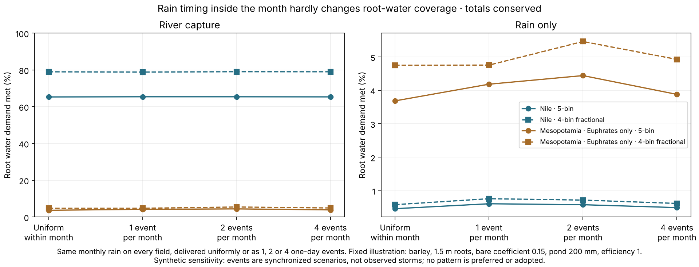

# Rain timing inside the month hardly changes crop root water

**Outcome.** The declared sensitivity is complete. With every field's monthly
rain conserved exactly, delivering it as one, two or four one-day events instead
of uniformly changes root-water coverage by at most 0.76 percentage points
across the eight mapped illustrations, and by at most 0.19 points on the Nile
with river capture. Uniform within-month rain is therefore not what holds the
Nile result down. No pattern is preferred and nothing is adopted.

Protocol: [plan](../calibration/rain_timing_20261114/plan.json), committed in
`e045ab5a` before any timing code or output. Normal page:
`atlases/earth_evidence/rain_timing/`.



## Results

Root transpiration actual/potential, area-weighted over crop-eligible fields.
Fixed illustration: barley, 1.5 m roots, bare coefficient 0.15, pond 200 mm,
efficiency 1.

| Region · calendar · access | Uniform | 1 event | 2 events | 4 events | Range |
|---|---:|---:|---:|---:|---:|
| Nile · 5-bin · capture | 65.31% | 65.41% | 65.40% | 65.35% | 0.10 |
| Nile · 4-bin fractional · capture | 78.98% | 78.84% | 79.04% | 79.00% | 0.19 |
| Nile · 5-bin · rain only | 0.46% | 0.61% | 0.58% | 0.49% | 0.15 |
| Nile · 4-bin fractional · rain only | 0.58% | 0.76% | 0.72% | 0.62% | 0.18 |
| Euphrates only · 5-bin · capture or rain only | 3.69% | 4.19% | 4.44% | 3.88% | 0.76 |
| Euphrates only · 4-bin fractional · capture or rain only | 4.75% | 4.76% | 5.46% | 4.93% | 0.71 |

- The effect is small everywhere and not monotone in the number of events.
- On the Euphrates-only member, capture and rain-only rows are identical, as in
  the baseline: capture does not change that member.

## Clock control

All four patterns share one common clock per calendar that contains every event
boundary (545 or 547 steps against 377 or 379 originally), so they differ only
in rain. Uniform rain on the common clock reproduces the archived original-clock
coverage to within 0.021 percentage points. Individual annual field fluxes
differ by up to 10 mm between the two clocks in the capture cases; that is a
step-size effect of the operator and is kept separate from rain timing.
Thermal eligibility is identical on both clocks.

## Checks

- **Preflight, before any Earth output:** 12 controls: nonnegative rain, exact
  bin and field totals on arbitrary clocks, event support and duration, zero
  rain, invalid inputs, a Decimal overlap reference, no input mutation.
- **Independent review:** pulse rain rebuilt from the declared bin/event
  intersections with plain loops; the previously reviewed scalar river, pond
  and soil ledger reused with two declared substitutions so it reads per-step
  rain. 13,165,152 field-steps; eligibility, annual per-field stocks and
  fluxes, monthly basin ledgers and daily basin stocks compared. Largest annual
  field difference 1.6e-12 mm; largest joint mass residual 3.8e-6 m³.
- **Replay:** a fresh run reproduces both numeric files byte for byte.
- **Protected files:** the pinned daily coupling, its producer and reviewer and
  all earlier protected outputs are unchanged.
- **Page:** four viewport/theme cases, 32 rows, both filters, five download
  hashes, keyboard focus, evidence and hub links.

## What it does not show

- Storm runoff and deeper infiltration from intense rain are not modelled; the
  plan excluded new storm physics.
- Events are synchronized across all fields, unlike real storms.
- Soil profiles, root development, crop coefficients, pond access and drainage
  dates remain unqualified; Mesopotamia still lacks the Tigris.
- These are water diagnostics, not a harvest rule or a yield.

## Next

Rain timing can be set aside. The remaining candidates for the Nile shortfall
are the ones the daily-coupling report listed: soil and root development, stage
crop coefficients, pond access and drainage dates. Then add the Tigris and
independent regions, freeze the harvest translation, and test Nile gain and
Mesopotamian non-inflation before the whole-empire supply calibration.

## Reproduce

```sh
.venv/bin/python -m pytest -q tests/test_rain_timing.py
.venv/bin/python -I scripts/rain_timing_fields.py
.venv/bin/python -I scripts/rain_timing_fields.py --out output/rain_timing_20261114/fresh
.venv/bin/python -I scripts/review_rain_timing_fields.py
.venv/bin/python -I scripts/publish_rain_timing.py && .venv/bin/python -I scripts/build_fit_hub.py --date 2026-11-14
python3 -m http.server 8766 & node scripts/check_rain_timing_browser.js output/rain_timing_20261114/browser
```
