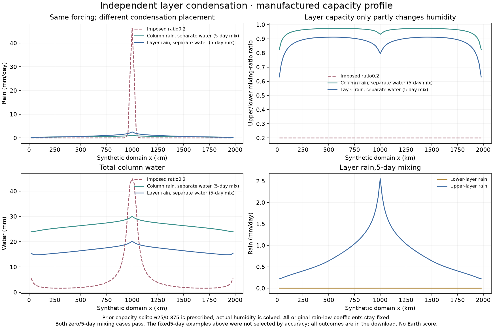

# Independent condensation with prescribed layer capacities

The preceding nonlinear transport test allows upper air to become nearly as
humid as lower air. This follow-up asks whether separating condensation between
layers changes that behavior while preserving the old rain law at the old
profile. It remains a **manufactured mechanism test**, not an Earth climate
integration, accuracy gain or adopted physical closure.

Plan `calibration/reservoir_clouds_20261026/plan.json`, source60758ca, fixes two
new profiles: zero and5day vertical mixing. Every preceding synthetic input is
unchanged. Column capacity40mm is partitioned0.625/0.375, equivalent to the
prior0.2 specific-humidity capacity shape and lower dry-mass fraction0.25.
Actual water and humidity are independently solved, not reset to that shape.
The partition is an imposed approximation, not an independently observed or
calculated upper-air temperature profile. No new rain coefficient is tuned.

Each layer uses the unchanged `rain_coefficient` at equivalent column water
`W_i/f_i`, with original column capacity. Thus when `W_i=f_i*W`, both loss
coefficients exactly recover the old column law and their rain sums to old
column rain. This also preserves the convective water floor; merely multiplying
convective amplitude by f_i would fail that equivalence near the old0.1mm floor.

Existing parent results are imported after verifying every original source
and result hash, rather than silently rerun under changed inputs. Two new
nonlinear systems are solved. Their actual local water equations are checked
separately in each layer at the same1e-8 residual tolerance. No climate
integrations are added; the completed Earth series remains721 attempts,
717passes and4 preserved original failures.

| New profile | Peak rain mm/day | Peak water mm | Mean rain mm/day | Upper/lower q range |
|---|---:|---:|---:|---:|
| Layer rain, no mixing |2.8123|20.6303|0.78967|0.600–0.907|
| Layer rain,5day mixing |2.5572|20.2374|0.78536|0.630–0.912|

Both pass in202 iterations. The5day example's upper-humidity maximum falls
from0.973 under proportional column rain to0.912 with separate layer rain,
while peak rainfall rises from1.10 to2.56mm/day. The fixed-profile synthetic
peak remains46.17mm/day. Only fixed5day examples are plotted together; all
zero/5day outcomes and verified parent results are available in the download.
No profile is selected by observed accuracy.

The result is a partial mechanism change, not a realistic Earth vertical
moisture validation. Capacity partition alone does not determine vertical
temperatures, convective air mass exchange, cloud formation or latent heating.
The high humidity ratios and sensitivity to precipitation placement remain
reasons to require physical vertical structure and external humidity constraints
before a coupled seasonal fit. The old column approximation must not simply
be duplicated and declared independent cloud physics.

Six new tests verify full old-profile rain equivalence across the numerical
water floor, exact independent supersaturation solutions, terrain/vertical-flow
nonlinear equilibrium and three invalid capacity partitions. Together with the
preceding operator and nonlinear checks,21 focused tests pass. Core ClimateModel,
Earthr39/worldr38 atlas climate, economic/population data and headline measured
accuracy remain unchanged. No storm, surface-ocean or thermal-feedback coupling
is implied by these isolated tests.
