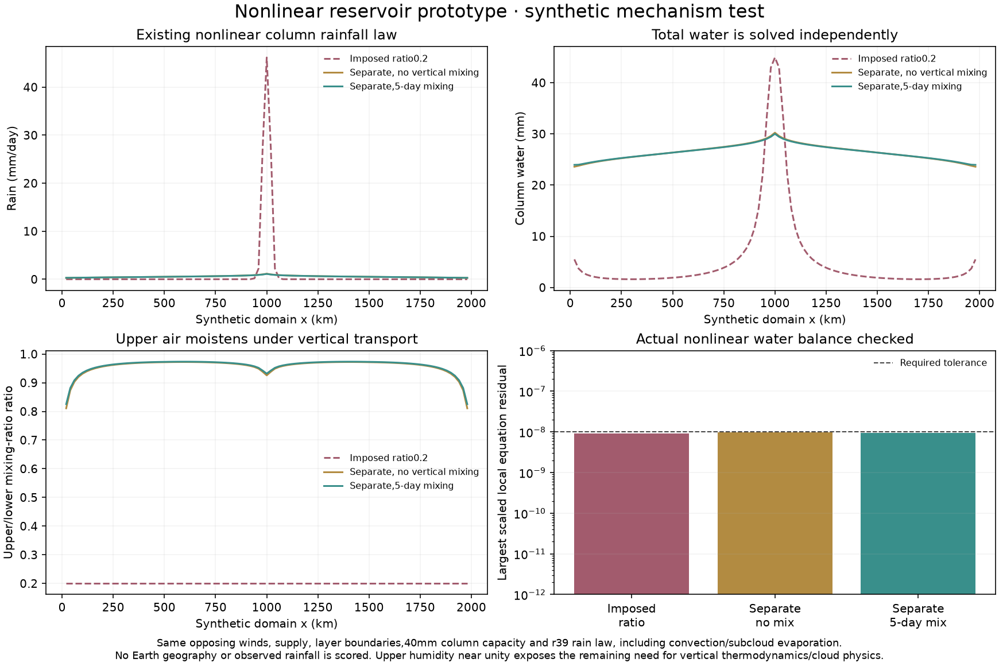

# Nonlinear rain with independent moisture reservoirs

The linear two-reservoir illustration is followed by a frozen nonlinear test
using the unchanged r39 `rain_coefficient`, including the fitted convective
exponential, humidity gate, supersaturation removal and subcloud evaporation.
This is a **synthetic mechanism test, not a climate integration or Earth
accuracy gain**. Code/plan were committed as0e55984 before the three results.

All cases prescribe the same7x101 flat grid at20km,8m/s sinusoidal lower winds
and mass-balanced upper return,1mm/day lower supply,40mm column saturation,
22C temperature and temperature factor0.7, dynamics0.5, and50day accountable
drying. Both layer boundary values are identical:8.75/5.25mm, equivalent to
the old0.2 upper/lower humidity ratio. No geography, observed climate, thermal
feedback, ocean exchange or storms enters this manufactured comparison.

`experiments/condensing_reservoirs.py` solves the two conservative layer
transport equations with the existing column rain loss coefficient evaluated
at total water. Rain removes each layer's current water share, so the total
rainfall law is unchanged. The vertical humidity profile remains independently
solved. Every Picard step solves the actual two-layer matrix; stopping requires
the actual nonlinear local residual in **each** layer, not just a small update
or cancellation between layers. No hidden source, convergence multiplier or
humidity reset is introduced.

`calibration/reservoir_rain_20261026/plan.json` predeclares three profiles:
imposed ratio0.2, independent water without vertical mixing, and independent
water with5day symmetric mixing. Numerical work/tolerance is declared separately
(.1 relaxation,2048 ceiling,1e-8 nonlinear residual). Sources, plan and inputs
are hash-frozen before results in `output/reservoir_rain_20261026/protocol.json`.
No extra profiles or changed thresholds are added after outcomes.

## Results and interpretation

| Profile | Peak rain mm/day | Peak column water mm | Mean rain mm/day | Largest local residual mm/day |
|---|---:|---:|---:|---:|
| Imposed ratio0.2 |46.1745|44.9253|1.06625|6.38e-9|
| Separate, no mixing |1.1533|30.2352|0.54138|9.21e-9|
| Separate,5day mixing |1.1002|30.0115|0.53884|8.95e-9|

All three systems converge in201–205 iterations. No Earth climate integrations
are added to the cumulative721-case count. Different resulting boundary fluxes
are accounted explicitly; equal prescribed boundary water does not imply equal
water supply once the solved circulation/humidity field differs.

The sharp convergence pile-up weakens under independently solved layer water,
even without explicit vertical mixing. This mechanism survives replacing the
illustrative linear sinks with the actual nonlinear column rain law.

However, solved upper/lower mixing-ratio ratios reach0.97 (ranges roughly0.81–
0.97), nearly uniform with height. This is **not** evidence of a realistic
Earth vertical moisture profile. Proportional column rain does not independently
condense saturated upper air, and vertical thermodynamics/cloud formation is
still absent. The test supports adding independent water states; it cannot
justify adopting this closure unchanged. Lower mean rain could also harm dry
regions. A future experiment must represent vertical saturation/condensation,
then perform controlled Earth-input replay and genuinely coupled seasonal
benchmarks with all original Earth/world gates before changing any atlas.

Six new nonlinear tests verify exact supersaturation rain, independent
two-box vertical exchange, terrain/transport equilibrium with a manufactured
nonlinear source, failed-iteration rejection, and invalid saturation. Together
with the nine preceding operator checks,15 focused tests pass. Current core
ClimateModel, published atlas climates, economic/population data and headline
accuracy scores are unchanged.
