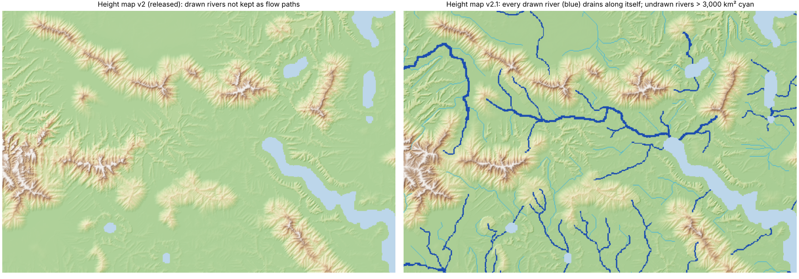

# Drawn rivers in the eroded height map, and the height map as a climate lever — 8 November 2026

Owner, 7–8 November 2026:
* "Remember that all of our drawn rivers also have to be there in the eroded map."
* "Can we have the height map also help our climate calibration? As long as it doesn't break our height map tier system."

## 1. The drawn rivers (plan_R1 + amendments 1–4)

Plan: `calibration/geography_control_20261107/plan_R1.json`. Code: `scripts/terrain_rivers.py`.

### What was wrong with the released height map v2

A strict check of the stored surface used steepest descent, the same rule a river follows. On v2:

| Check | v2 |
|---|---|
| Drawn-river cells whose water goes into the next river cell (or the sea / a lake) | 31 % |
| Drawn-river cells whose water stays on the drawn river all the way to the sea / a lake / the map edge | 1.3 % |
| Downstream steps along a drawn river that go up or stay flat | 19,602 of 27,281 |
| Drawn-river cells below every bank | 25 % |
| Drawn rivers (of 107) that drain along themselves | 0 |

The earlier check, "100 % of drawn-river cells within one cell of a channel", was not informative. Every cell counted as a
channel, because fastscapelib's `accumulate()` already multiplies by the cell area and the code passed it the cell area again.
The drainage areas were therefore in m⁴, not m².

### Method

Every step comes from the hydrological conditioning literature.

1. **Order.** The drawn-river cells are ordered by their distance along the drawing to an outlet: the sea, a lake or the map
   edge. All 107 drawn rivers have one.
2. **Bed.**
   * The target bed is 0.6 × the tier-ramp height, fitted on Earth.
   * Two monotone profiles are built: one breached from the sources down, one filled from the mouth up. The bed is their
     mean (hybrid breach–fill, Lindsay 2016).
   * The bed strictly falls downstream and stays above sea level.
3. **Valley.**
   * Land within 11 px (about 20 km) of a river is lowered linearly toward the bed (the stream-burning buffer of Hellweger
     1997 / AGREE; Saunders 1999).
   * Land in that buffer that lies below the bed is raised to the bed + 10 m, so no trench runs beside a drawn river.
4. **Banks.** Every cell next to a river is at least 10 m above the highest adjacent bed.
5. **Flats.**
   * Hollows are filled, and flats drain toward their lower edges and away from higher ones (Barnes, Lehman & Mulla 2014b).
   * A final Priority-Flood + ε pass then makes every land cell drain (Barnes et al. 2014).
   * River cells are never changed by these steps.

### Earth fit

The pipeline was run on the eight ETOPO windows of plan_B2. On each window, the "drawn rivers" are the largest-catchment
cells, at the map's river density.

| Quantity | Unconditioned | Chosen form |
|---|---|---|
| Joint loss (valley profile + bed level), development windows D1–D4 | 1.70 | 0.72 |
| Joint loss, check windows B1–B4 | 1.35 | 0.93 |
| Drainage divides closer to Earth | — | 8 of 8 windows |
| Slope distributions closer to Earth | — | 7 of 8 windows |

* The check windows were the B2 blind windows. The valley metric had never been computed on them, but they are not unseen
  data, so they count as a check, not a blind test.
* On the check windows the loss falls on Balkans and Guizhou and rises a little on Zagros and the Appalachians.
* River beds sit at a median 0.6 of the tier ramp; Earth's eight windows range from 0.28 to 0.76.
* Undrawn rivers, recomputed with areas in m² (`output/terrain_rivers_20261107/side_effects_m2.json`):
  * Do the reconstructed rivers over 500 km², more than 5 px from a drawn river, sit where Earth's do? F1 is 0.17–0.31
    before conditioning and 0.17–0.27 after; conditioning lowers it in 5 of 8 windows and leaves 3 unchanged.
  * The new rivers are therefore plausible, but not predictions: a four-tier sketch does not carry where Earth's smaller
    rivers run.
  * The earlier "F1 = 1.00" came from the m⁴ areas and meant nothing.

Amendments, each frozen before its own results:
1. **Amendment 1.** Earth bed level was added after breach-only carving drove upland beds to sea level.
2. **Amendment 2.** The map's tier gates became constraints on the Earth-ranked forms. No form passed.
3. **Amendment 3.** Hills are kept inside tier 1, as the owner asked ("there can be hills outside of the marked heightmap
   tiers, right now it's all flat"), and their height was refitted to Earth lowland slopes: 1,600 m, KS 0.045. This was
   needed because the hills had been raising the narrow tier-3 band.
4. **Amendment 4.** Flats now drain toward their lower edges (the Barnes 2014b step above). The m⁴ units were found here; the
   fitted erosion numerics are kept bit-identical.

### Height map v2.1

| Check | v2 | v2.1 |
|---|---|---|
| Owner check: every drawn-river cell drains along the drawn river to the sea / a lake / the map edge | 1.3 % | **100 %** |
| Downstream steps that go up or stay flat | 19,602 | **0** |
| Drawn-river cells below every bank | 25 % | **100 %** |
| Drawn rivers draining along themselves | 0 / 107 | **107 / 107** |
| Tier band share, tiers 2 / 3 / 4 | 0.962 / 0.495 / 0.832 | 0.984 / 0.516 / 0.862 |
| Tier-1 9 km slope median (Earth lowlands 0.167°) | 0.160° | 0.166° |
| Climate-scale departure from the tier ramps | 43.1 m | 45.0 m |
| Undrawn rivers draining more than 3,000 km² | — | 0.9 % of land |

### Climate on v2.1

`output/terrain_v21_climate_check/summary.json` compares the r44 map world, 3 seeds, on v2.1 against v2:
* strict zone agreement +0.11 points raw and +0.12 points corrected, so the climate is adopted (no drop);
* mean |ΔT| 0.17 °C, median rain ratio 1.004;
* the climate model's own rivers on the 14.7 km grid now follow the drawing better: recall of drawn-river cells 0.65 →
  0.77, precision 0.39 → 0.44.

## 2. The height map as a climate lever (plan_T1)

Plan: `calibration/geography_control_20261107/plan_T1.json`. Code: `scripts/terrain_climate_t1.py`.

### Where the lever can act

* 64–94 % of each painted zone's cells lie in tier 1 (0–62 m).
* Their failures are mostly moisture: cold-dry aridity, "tree" humidity.
* The swamp zone needs about 4 °C more warmth even at sea level.
* A lapse-only ceiling: if every upland cell could take its best position inside its own band, strict agreement would go
  from 0.352 to 0.370. One band position per tier would add only about 0.5 points.

### Levers tested

The tier tops, the tier membership of every cell, the drawn rivers and the Earth-fitted amount of hills were all held fixed.

| Lever | What it changes | Result |
|---|---|---|
| L1 | Position inside the band per upland tier: ramp lo + (hi − lo)·s^γ, γ per tier 2/3/4 | Best is uplands low in their bands (γ = 1.6 for all). Full 3-seed run: +0.39 points raw, +0.29 corrected; west +0.19, east +0.40 |
| L2 | Where the tier-1 hills stand (same amount, steered by the target) | Lowers agreement (−0.5 / −0.8 points). Hills are relief around a local mean, so they do not change climate-cell elevation |

### Decision

* The frozen bar was +0.5 points corrected. The best band-position setting gives +0.29.
* The ceiling of this lever, with every upland at the very bottom of its band, is +0.44, so no setting can pass.
* Height map v2.1 stays as it is.
* The height map cannot do much for the painted-zone fit, because the misfit lies in the lowland moisture field. That is the
  climate model's work: P8 maritime lag and the W3 fantasy-map desert.

## 3. Release (8 November 2026)

Drivers:
* `scripts/release_r44_rivers.sh` (base);
* `scripts/release_r44_rivers_addons.sh` (promotion and add-ons).

Logs are in `output/atlas_r44r/`. The checkpoint is the 3-seed v2.1 climate-check run, made with
`scripts/make_release_checkpoint.py`, which checks that its parameters equal `calibration/map_world_r44_terrain21/params.json`.

* **Base build.** The base build ran 00:45–01:37: world, diagnostics, corrected layers and climate (r44 corrections),
  languages and the physics tag.
* **Promotion.**
  * The live atlas was backed up to `output/atlas_r44r/previous_atlases/earth_fit_r44v2`.
  * The promoted atlas has exactly the previous file set.
  * Its `params.json` names `map_height_v21.npz`.
* **Add-ons.** All add-ons were rebuilt in dependency order (01:37–02:22). The free and Whittaker atlases were recomputed too,
  through the shared pilots and the joint administrative inventory.
* **Control v2.1 on v2.1 terrain.** It holds 68.2 % (raw) and 68.0 % (corrected) of Earth-fit land; r44 on v2 held 68.1 % and
  67.8 %. The hillshade now comes from the atlas's own terrain file.
* **Smoke.** The smoke test (`scripts/check_atlas_smoke.js`) passes on all three atlases: 65 / 70 / 67 layers, as in r44, with
  no errors and no failed requests.
