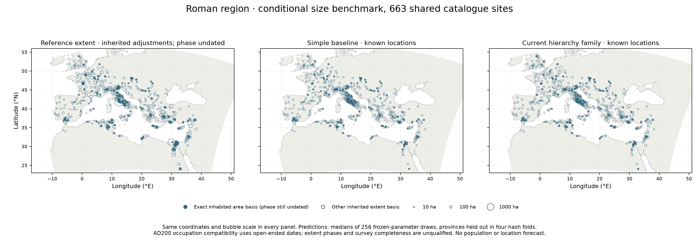
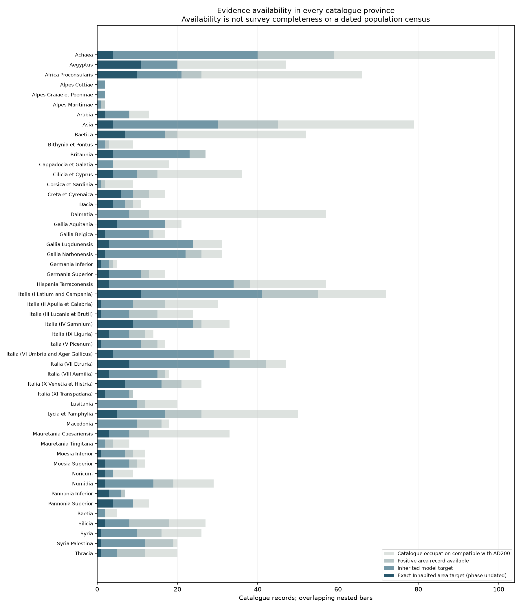
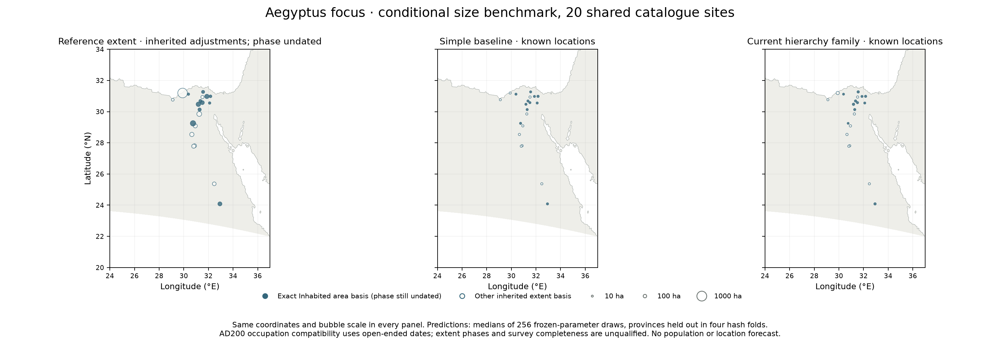

# Roman settlement benchmark around AD200 — 17 November 2026

The current hierarchy adds **modest conditional settlement-area skill** over a simple baseline. Across 663 catalogue records compatible with AD200, its predictive score improves 4.40% and median log-area error improves 5.55%. On the 152-target exact `Inhabited area` subset, improvements are 7.54% and 9.43%. These are development comparisons at supplied city locations, not a dated census or a settlement-location forecast.

Egypt remains substantially underpredicted, and the hierarchy overpredicts the aggregate area of the broad target set. The evidence does not support promoting the provisional atlas to a fully validated AD200 population model.

## Evidence and time support

The pinned Hanson2016 Cities table has city Start/End dates. The Areas table has Area and Estimate Basis, with no measured-phase date. The inherited city-size cohort was prepared at catalogue epoch AD150, and its same 664 training records are retained for both alternatives. Targets alone are additionally screened for AD200 occupation compatibility, preserving the old convention that a missing End Date is open-ended.

Of the 664 original model records, 663 remain compatible under that convention, including 152 of the original 153 strict extent-basis targets. Only six compatible records have an explicit occupation end date. This sparse known-end subset is reported separately, not treated as a representative high-certainty validation pool. An explicit end date still does not date an area measurement. Zero extent phases, complete survey footprints or observed city-population measures are newly qualified by this packet.

All 51 catalogue provinces remain in the coverage ledger. There are 1,362 AD200-compatible catalogue records and 865 with positive area records before inherited model eligibility. These are availability counts, not a surveyed-land denominator or catalogue completeness. Exact20/30 exclusion, Greek wall adjustments, old geographic eligibility and supplied capital labels remain inherited conditions. The map reference panel uses those adjusted model extents. Raw catalogue tables are not redistributed.

## Fair comparison

**M0 baseline:** the same outer-training pool supplies one mean of log area. Three inner province folds estimate predictive scatter from held-out training residuals. It has no hinterland, capital or local geographic predictor.

**Current hierarchy family:** the already selected, repaired training-isolated refreshed-H outer fits are replayed without refitting means, scatter, hierarchy selection or capital shift. This assesses the model family used by r5; evaluating its all-data release fit on its own source targets would not be an honest held-out comparison. Known catalogue locations and capital labels are supplied to both the experiment and its interpretation.

Both alternatives share the original four province-hash folds and area bounds. Those folds separate provinces, not contiguous geographic blocks. The bounds were inherited from exposed development data. This is not a new blind test or an externally independent transfer test. The original five hierarchy seed outputs reproduce exactly. Then 256 seeds (1000–1255), declared before evaluation, are used for both alternatives to reduce the earlier five-draw sampling noise. Generated spread expresses model assumptions, not calibrated archaeological confidence.

Lower log-area CRPS and log-area errors are better. CRPS compares the entire generated distribution against each reference extent. MAE uses the median generated log area.

| Targets | Model | Records | Log-area CRPS | Median log-area MAE | Median log-area RMSE | Mean generated total / reference area |
|---|---|---:|---:|---:|---:|---:|
| AD200_compatible | baseline | 663 | 0.5978 | 0.8443 | 1.0608 | 1.016 |
| AD200_compatible | hierarchy | 663 | 0.5715 | 0.7975 | 1.0159 | 1.118 |
| AD200_strict | baseline | 152 | 0.5825 | 0.8229 | 1.0352 | 1.110 |
| AD200_strict | hierarchy | 152 | 0.5386 | 0.7452 | 0.9651 | 1.148 |
| AD200_known_end | baseline | 6 | 0.4791 | 0.6048 | 0.8436 | 1.560 |
| AD200_known_end | hierarchy | 6 | 0.4356 | 0.6502 | 0.7406 | 1.641 |

The hierarchy wins the province-level distribution score in 32/51 compatible-target provinces and 25/40 strict-target provinces. Equal-province improvements are smaller than pooled-target improvements: about 2.01% for compatible targets and 4.71% for strict targets. All small samples are retained and flagged below five records; no weak province or fold is removed. The six known-end targets give mixed metrics and do not establish a chronology-qualified result.

The broad target set shows an additional tradeoff: baseline mean generated total area is 1.016 times the reference, versus 1.118 for the hierarchy. On strict targets the ratios are 1.110 and 1.148. Better local distribution scores do not guarantee an improved regional area budget. Aggregate generated ratios and the median bubbles shown in maps are different statistics.

## Egypt is still a clear failure to explain

Aegyptus has 47 compatible catalogue records, 20 inherited model targets and 11 strict extent-basis targets. Only one catalogue occupation end is explicit; extent phases are unqualified throughout. On the eleven strict targets, the hierarchy has log-area CRPS 0.8527 versus baseline0.8893, but its mean generated area is only **39.76% of the reference total** (baseline38.33%). Every hierarchy median is below the corresponding reference area in this subgroup. A small relative improvement does not make this a successful Egyptian reconstruction. No Egyptian correction has been fitted here.

## What is established and what remains open

There is some conditional city-size signal beyond an intercept-only distribution. The present test cannot establish AD200 urban population, regional urbanisation, missing-town counts, location forecasts, rural density or seasonal food/work feasibility. Those claims need their own observations and support. The published r5 atlas stays unchanged and provisional. Its reach/trade/administration reference populations are not altered. Climate remains fixed.

The next discriminating task is `calibration/roman_benchmark_20261117/dated_regional_evidence.json`: qualify period-appropriate regional observation support, especially survey footprint/date/site type and population definitions, before a spatial or demographic comparison. No new hierarchy parameter search or warehouse-handling study follows from these results. The existing undated catalogue can continue to support conditional area development, while stronger historical claims remain unpassed.

## Reproduction and checks

Declaration `bc8dca843` preceded target filtering/new scores. Target preparation and independent review `275b604ca` preceded the baseline fits. The producer changes no historical scientific or publication file. Historical publication differences resolve only to the exact archived r5 baseline; current publication hashes are separately verified.

The independent reviewer checks all 339,968 generated area values through closed-form scalar baseline fitting and a separate hierarchy replay; maximum area discrepancy is 7.39e-13ha. Direct pairwise CRPS agrees with the producer’s sorted-weight formula within 2.67e-15. All 664 prediction rows and 2,688 aggregate metric cells are checked. Six fresh outputs plus the result receipt are byte exact. The figures use the same sites and hectare bubble scale; anonymous plot values are retained and checked.

Recipes: `scripts/prepare_roman_benchmark.py`, `scripts/review_roman_benchmark_preparation.py`, `scripts/run_roman_benchmark.py`, `scripts/review_roman_benchmark.py`, `scripts/render_roman_benchmark.py`, `scripts/seal_roman_benchmark.py`. Producers refuse overwrite; benchmark producer accepts `--out <isolated-directory>` for replay. Large/derived NPZ files are local/ignored and pinned.

[All province scores](../output/roman_benchmark_20261117/provinces.csv) · [Fold scores](../output/roman_benchmark_20261117/folds.csv) · [All comparisons](../output/roman_benchmark_20261117/comparisons.csv) · [Evidence coverage](../output/roman_benchmark_20261117/coverage.csv) · [Readiness](../output/roman_benchmark_20261117/readiness.json).
