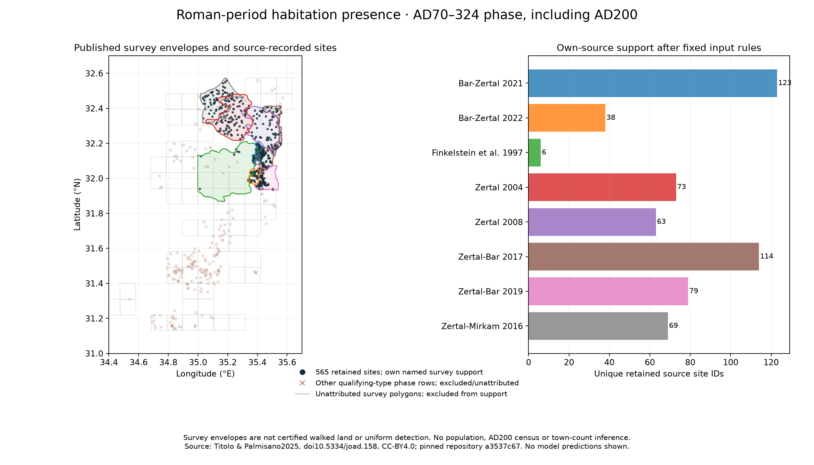

# Dated regional-source screen and South Levant contract — 17 November 2026

The three-source screen found a usable **conditional spatial-presence** contract
in Titolo and Palmisano's South Levant data. It retains565 distinct source site
IDs in eight exact-matched survey envelopes, for the reported Late Roman70–324AD
phase. This is a period-specific habitation proxy encompassingAD200, not an
AD200 population census or a complete inventory of towns.

## Three candidates and selection

| Candidate | Relevant support | Decision |
|---|---|---|
| Rural Settlement of Roman Britain, doi10.5284/1030449 | Existing source preparation identifies selected excavation/report records; occupation spans and undated roles | Not qualified for complete regional counts; investigated area is not settlement extent |
| Potenza Valley Survey, official Ghent methods | Three intensive/extensive samples and explicit visibility methods; acknowledged second/third-century pottery-dating hiatus | No matching machine-readable support/observations qualified from the opened methods page; not selected for immediate numerical work |
| South Levant, doi10.5334/joad.158 | Explicit site-phase/date/type/quality fields, published survey polygons and directly accessible GIS | Selected before model scores, for a limited within-source spatial diagnostic |

[Potenza methods](https://www.potenza.ugent.be/node/26) were read through the web
source. A direct local HTML fetch returned503; no raw-HTML identity is claimed.
The prior Britain metadata remains unchanged. No fourth source family was
screened, no reserved Buringh pool or owner workbook opened.

## Source identity and version

Andrea Titolo and Alessio Palmisano2025, *From Villages to Empires:
Archaeological Settlements of the South Levant from the Chalcolithic to the
Byzantine Period*, Journal of Open Archaeology Data13:10,1–9,
[doi10.5334/joad.158](https://doi.org/10.5334/joad.158).
Data: [author repository](https://github.com/UnitoAssyrianGovernance/villages-to-empire-dataset),
commit `a3537c67cc736fb929291c50a4928a0cd7136dd9`, CC-BY4.0; archive DOI
10.5281/zenodo.15111732. Source authors do not endorse this model's interpretation.
The binary GIS is downloaded directly from the pinned public GitHub commit;
GitHub connector metadata and blob identities establish that version.

The GPKG is canonical: the latest pinned source commit explicitly fixes its
SizeHa field. CSV is a separate retained export and is never silently overlaid.
Current data contain14,273 phase rows and5,557 site IDs; the article's original
release described14,142 phases and5,542 sites. Those publication counts are not
rewritten to describe the newer files. The actual polygon layer is
`archaeo_survey_areas`, not the README's singular spelling.

## Cohort and geometry checks

| Input stage | Rows or IDs |
|---|---:|
| All phase rows | 14,273 |
| Exact Late Roman label and70–324 span | 811 |
| Settlement / Fortified Settlement type | 781 |
| Location-qualityA | 781 |
| Distinct IDs after10 agreeing duplicate rows collapsed | 771 |
| Exact primary-source match to named polygon | 571 |
| Covered by its OWN source polygon | **565** |
| Outside own source polygon, retained as exclusions | 6 |
| No matching named primary-source polygon | 200 |

One additional Late Roman-labelled row has the incompatible324–638 span and is
excluded without correcting its source. No conflicting identity was merged.
No different IDs are merged by spatial proximity. Building/Cave categories are
separate, not automatically scored as urban towns. Source fortification labels
imply no state authority. The full stage counts and original source-ID receipts
are in [cohort.json](../output/roman_regional_sources_20261117/cohort.json).

All69 polygon geometries are valid. Only8 have a named reference;61 anonymous
polygons are not reassigned by proximity. Named envelopes sum to2849.91km²;
their union is2704.26km², including145.65km² of between-reference overlap.
Within-source areas are unions, never duplicated. The source CRS is
EPSG32636 in metres; geometry-to-WGS84 attributes agree within5e-10degrees.
That is an internal representation check, not independent survey accuracy.
Published area attributes and geometric areas remain separate.

## Observation limits remain part of the contract

The paper explicitly describes varying survey methods/intensity, geographic
sampling imbalance, urban masking and broad pottery-based occupation episodes
(pp3–5). Published survey boundaries are not a guarantee that every hectare
was walked or that detection is uniform. Therefore, no absolute settlement
count, population total or complete-census density benchmark is qualified.

Phase70–324 presence does not establish uninterrupted or simultaneousAD200
occupation. The source quality definition distinguishes phase-specific extent
from sizes copied across phases. Current records have noA/B SizeQual entries:
14,015 areC,239D and19missing. SizeHa is consequently excluded from this
contract; it is not converted into inhabitants or dated built-up area.

Source totals differ dramatically across these eight envelopes because temporal
classification, survey method and record coverage differ. They must not be
compared as direct density measurements. A later diagnostic will condition
counts within source and explicitly assume equal observation opportunity within
that source's retained model-land support. Recorded habitation-site intensity
is also not automatically proportional to person density. Those assumptions
limit any score's interpretation.

## Cross-format preservation and independent review

CSV/GPKG comparison retains20,295 differing field representations:20,097 are
semantically equivalent null/array serialization, while198 are data changes or
unresolved encodings. The latter include three SizeHa entries, five entries
in each coordinate field, and155 alternative-source strings. None is silently
repaired. The canonical point geometries, not stale CSV coordinates, define
this cohort. All source bytes, Git blob hashes and retrieval URLs are pinned;
raw source files remain local/ignored. Public outputs are derived receipts,
aggregates and the attributed map.

The separate reviewer checks all14,273 source rows,69 polygon areas with
compensated shoelace arithmetic,571 own-source memberships using independent
scalar ray crossing, and3,955 observation values. All seven outputs and result
receipt reproduce byte for byte in a fresh run. Producer imports no population,
food, climate or route model. Current published r5 and the previous Roman
benchmark remain unchanged.

Recipes: `scripts/qualify_roman_regional_sources.py`,
`scripts/review_roman_regional_sources.py`, `scripts/render_roman_regional_sources.py`,
`scripts/seal_roman_regional_sources.py`. InstallShapely2.1.2 without upgrading
existing numerical dependencies. Completed stages refuse overwrite; producer
`--out <isolated-directory>` supports replay from pinned source files.

The next frozen protocol is
`calibration/roman_benchmark_20261117/levant_spatial_diagnostic.json`: compare
uniform model-land opportunity, legacy population-pattern density and the
already reviewed refreshed input recipe on identical native9km support within
source. First report pixel support, collisions and off-land points. No refit,
modern analogy, town generator scored against farms, false independent test,
food/work/climate/route solve or atlas adoption follows from preparing these data.
