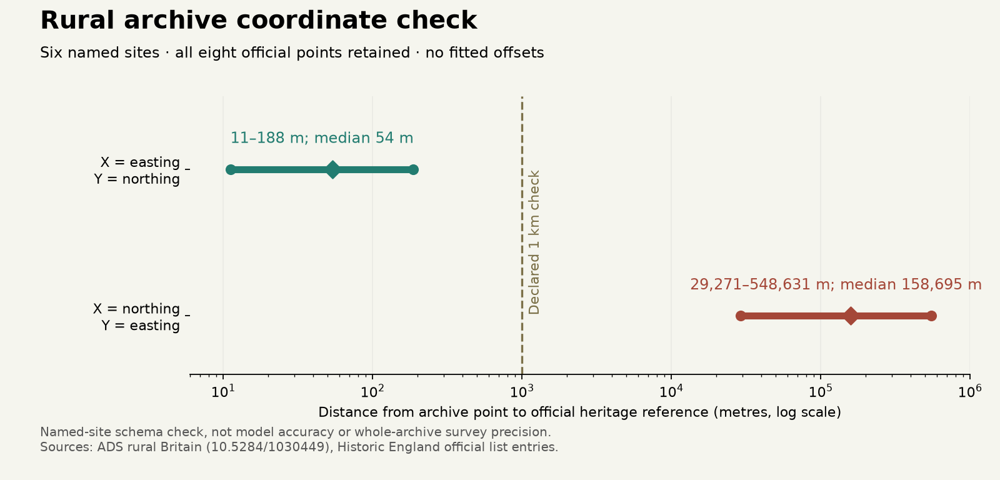

# Rural archive coordinates: an operational interpretation supported by anchors

10 November 2026. Six named sites support treating the exported MAP columns as
**X=easting and Y=northing in British-grid metres**. All eight official heritage
reference points lie within 188 m of their matching archive points; the median
separation is 54 m. Reversing axes puts every point at least 29 km away. This resolves
the working coordinate interpretation; it does **not** establish whole-source
positional accuracy, unique physical places or climate/settlement model accuracy.

## Why the map-client projection was insufficient

The ADS [rural archive](https://doi.org/10.5284/1030449) documents OSGB coordinates
under `X_REF/Y_REF`; its export instead has `X_REF_MAP/Y_REF_MAP`. The old web map
uses an EPSG:3857 client and WMS layers, so client settings alone do not identify the CSV
grid. Leah Reynolds' Cardiff thesis, *Roman Rural Settlement in Wales and the
Marches*, [repository copy](https://orca.cardiff.ac.uk/id/eprint/122869/1/2019reynoldslphd.pdf),
printed pages 65–66/Table 4.6, reuses the MAP field names but labels X as northing and
Y as easting. That is conflicting secondary-use documentation, not an authoritative
export-CRS definition. The source PDF was checked directly; its local content hash
is retained in the protocol and it is not redistributed.

## Declared exploratory comparison

The [protocol](../calibration/roman_rural_coordinates_20261110/plan.json) discloses
prior exposure: source records/ranges and some official references had already been
seen. This is a schema investigation, not a blinded or prospectively independent
test. Six exact source names were declared; every name must have exactly one
matching source record. No fuzzy matches, nearest-record selection, offsets,
scale fitting or dropped sites are allowed.

Official sources are Historic England's National Heritage List entries:

* [Fishbourne Roman Palace,1001211](https://historicengland.org.uk/listing/the-list/list-entry/1001211)
  — registered garden reference within the palace complex, not the same excavation
  point definition as the source record.
* [Chedworth Roman villa,1003324](https://historicengland.org.uk/listing/the-list/list-entry/1003324).
* [Lullingstone Roman villa and Saxon church,1007463](https://historicengland.org.uk/listing/the-list/list-entry/1007463).
* [Beadlam minor Romano-British villa,1011365](https://historicengland.org.uk/listing/the-list/list-entry/1011365).
* [Roman villa site at Rudston,1005222](https://historicengland.org.uk/listing/the-list/list-entry/1005222).
* [Chysauster courtyard-house settlement and associated monuments,1006726](https://historicengland.org.uk/listing/the-list/list-entry/1006726)
  — all three listed points retained.

The initial protocol would have rejected multiple references. Before any pairwise
distances were computed, Chysauster's three references prompted an explicit
amendment: retain **every** reference and require all of a site's references to pass.
The original [v1 protocol](../calibration/roman_rural_coordinates_20261110/plan_v1.json)
is preserved with its hash, rather than silently replacing the rule or selecting
the nearest point. The 1 km diagnostic threshold was not tuned to calculated errors.

The implementation decodes two-letter National Grid notation arithmetically into
nominal easting/northing and grid resolution. This is notation conversion, not a
datum transformation or an estimate of survey precision. All eight reference
strings encode 1 m nominal grid increments; that does not establish 1 m accuracy.
The protected-monument reference and the investigated-area point can differ.

|Interpretation|Points within 1 km|Sites with every reference within 1 km|Min / median / max separation|
|---|---:|---:|---|
|X=easting,Y=northing,metres|8/8|6/6|11 / 54 / 188 m|
|X=northing,Y=easting,metres|0/8|0/6|29.3 / 158.7 / 548.6 km|

Separately, interpreting all 3652 Y values as Web Mercator ordinates gives latitudes
0.094°–5.877°, with none in the source metadata's 49.74°–55.82° latitude envelope.
This rejects that regional interpretation; it is not a full Mercator-to-OSGB
projection comparison. The whole archive has not been projected or independently
verified, and no source-site map was made.

## Use and limits

The evidence supports an **operational OSGB-compatible XY interpretation**, while
official export-CRS certification and positional precision remain unestablished.
Six well-known sites are neither a random precision sample nor a full source audit.
Different point definitions mean their residuals cannot be used as a global
location-error distribution. Future located calibration must declare resolution,
uncertainty/sensitivity and source-coverage treatment explicitly.

The [role evidence](ROMAN_RURAL_ROLES_20261110.md) remains unchanged: channels can
coexist, individual function dates are unknown, and association blocks do not merge
physical settlements. Next, build defensible place identities and phase/role
constraints, then declare grouped/spatial role-calibration targets and splits.
Only qualified residential/institutional changes should enter the same resident,
food, staffing and control consumers. All [S1–S5 steps](SETTLEMENT_CONTROL_ROADMAP_20261110.md)
remain required; no production climate or settlement/control fields changed.

Reproduce: `.venv/bin/python -I scripts/audit_roman_rural_coordinates.py`, then
`.venv/bin/python -I scripts/plot_roman_rural_coordinates.py`. The prior pinned
core CSV must be in the local source cache. The official HTML pages are cached
locally; missing pages can be reacquired, but a change from recorded source hashes
fails for review. Public outputs are aggregate results/protocol/source identities,
not raw coordinates, HTML, PDF or maps. The same source-archive attribution applies;
original collectors are not responsible for this interpretation. Official text
reference facts are used with attribution; no Historic England/OS map is copied.

Verification:77 focused tests pass, including National Grid square/precision
examples, malformed and non-British references, multipoint retention and
conflicting HTML fields. Fresh-output audit and source receipt reproduce byte
for byte; a modified official page is rejected. Both prior source audits and all
four numerical settlement artifacts remain byte-exact against9ad8a181. Browser
checks pass for keyboard access,15 aggregate/document downloads, the loaded
figure, mobile/dark layouts and existing evidence filters/download/failure UI.
The standard launcher verifies the updated release. Full ZIP/site copies were
not rebuilt under the disk quota.

Focused Windows-style checkout preserves 49 critical files byte for byte;
all 643 local page dependencies resolve. Standalone publication is idempotent.
