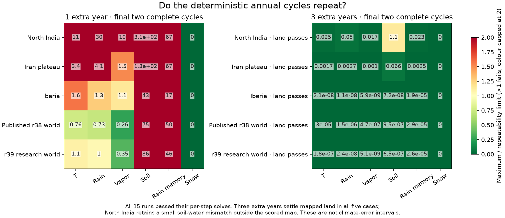
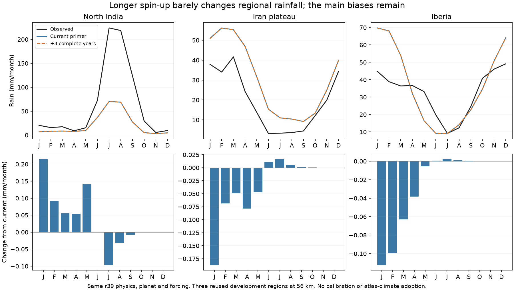

# Seasonal repeatability and initialization

The simulator can now check whether its deterministic annual climate repeats,
including water reservoirs, rather than relying solely on converged solves
within each seasonal step. The existing defaults and published climate data
remain unchanged. The normal Earth atlas links this check from **Fit checks**.

`seasonal_spinup_years` adds complete years before recording the final year;
zero preserves the historical roughly four-month primer.
`seasonal_require_convergence` can require repeatability before returning a
result. Temperature, rain, column vapor, soil water, recycled-rain memory and
snow are compared at matching seasonal steps in consecutive full years.
Fixed numerical limits are recorded with every check. These are not fitted
climate targets or estimates of real interannual variability. The calendar
also now wraps safely for legacy warm-ups longer than two years.

## Controlled pilot

The plan was frozen before new integrations. North India, Iran plateau and
Iberia use r39 physics at 56 km. Two fantasy cases use the published r38 Earth
atlas and the previously rejected r39 research world, each at ds16/layout 1.
Only the number of additional complete years changes: 0, 1 or 3. Three extra
years are the designated equilibrium comparison, not whichever setting has
the best error score. No parameter search or planet change is involved.

All five default controls reproduce their archived fields exactly: Earth
monthly temperature/rain/observations at stored precision, and all seven
world climate arrays. All 15 runs pass per-step numerical checks. After three
extra years all five cases meet repeatability limits on mapped land; four
meet them over the full domain interior. North India's padding region still
has a maximum soil-water mismatch of 0.1126 mm against a 0.1 mm limit.
On its mapped land that mismatch is just 0.000114 mm. The stricter domain
failure remains recorded; no thresholds or run budget were changed.

## Climate changes are small

These are absolute monthly differences between the default and three-extra-year
cases over their mapped model-grid land cells. They measure initialization
sensitivity, not error against observations.

| Case | Mean rain difference (mm/month) | Largest rain difference (mm/month) | Largest temperature difference (°C) |
|---|---:|---:|---:|
| North India | 0.07295 | 2.91792 | 0.15828 |
| Iran plateau | 0.03942 | 0.61316 | 0.03515 |
| Iberia | 0.02823 | 0.31331 | 0.05932 |
| Published r38 world | 0.000454 | 0.03884 | 0.00820 |
| r39 research world | 0.000563 | 0.04276 | 0.00599 |

North India's rainfall loss worsens by about 0.04%; Iran and Iberia improve
slightly. This does not explain or solve the missing Himalayan monsoon rainfall.
The fixed default/profile is retained; the pilot does not adopt new physics,
longer production spin-up, or a new world fit.

The atlas's new initialization note is deliberately scoped to its verified
screening-grid layout 1. Its main maps remain the native-resolution average
over layouts 1–3. The note links the annual-cycle chart; it does not add another
map button. The climate, farming, population and trade data remain unchanged.

## Reproduction and controls

Run `scripts/check_seasonal_cycle.py --out output/new_cycle_check` in the
configured environment, choosing a new directory after source changes. Source,
raw-input, cached-evidence and package hashes are frozen in
`output/seasonal_cycle_20261026_verified/protocol.json`. Every member has a
numerical certificate and checkpoint identity. Unchanged failed cases cannot
be silently rerun or relabelled. `scripts/plot_seasonal_cycle.py` makes the
figures; `scripts/add_initialization_check.py atlases/earth_fit` attaches only
the exact matching physical/geographic case to the normal atlas.

The completed pilot used the runner at commit `0a0c8d9`, whose exact bytes are
identified in its protocol. Subsequent runner hardening adds explicit world
raster hashes and rechecks actual derived Earth case identities before cache
reuse; it does not rewrite the completed experiment. The atlas exporter also
verifies the raster identities saved with the historical world checkpoint.

An initial preflight stopped before longer runs because its case identity
recorded integer `56` instead of the historical float `56.0`. Using the same
spacing type exactly restores all three Earth case hashes; no array input
changed. That stopped attempt, original runner bytes and records remain under
`output/seasonal_cycle_20261026/`. Recovery uses a separate frozen directory.

Sixty-five core/seasonal tests pass, including legacy calendar compatibility,
multi-year phase ordering, reservoir drift, required checking and existing
temperature/moisture/ensemble behavior. The required check accepts periodic
cycles and rejects drifting cycles despite successful individual solves.
Ten additional atlas checks cover physical
and geographic matching and complete diagnostic assets. Future rainfall work
can focus on moisture delivery and monsoon structure, with seasonal settling
now measured explicitly instead of assumed.
