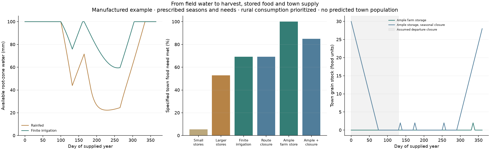

# Continuous field water, seasonal food and town provisioning

Three isolated components now connect a supplied upland crop sequence to food
storage and directed provisioning. They are numerical/scenario prototypes,
not a validated world population forecast. The normal production atlases keep
their existing yield and population layers.

## Published relationships and explicit adaptations

The soil-water component implements the fixed-root-zone balance, stress
coefficient and single crop coefficient from
[FAO56 chapter8, equations81–88](https://www.fao.org/4/x0490e/x0490e0e.htm).
It reproduces the published Example37 depletion table within0.05mm rounding.
Each day accounts for rain, supplied runoff, net irrigation, capillary input,
evapotranspiration, drainage and remaining water. Changing crop coefficients
never refills the soil. A minimum repeating state replaces arbitrary inherited
water in a repeating-year scenario.

Net irrigation cannot exceed its explicit field supply. This is not a routed
river-withdrawal model. Fixed root depth, off-season coefficient and available
water remain supplied assumptions. Snow/frozen soil, dynamic roots, dual-layer
evaporation, ponded rice and groundwater routing are not represented.

The upland harvest adapter applies the supplied seasonal yield-response factor
described in [FAO56 chapter8's FAO33 discussion](https://www.fao.org/4/x0490e/x0490e0e.htm).
It uses each crop's realized ET budget without a half-weight second crop or a
second seed deduction. A declared ET-ratio guard refuses simple-yield inference
under stronger deficits; this is an analysis-domain choice, not a universal
biological threshold. Growth-stage effects still need a better crop model.
Physiologically feasible crop windows must be supplied; the demonstrated
windows are prescribed, not validated predictions of the new cereal clock.

The provisioning solver uses a time-expanded directed flow formulation, building
on [Ford and Fulkerson1958](https://doi.org/10.1287/opre.6.3.419).
Explicit storage, losses, periodicity and consumption priorities extend that
foundation. It maximizes food consumption by priority group, then minimizes
freight and holding cost. Prioritizing aggregate rural needs before urban needs
is a scenario policy, not an inferred historical institution or fairness rule.
Costs and physical food losses remain separate. No route may exceed its
departing capacity, and food only arrives after its declared transit delay.
Both stocks and in-transit food repeat over the supplied year; initial stocks
cannot create food against a persistent production deficit.

## Integrated manufactured example

One supplied accounting hectare grows wheat and millet in prescribed seasons.
Potential net edible energies are inherited from the existing low-input crop
assumptions. One food unit is10,000kcal. Farm consumption is365 units/year;
the town requests146. Granary capacities, route capacity/delay/closure,
rainfall, evaporation and field irrigation are **illustrative inputs**.
They are not estimated ancient capacities, observed crop calendars or town sizes.

Small stores cause overflow at harvest and later unmet consumption. With larger
stores, the rainfed case meets more town demand. Finite irrigation increases
food but can still leave a storage bottleneck. A seasonal closure has little
additional effect while that bottleneck already restricts supply. Two paired
ample-farm-storage cases then isolate the effect of the route closure.

Every scenario closes its water and food ledgers. No scenario estimates famine
frequency, mortality, actual urban population, technological progress or state
power. The five-day food accounting is a scenario discretization; crop water
remains daily. Source parameters and every scenario's food/water totals are
downloadable in the browser lab.

## Connection to the existing atlas network

The current trade graph has directed seasonal costs grounded partly in
historical freight relationships. Its costs are **road-km equivalents**, not
travel days, cargo capacities or tonnes; gravity weights are not grain. A
correct world connector needs cost and travel time for the same chosen route,
explicit seasonal cargo capacities, farm surplus after rural consumption and
specified town-demand scenarios. It must preserve sea/river/road direction and
auxiliary-node identity. No cost-to-travel-time conversion or manufactured city
population is silently inserted by this prototype.

The current flow solver is ready for those inputs; the example uses explicitly
supplied routes. Full river-water allocation and historical granary/labour
evidence are additional requirements before adopting world food-security maps.

Components: `harvest/soil_water.py`, `harvest/upland_food.py`,
`polity/food_transport.py`. Reproduce with
`scripts/demo_seasonal_food_system.py`. Tests cover the published water example,
sequence continuity, finite irrigation, water/food conservation, direction,
transit delay, bottlenecks, losses and the no-production/no-food condition.
