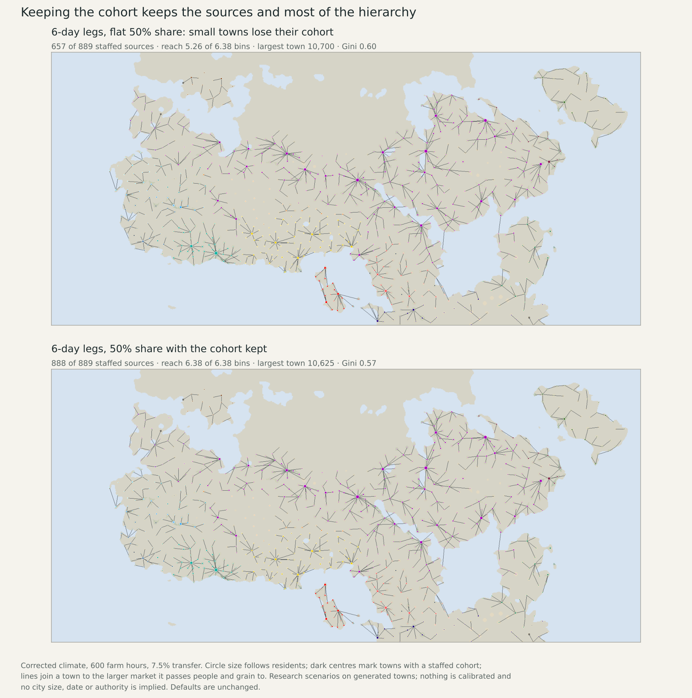
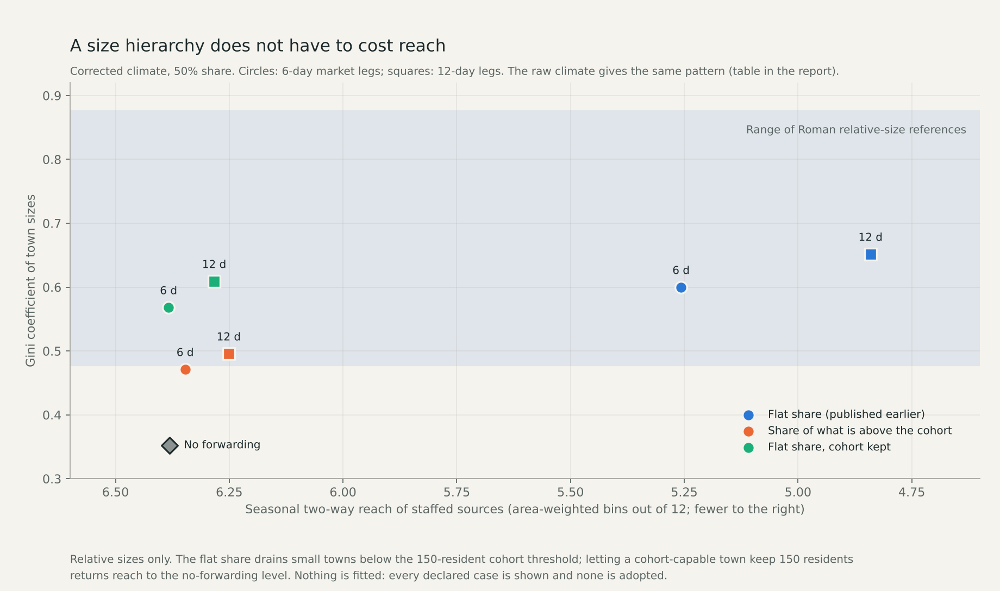

# Cohort-protected forwarding: does a size hierarchy have to cost reach?

No. When a town that can hold a cohort keeps its 150 residents and forwards
from the rest, staffed sources and reach return to the no-forwarding level
while most of the size hierarchy remains. This was the owner's chosen next test
after the market-hierarchy maps. Nothing is fitted or adopted; all defaults are
unchanged, and the eight new cases are selectable beside the earlier twelve.

## Why the test is a retention floor

The question started as "should larger centres carry larger cohorts?". In this
model a staffed town either is a source of reach or is not, and project rules
forbid turning staff numbers into a travel-strength multiplier, so a bigger
cohort living at a centre changes no reach. Larger institutions at centres
matter for reach only if their people are posted at the smaller towns. Posting
a cohort and its grain at a tributary town gives the same final distribution as
that town not sending those people and that grain up, and avoids losing grain
twice on the leg. The declared test (8e798f32) is therefore a floor: the
existing 100-person cohort plus the existing 50-person civilian minimum.

Two passing rules were declared for towns that can hold a cohort (affiliated,
civilian request of at least 50):

- **Share of what is above the cohort:** pass 50% of what the town holds above
  150 residents.
- **Flat share, cohort kept:** pass the flat 50%, reduced only as far as needed
  to stay at 150. A town holding less than 150 has no cohort to protect and
  passes the flat share as before.

Links, the 6- and 12-day ranges, grain loss of 5% per travel day, the solver,
the feasibility test and the ledgers are unchanged. People and grain leave each
town in the same proportion. The catchment draws are identical to the published
flat-share cases, and a zero floor reproduces those cases exactly; both are
hard gates in the code.

## Results

|Climate|Range (days)|Passing rule|Largest town|Gini|Checks inside band|Staffed sources|Reach (bins)|People passed up|Towns held at 150|
|---|---:|---|---:|---:|---:|---:|---:|---:|---:|
|raw|–|no forwarding|3,066|0.36|0 of 6|861|6.15|0|–|
|raw|6|flat share (published earlier)|11,532|0.60|6 of 6|639|5.09|194,048|–|
|raw|6|share of what is above the cohort|9,977|0.48|5 of 6|856|6.11|119,542|0|
|raw|6|flat share, cohort kept|11,525|0.57|6 of 6|865|6.17|181,104|240|
|raw|12|flat share (published earlier)|19,475|0.66|6 of 6|550|4.47|196,152|–|
|raw|12|share of what is above the cohort|15,762|0.50|5 of 6|830|5.98|118,683|0|
|raw|12|flat share, cohort kept|19,341|0.61|6 of 6|833|6.01|180,781|285|
|corrected|–|no forwarding|2,789|0.35|0 of 6|889|6.38|0|–|
|corrected|6|flat share (published earlier)|10,700|0.60|6 of 6|657|5.26|202,508|–|
|corrected|6|share of what is above the cohort|9,162|0.47|4 of 6|884|6.35|123,132|0|
|corrected|6|flat share, cohort kept|10,625|0.57|6 of 6|888|6.38|188,781|239|
|corrected|12|flat share (published earlier)|16,910|0.65|6 of 6|597|4.84|199,201|–|
|corrected|12|share of what is above the cohort|13,546|0.50|5 of 6|863|6.25|120,533|0|
|corrected|12|flat share, cohort kept|16,672|0.61|5 of 6|867|6.28|184,425|273|

- **Keeping the cohort keeps the sources.** With 6-day legs and the flat share
  capped at the floor, 888 of 889 corrected-climate sources stay staffed
  (657 under the plain flat share) and reach is 6.38 bins against 6.38 with
  no forwarding. In the raw climate 865 sources are staffed against 861 with no
  forwarding, because a few receiving towns rise above the threshold.
- **Most of the hierarchy survives.** The largest town is 10,625 residents
  (10,700 under the plain flat share), the Gini is 0.57 (0.60), and all six
  declared checks stay inside the reference range in both climates at 6 days.
  The reason is that most forwarded people come from towns well above the
  floor: 188,781 people are passed up against 202,508, and 239 towns are
  held exactly at 150.
- **Passing only the excess is weaker.** It keeps 884 sources but the Gini falls
  to 0.47 and only 4 of 6 checks stay inside the range.
- **Twelve-day legs still lose some sources.** 867 of 889 stay staffed
  (597 under the plain flat share). The remaining loss is not the passing
  rule: longer legs lose more grain, the solver draws fewer people from some
  catchments, and those towns never reach 150.
- **Small unstaffed places still shrink under the capped rule.** Communities
  meeting the 50-civilian minimum fall from 1,024 to 975 (corrected, 6 days),
  because towns below the floor pass the flat share. The excess rule keeps 1,021.





## What this does and does not show

As fixed in advance: the cost in reach seen in the flat-share scenarios was a
consequence of the passing rule, not of hierarchy itself, within this ledger.
It does not show that either rule is how markets or institutions worked, and
neither is selected as calibrated.

- The floor, the 50% share, the ranges and same-actor links are scenarios.
- The cases use the original coupled parents. Staff collection hours, the
  continuous destination inventories and the worker calendars developed on the
  other line do not yet constrain forwarded grain.
- The cohort is still one fixed group of 100 per town. Whether large centres
  should hold additional institutions is not tested; under the binary source
  rule it would not change reach.
- Relative sizes only; the Roman references are conditional, area-based and
  from one exposed catalogue. Cereal only.

## Review

The independent reviewer recomputes what every town holds and passes by
recursion from the roots, with its own implementation of both rules, then
redistributes grain, recomputes pooled food with a separate monthly recurrence
and checks that the floor is honoured, that draws equal the published
flat-share cases, population and grain closure, the cohort rule, work-limited
production, the rural source gate and all metrics for all eight cases. Reach
masks for all twenty hierarchy cases are rebuilt by a second, dense
implementation. Fresh runs reproduce all 16 result and field files byte for
byte. Seventeen unit tests cover the passing rules.

In the atlas the market-hierarchy family now holds ten cases per climate (40
map options over Settlements and Supply-supported reach); all load with exact
audit downloads, other families still load, the default is unchanged, and
754 existing atlas data files are verified unchanged.

## Whole-plan review and next work

Release 2 now has a forwarding rule that reaches the reference shape without
losing sources, still as an uncalibrated scenario. The remaining step on this
line is to re-run forwarding on the other line's dispatch-limited parents, so
that collection work, destination inventories and worker calendars constrain
forwarded grain; that needs its own declaration and should follow the other
line's continuous collection calendar. Absolute sizes, urban share, dated
occupancy, the failed geographic transfer, complete diets and work, and S5
remain open on the [live queue](SETTLEMENT_CONTROL_ROADMAP_20261110.md).

Reproduce:

```sh
.venv/bin/python -I scripts/build_settlement_cohort_forwarding.py --mode corrected --days 6 --rule capped
.venv/bin/python -I scripts/review_settlement_cohort_forwarding.py
.venv/bin/python -I scripts/replay_settlement_cohort_forwarding.py
.venv/bin/python -I scripts/build_hierarchy_reach.py --mode corrected
.venv/bin/python -I scripts/review_hierarchy_reach.py
.venv/bin/python -I scripts/publish_settlement_market.py
.venv/bin/python -I scripts/publish_settlement_cohort_evidence.py
```
