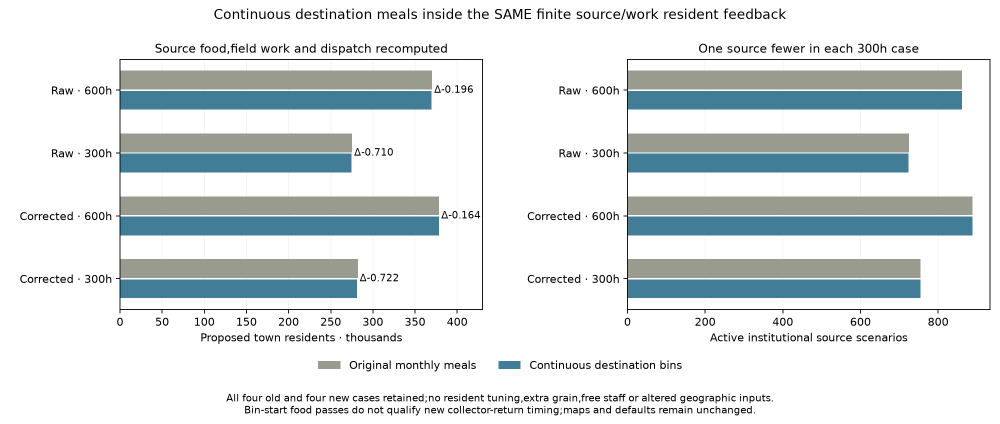
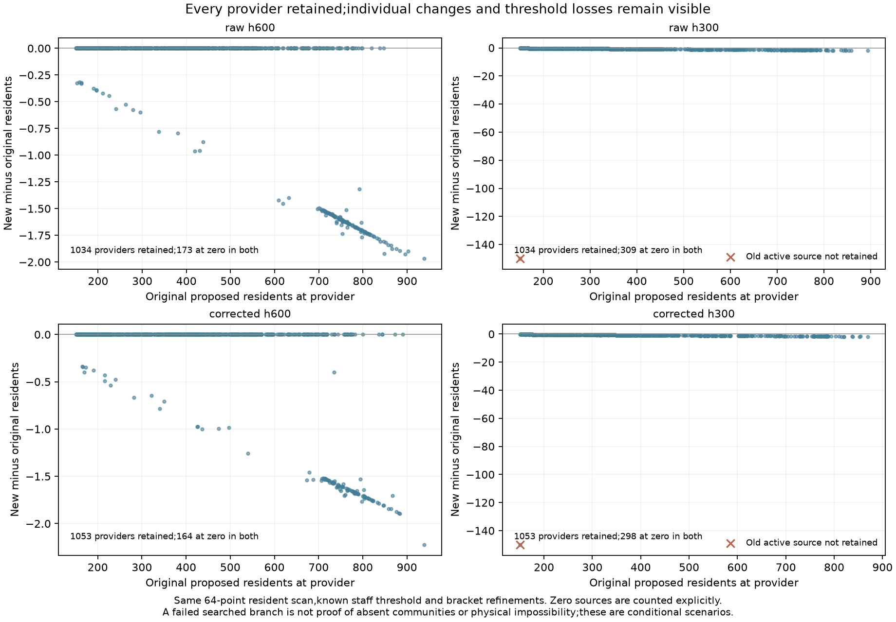

# Continuous destination food inside finite resident feedback

Declaration `aacf2ddb` preceded resident outputs. All four parent cases behind
the eight coherent-year point maps are retained:raw/corrected climate,600/300
annual farm hours,120000 kcal trips and all bins open. Four old and four new
rows are published. This is exposed model development,not an empirical census,
a blind transfer test or calibrated adoption.

## What changed inside the shared ledger

The original model eats all destination-bin meals immediately after supply,
clips capacity afterwards and then applies stored-food loss. The new version
pulses supply at the same arrival-bin start,clips immediately to capacity and
integrates continuous meals and exponential stored loss until the next bin.
It finds the minimum repeating stock;periodicity does not establish sufficiency.

At EVERY resident trial,the same finite ledger recomputes civilian/rural meals,
field workers,crop production,source surplus/export inventories,dispatch scales,
institutional residents and integer collector trips/monthly hours. The original
geographic cells,owners,nodes,directed paths,minimum communities,source monthly
food assumptions,one-bin shipment lag and0.95 retention stay fixed. No grain,
people or free staff are added. Staff meals occur once inside total meals.
Destination physical storage is90 days of the CURRENT trial total resident
meals;unlike the headroom diagnostic,it is not frozen at the original population.

The declared64-point resident scan,known150-person staff threshold,24 resident
bracket refinements and40 work/food dispatch refinements stay fixed. Displayed
food ceilings use the new continuous convention and the parent's normalized
42-step search/downward margin. A versioned class and scoped writer factory
preserve every original model/writer byte. A failure control checks restoration.

## All old/new outcomes

|Climate|Farm h|Inventory|Town residents|Civilian residents|Institutional residents|Active sources|Unmet kcal|Collection hours|
|---|---|---|---|---|---|---|---|---|
|Raw|600|parent|369,863.947|283,763.947|86,100|861|23.756|21,855,620.2|
|Raw|600|continuous|369,668.076|283,568.076|86,100|861|33.474|21,889,623.3|
|Raw|300|parent|275,447.276|202,947.276|72,500|725|17.732|16,486,905.9|
|Raw|300|continuous|274,737.734|202,337.734|72,400|724|24.907|16,479,083.7|
|Corrected|600|parent|378,280.833|289,380.833|88,900|889|24.313|22,172,129.6|
|Corrected|600|continuous|378,116.797|289,216.797|88,900|889|34.233|22,208,297.8|
|Corrected|300|parent|282,044.847|206,544.847|75,500|755|17.791|16,742,671.5|
|Corrected|300|continuous|281,323.342|205,923.342|75,400|754|25.504|16,735,992.5|

Proposed town residents fall164.036–721.505 per case. The two600-hour cases
retain their active source counts;each300-hour case has one fewer active source
under the unchanged searched family. Individual reductions are retained even
when a site crosses the staff threshold. This is not proof of absent communities,
an unavoidable physical loss or globally optimal resident/logistics planning.
All positive new allocations pass their source food,continuous destination food
and monthly integer collection-hour checks within the declared numeric tolerance.
Outside rural people and their existing deficits remain in the same ledger.

## Complete cohorts,review and replay

All144 actor summaries and8348 provider/accounting records are exported,including
providers at zero in both versions. Full original and new field packets retain
origin food/work,people,shipments,integer trips and monthly work. Old fields that
were never recorded (peak stock,shortfall duration,periodic residual) remain null
in the comparison CSV;they are not fabricated from the new convention.

Independent physical review imports no resident solver or new inventory primitive.
It rebuilds rural allocations,field production,rural/export inventories,origin
dispatch,cargo retention/lag,integer trip work and shared secondary-duty hours.
Destination stocks and the explicit staff-threshold trial use separate scalar
continuous integration and bracketed periodic stocks. Displayed food ceilings,
source/people/grain conservation and every actor/provider export are checked.
Eleven fresh model result/field/summary/comparison/CSV files are byte exact.
Twelve new primitive/factory controls pass,including independent scalar parity,
zero-loss/mixed-loss cases,capacity/meal order,interior periodic reserve,variable
rates/durations,finite population/work and factory restoration on writer failure.

## Publication limits and next dependency

All earlier Earth atlas files,point maps and defaults stay byte unchanged.
These are bin-start destination food results,NOT collector-return food or new
point-map qualifications. The new actual shipments and workers must be packed
into new calendars and their return times checked before new map publication.
The earlier collector/visit schedules cannot be reused against changed cargo.
Any source/return-time failure stays explicit;it cannot be repaired by combining
successes from incompatible calendars or inventing imports.

Source food remains monthly. Crew-carried rations,food location,complete diets,
household/draft work and actual provider functions remain unresolved. The whole
release1–4/S1–S5 programme also retains dated occupation/compatible size evidence,
prospective transfer and mobile/nonstate/unaffiliated resources. None is replaced
by a cereal feasibility result. Normal research publishes all rows,figures and
downloads. The historical full publisher still lacks the private Vidarbha cache;
this direct publication preserves earlier panels and does not claim a full rebuild.
