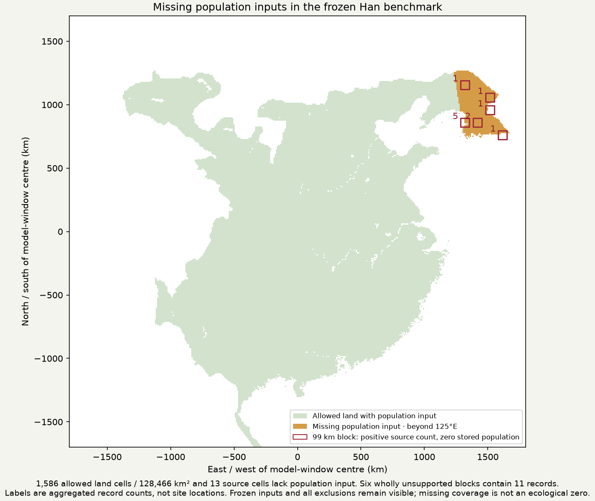
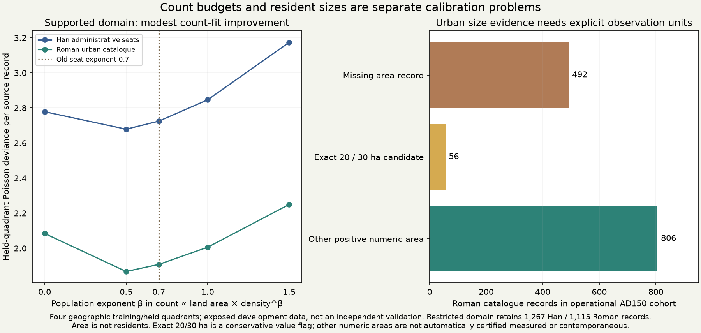

# Settlement counts, resident-size evidence and population-input coverage

The next settlement-map release needs a count budget as well as better point
placement. This development round found a concrete benchmark-input bug: part of
the saved Han window lies beyond the population raster's eastern edge. Missing
coverage was returned as zero density and ignored by the old preparation. The
full-region count fit is therefore **unqualified**, not evidence that those
districts could support no people.

## Coverage failure and supported sensitivity

The global population raster stops at 125°E. In the frozen Han allowed-land mask,
1,586 of 50,349 cells lack input: 128,466 km² at 9 km resolution. Thirteen distinct
source cells / thirteen records lie outside coverage. Six 99 km blocks contain
eleven records and zero stored population; every one of those blocks is entirely
outside population coverage. Roman allowed land is fully covered.

The original inputs, scores and failures remain unchanged. A separately declared
**covered-only sensitivity** uses the exact source raster support, never a score
threshold. Partial blocks retain their actual covered land, population and source
records; unsupported area and thirteen records remain explicitly unresolved.
The full-region fit is not replaced by the restricted fit. The new coverage
primitive raises when required input is missing; unknown must not silently become
a population zero in future builders.

## Count fits

The two response units remain distinct: Han administrative-seat records versus
Roman urban-catalogue records. Neither is a census of all villages. The old saved
`real` arrays were already deduplicated; their first reuse as record counts was an
implementation error, preserved as an invalid attempt. The correction was committed
before reconstructing multiplicity from the same source records and exact legacy
matching. Unique recovered cells equal the saved arrays exactly. Primary allowed
record counts are 1,280 Han / 1,115 Roman; distinct cells are 1,264 / 1,085. Within
population coverage, primary records are 1,267 / 1,115.

The count mean is μ = k A (P/A)^β, with actual land exposure A and unchanged model
population P. We test β in {0, 0.5, 0.7, 1, 1.5}. Scales k train on three geographic
quadrants and predict the fourth, separately by response unit; a shared-scale
control remains in the complete results. Blocks are actually 99 km and 297 km,
including partial edges. Zeros, all folds, record and distinct-cell targets remain.
No population multiplier, observed placement count or new site anchor is supplied.

These are source-record intensities. In particular, archaeological discovery and
catalogue inclusion can vary geographically; we have not fitted an observation
process that makes the Roman list a complete census of every urban settlement.
Good catalogue-count prediction alone would not establish true urban abundance.

| Supported-domain primary count diagnostic | β = 0.7 | β = 0.5 |
|---|---:|---:|
| Han held-quadrant deviance / record | 2.7247 | 2.6789 |
| Roman held-quadrant deviance / record | 1.9079 | 1.8676 |
| Equal-pool mean | 2.3163 | 2.2732 |

The 1.86% improvement is modest. At β = 0.5, normalized count mass to relocate is
still about 63.6% for Han and 50.9% for Rome. Total count errors of about 1.6% and
2.3% therefore hide large geographic errors. Some shared-scale controls improve
the deviance more than separate scales, showing that separate fitting alone is
not a solution; both source units and regional estimation variance matter. These
are exposed-development comparisons, not independent qualification or proof of
one universal exponent. The declared ranking selects among role-specific betas;
it does not retroactively select the shared control as a new validated winner.

Full-domain positive-population-power models retain infinite losses where source
counts meet stored zero population. No loss floor, deletion of difficult blocks
or area-only default adoption masks that input failure. Actual archived production
point counts are a descriptive reference, not a Poisson expected-rate estimator;
their zero-count deviance must not be used to claim a fair rate-model victory.

## What the size sources actually observe

Hanson's workbook contains 1,388 cities and 885 area records. The operational AD150
cohort has 1,354 cities: 862 positive numeric area records and 492 without an area
record. Of the supplied positive areas, 56 equal 20 or 30 ha; these are conservative
default-value candidates, not a claim they are all fictitious. There are 806 other
positive values, which are not automatically certified measured, inhabited or
contemporaneous. The exact `Estimate Basis` categories remain in the download,
including walls, urban grids, inhabited area, ranges and unspecified evidence.
The old reader fills missing areas by rank medians; this audit performs no fill.
Also, 1,338 selected city records have missing end dates, so the old operational
AD150 filter is not direct evidence of continuous occupation in that year.

The Han source includes 1,294 AD2 seat records, all with positive `CountyPOP` values.
That field is district population. It is **not** the number of residents in its
seat. Prefecture/county type, adjustment and directly-recorded flags remain visible
for all source years; no administrative population becomes an urban-size label.

Hanson & Ortman (2017),
[*A systematic method for estimating the populations of Greek and Roman settlements*](https://doi.org/10.1017/S1047759400074134),
proposes settlement population estimates grounded in inhabited area and housing
evidence. That is an appropriate next size-reference route. An estimated footprint
or a fantasy icon is not by itself a measured resident population. The earlier
project's near-zero/negative market-access size relationships also remain reported
in [POLITY_V3_20261025.md](POLITY_V3_20261025.md), rather than being forgotten.

## Review and next work

The count protocol preceded fitting; committed multiplicity and coverage corrections
state exactly which preliminary outcomes were known. An independent review reads
the workbook/shapefile, reconstructs legacy matching, obtains coverage from the
frozen sampler, directly rebuilds 2,780 blocks and verifies 704 held-fold cases /
9,680 scalar metrics. A fresh replay checks outputs. Raw third-party records and
coordinates remain private; public block counts are aggregates.

No fantasy population, food, settlement positions, roads, institutional staff,
control or r44 physics changes. The next blocker to full-region count qualification
is proper ecological input coverage, using the same crop, pastoral, foraging,
arability, irrigation and occupation assumptions. The supported-domain count work
can guide development while that extension is prepared. Resident allocation still
needs its own evidence and must consume the same finite population/food ledger for
all actors, mobile groups and unaffiliated communities. First-map milestones 2–4
and the complete later institution/control roadmap remain open.
