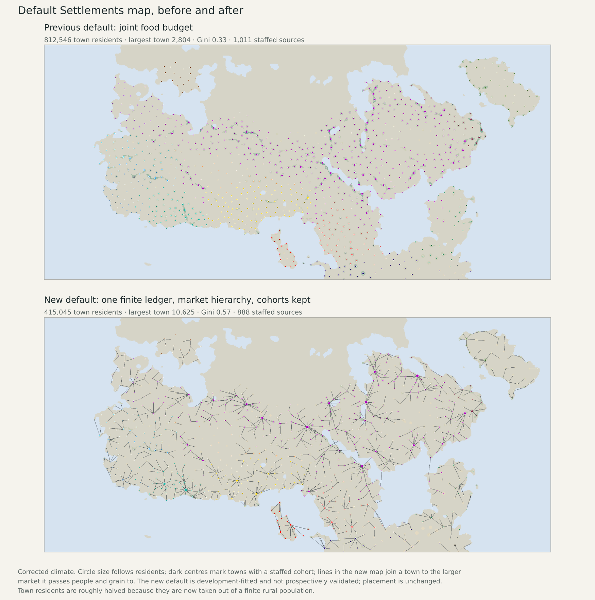

# New default Settlements map

On 12 November 2026 the owner asked for a better default map now, with further
development later, after being told that a calibrated default is blocked on
evidence. The Settlements layer of the Earth atlas now opens on the
cohort-kept market-hierarchy scenario. It is labelled a scenario:
development-fitted, not prospectively validated. The
[decision record](../calibration/settlement_default_adoption_20261112/decision.json)
was committed before anything changed.

## What changed

- **Settlements** opens on "market hierarchy with cohorts kept (6-day legs,
  50%)" in both climates. The previous default, the joint food budget, stays in
  the normal view as "previous default".
- **Supply-supported reach is unchanged.** It keeps control v2.1, the map that
  passed a blind Earth test; the new scenario has no comparable test.
- No data file was modified. The default is a selection among published
  options, and if the optional market packet is missing the atlas falls back to
  the previous default.

## Before and after

|Climate|Map|Town residents|Largest town|Gini|Largest / median|Staffed sources|Communities meeting the minimum|
|---|---|---:|---:|---:|---:|---:|---:|
|raw|previous default|807,770|2,918|0.34|4.3|987|1,030|
|raw|new default|411,514|11,525|0.57|57.6|865|949|
|corrected|previous default|812,546|2,804|0.33|4.2|1,011|1,049|
|corrected|new default|415,045|10,625|0.57|53.8|888|975|

- Town sizes now form a hierarchy: the largest town is 10,625 residents
  against 2,804, and all six declared relative-size checks against the Roman
  references pass in both climates.
- Town residents are roughly halved (812,546 to 415,045, corrected).
  The previous default added town residents on top of the rural population; the
  new one takes them out of a finite population and recomputes farm work and
  rural meals.
- Staffed sources fall from 1,011 to 888 (corrected) and from 987 to 865
  (raw), for the same reason: fewer towns reach the 150-resident threshold once
  people are counted once. This is a real difference from the previous default,
  not a rounding effect.

## What "development-fitted" means here

The forwarding share (50%), market range (6 days) and cohort floor (150) are
declared values. They were not fitted, and the comparison with Roman relative
sizes used data the project had already developed against. Placement is the
earlier placement, whose one prospective transfer test failed. The scenario is
built on the original coupled inputs, so staff collection hours, continuous
destination inventories and worker calendars do not yet constrain it. Absolute
city sizes, dates, complete diets and mobile or nonstate communities are not
modelled.

This overrides, for this one layer and by explicit owner decision, the rule
that defaults change only on qualified evidence. The rule stands for later
changes.

## Checks

The atlas opens Settlements on the new default in both climates with its
evidence text and without the experimental label; the previous default is one
selection away; reach opens on control v2.1; all 40 market-hierarchy options
and the other optional families still load; a missing market packet falls back
to the previous default. Six older browser-check scripts that assumed the old
default now request it explicitly in the URL; they were edited but could not be
run in this container.

## Revisit

Replace or re-run this default when forwarding has been run on the
dispatch-limited inputs, or when qualified size or transfer evidence exists.
