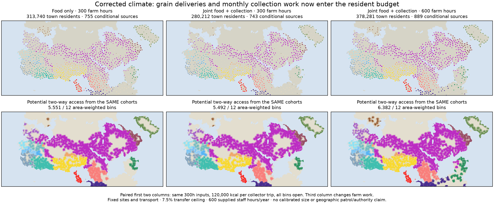
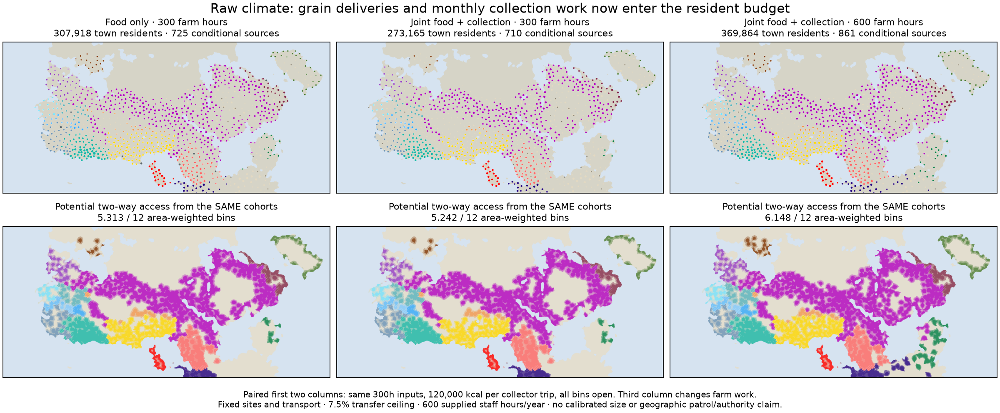
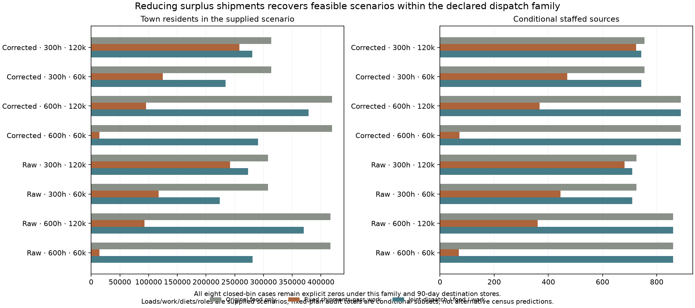

# Dispatch volumes and monthly collection work enter the resident/food loop

The new experimental maps accept residents only after their remaining rural
workers, source meals, grain shipments, destination stores and monthly collector
hours fit together. The corrected 600-hour / 120,000-kcal-load case supports
378,281 modeled town residents and 889 conditional staffed sources. The preceding
fixed-shipment work audit qualified 95,359 residents at 368 sources. Reducing
surplus shipments avoids many of those fixed-plan refusals; it does not establish
historical city sizes or authority.

The [declaration](../calibration/settlement_dispatch_20261112/plan.json) was
committed and pushed in `de42d1c3` before new results. All sixteen combinations
are retained: raw/corrected climate, 600/300 annual farm-worker hours, 60,000 /
120,000 kcal per collector trip, and all-open / three-closed-bin availability.
There are no new Earth observations, sites, tracks or climate solves. Original
production packets, eight previous feedback maps and earlier audits remain intact.

## What is solved

Every resident trial moves people from the same finite origin allowances,
recomputes remaining rural work and net cereal production, protects rural meals,
then rebuilds seasonal export availability. It keeps the existing 10% collection
share, freight upper bounds, rural/export year stores, 90-day destination stores,
5% annual stored loss, 95% delivery retention and one-bin delay.

Within each catchment, one scalar scales the original feasible origin/month
departures after closed bins are zeroed. Forty work refinements find a certified
maximum scalar fitting every month's staff hours. Integer collector trips,
both directed walking legs and handling all count; fractional loads cannot make
free trips. The same staff receive 600 supplied annual hours split into twelve
bins. No hours move between sites or months, and no rural/civilian collector
population is invented.

This is a conservative proportional dispatch family. It does not optimize
which origin to collect first, separate monthly scalars, mixed transport modes
or alternative labour sources. A refusal cannot establish that every other
schedule is impossible. The resident search retains the original 33 sampled
fractions and 24 bracket refinements, with its nonmonotone-branch limitations.
It certifies examined allocations, not a global optimum.

Once residents are selected, forty food refinements reduce dispatch while
preserving food support within the same work bound. Actual export and town
inventories, spoilage, unused grain and trip counts are recomputed. A stricter
`1e-10 × max(1, annual need)` destination feasibility predicate is used during
this new search; the prior source-food gate is preserved. The SAME SettlementPlan
feeds the existing shared monthly collection/patrol/service consumer. All three
secondary duties share the remainder after collection is reserved once.

## Results and maps

The table shows all eight open-bin cases. All eight closed-bin cases retain
zero positive allocations. Three missing delivery bins require 91.25 days of
meals, exceeding the supplied 90-day destination capacity even before decay.
This does not imply real abandonment, no institutions or an empty landscape.

|Climate|Farm hours|kcal/trip|Town residents|Conditional sources|Potential access bins|
|---|---:|---:|---:|---:|---:|
|Raw|600|60,000|280,876|861|6.148082|
|Raw|600|120,000|369,864|861|6.148082|
|Raw|300|60,000|223,822|710|5.241682|
|Raw|300|120,000|273,165|710|5.241682|
|Corrected|600|60,000|290,503|889|6.381614|
|Corrected|600|120,000|378,281|889|6.381614|
|Corrected|300|60,000|234,202|743|5.491839|
|Corrected|300|120,000|280,212|743|5.491839|

On corrected 600-hour / 120,000-load inputs, the original food-only plan has
419,264 town residents at 889 staffed sources. Re-evaluating those exact totals
with work-bounded dispatch supports 302,029 residents at 779 positive sites.
The new resident search changes requests within the same population and food
ledger, yielding 378,281 residents across 889 staffed sources. It is not simply
a relabeling of the old fixed-plan subset.

Final departed grain is 363.57 billion kcal versus 957.42 billion kcal in the
unbounded reference departures at the SAME final rural/resident allocation.
Destination unused food is zero in this case. Collection uses 22.17 million
of 53.34 million supplied staff hours. Other stores, unused grain, losses and
unmet rural cereal needs remain explicit; these are still partial cereal diets.

For the paired corrected 300-hour comparison, town residents change from 313,740
to 280,212 and staffed sources from 755 to 743. Potential access changes from
5.551 to 5.492 bins. For 600 hours, the source set and its potential access are
unchanged; resident sizes and deliveries change. Never advertise unchanged
travel footprints as a new accuracy gain.







## Qualification and presentation

An independent reviewer reconstructs origin population transfers, field/reaping
work, direct monthly rural/export/destination inventory recurrences, original
export envelopes, integer trips, monthly staff budgets, secondary requests and
the old-resident dispatch controls. Original outside people and source identities
are checked. Every positive final allocation passes source food and collection
work; all sixteen fresh result/field pairs reproduce byte for byte.

The independent recurrence subtracts trillion-kcal terms. Producer/reviewer
residual agreement uses a bound derived from floating-point roundoff of those
actual terms; the separate original grain-balance acceptance rule is unchanged.
No field tolerance or fit score was loosened to pass that comparison.

New source masks are independently assembled from the previous checked source
footprints. The original all-source actor/cell/bin reference remains exact,
all eighteen actors remain represented, and no shortest-path fit is rerun.
These footprints are **potential two-way travel access**, not geographically
funded patrol schedules, measured sovereignty or institutional roles. Generic
patrol-hour requests do not establish which destinations were actually visited.

The normal atlas adds eight experimental cases per climate in its existing
Settlements and Supply-supported reach selectors. A separate optional packet
preserves all earlier map cases and defaults. Site readouts and CSVs expose
collection hours, available staff hours, unused hours and dispatch scalars;
full cell inventories remain downloadable. Failed optional packets must leave
the original cases usable.

All 32 new map options pass browser checks, including exact monthly work CSV
fields, cell downloads, switching among three packet families, share-link reload,
344/390-pixel light/dark layouts and three optional-packet failure cases. The
sixteen previous feedback options and their existing CSV/failure checks pass.
The evidence panel has nine byte-exact local links, sixteen rows and three figures;
general inventory filtering, pagination and failure UI pass. The staged Windows-
style checkout preserves 1,764 assets byte for byte and the standard launcher
verifies r44. All 793 active-hub local dependencies resolve. Fifty-six focused
model/evidence/launcher/package tests and JavaScript syntax checks pass; this is
not a full-repository test claim.

## Next work and whole-programme review

The [full roadmap](SETTLEMENT_CONTROL_ROADMAP_20261110.md) remains authoritative.
This advances release 3 and S4, not release 2's empirical size/occupation or
prospective transfer gates. Release 4 still has no new calibrated default.
S1–S5, all actors, unaffiliated communities and mobile/nonstate occupancy remain
in scope. Full diets, household/draft work and dated provider functions remain
open. The original private Earth preprocessing cache is still absent; no full
historical base republish or invented global replacement is claimed.

Next check the supplied dispatch family's restrictions and actual geographic
patrol/service destinations before making work-funded coverage claims. The map
milestone is a checkpoint; development continues after its push.

Reproduce with the committed inputs:

```sh
OPENBLAS_NUM_THREADS=1 .venv/bin/python -I scripts/build_settlement_dispatch.py --all --jobs 4
OPENBLAS_NUM_THREADS=1 .venv/bin/python -I scripts/review_settlement_dispatch.py
OPENBLAS_NUM_THREADS=1 .venv/bin/python -I scripts/build_settlement_dispatch.py --all --jobs 4 --out output/settlement_dispatch_20261112/fresh
# Compare each results.json/fields.npz pair before recording replay.json.
.venv/bin/python -I scripts/build_dispatch_reach.py
.venv/bin/python -I scripts/review_dispatch_reach.py
.venv/bin/python -I scripts/plot_settlement_dispatch.py
.venv/bin/python -I scripts/publish_settlement_dispatch.py
```
