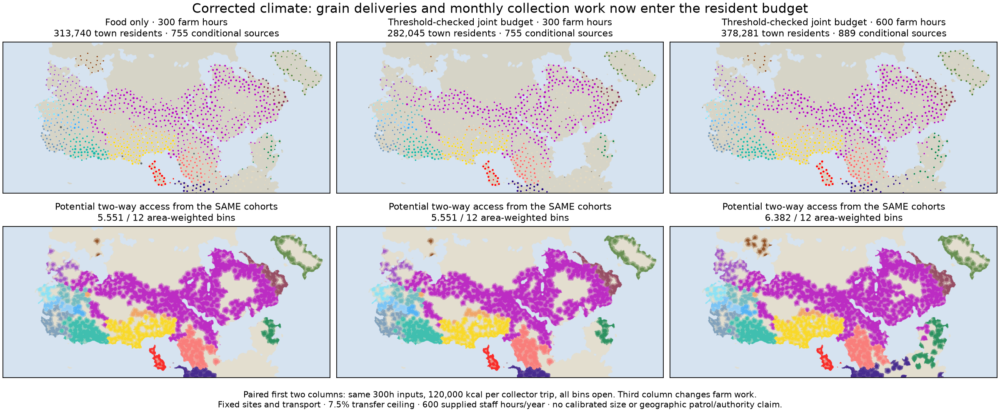
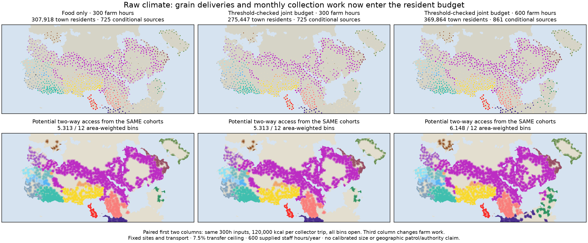
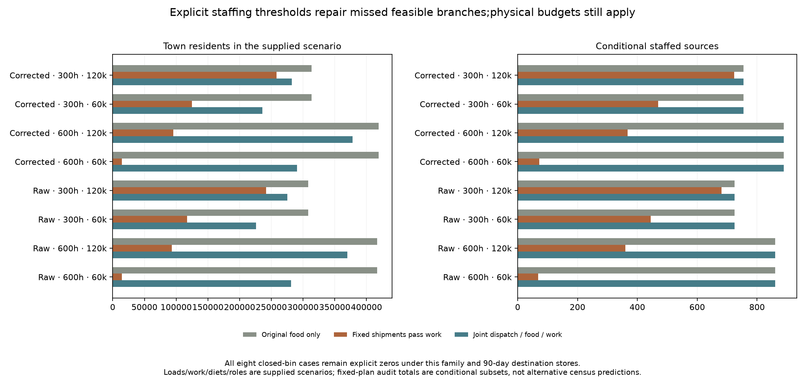

# Threshold-checked joint settlement and collection maps

The corrected map version explicitly checks the existing staff activation point,
so narrow feasible ranges no longer disappear between sampled resident requests.
In the open-bin scenarios it retains the original food-only source sets: 861 /
725 raw-climate sources at 600 / 300 farm hours and 889 / 755 corrected-climate
sources. Resident sizes and grain deliveries still change under collection work.
This is a numerical search repair, not new Earth accuracy or a calibrated default.

The [seeded declaration](../calibration/settlement_dispatch_seeded_20261112/plan.json)
was committed in `354f9a52` before seeded outputs. The preceding
[search audit](SETTLEMENT_DISPATCH_SEARCH_20261112.md) established that the
32-interval joint maps had missed staffed branches, and that 64 intervals alone
still missed five raw / two corrected 300-hour cases. Both original map versions
and all original source/result/field files remain preserved.

## Search correction with the same physical constraints

The new subclass first runs the existing work-capped dispatch equations at 64
resident intervals. It additionally probes the known 100-staff plus 50-civilian
boundary at every eligible site. If that candidate exceeds the selected total,
it refines 24 times toward the next grid point above the boundary. A merged
destination-independent request vector is re-evaluated, dispatch is reduced by
the same 40 food refinements, and all source, destination and monthly work gates
must pass again. No threshold, work rate, load, input or case is fitted to obtain
the recovered source count.

The old DispatchFeedback and field writer remain byte unchanged. A versioned
adapter scopes the effective subclass to one worker call, restores the original
factory even on failure, and records both the unchanged writer and the actual
new class/declaration hashes. Old certificates are preserved. The independent
reviewer imports no resident or dispatch solver; it reconstructs physical
ledgers, the threshold candidate and its eligibility, scan overlap and seed
selection separately.

A manufactured test has a feasible staffed interval of only 15.0–15.1 people
under a 10-staff/5-civilian minimum. The 64-point grid misses it; explicit boundary
seeding recovers its certified upper branch without adding people, food or hours.
This exercises the actual failure mode rather than asserting a copied formula.

## All open-bin results

All sixteen original combinations are rerun, including eight closed-bin cases
that remain zero under the same supplied 90-day destination stores. The table
shows every open-bin case. These are supplied cereal/work scenarios, not censuses.

|Climate|Farm hours|kcal/trip|Town residents|Conditional sources|
|---|---:|---:|---:|---:|
|Raw|600|60,000|280,876|861|
|Raw|600|120,000|369,864|861|
|Raw|300|60,000|226,104|725|
|Raw|300|120,000|275,447|725|
|Corrected|600|60,000|290,503|889|
|Corrected|600|120,000|378,281|889|
|Corrected|300|60,000|236,035|755|
|Corrected|300|120,000|282,045|755|

For corrected 300-hour / 120,000-load inputs, the original food-only allocation
has 313,740 residents. The 32-interval collection-constrained version found
280,212 residents and 743 sources. The finer search plus known-boundary branch
now finds 282,044.846934 residents and all 755 sources. The two newly seeded
branches are additional to the ten recovered by the finer grid. Raw 300-hour
inputs similarly retain 725 sources, including five explicit threshold additions
beyond the 720-source finer-grid result.

The open-bin source flags equal the original food-only flags byte for byte;
the corresponding potential actor/cell/season travel masks are unchanged.
Source-count losses in the first 300-hour joint map must not be presented as
physical loss or decline of authority. Food, work, dispatch and resident-size
constraints still matter even when a 100-person scenario cohort can be retained.







## Verification and remaining limits

All sixteen independent physical reviews pass. They check population transfers,
remaining field/reaping work, rural/export/destination monthly recurrences,
source inventory, integer trips, monthly collector-hour limits and all secondary
work/request ledgers. The additional original source-food gate passes every
positive allocation. All sixteen fresh result/field pairs are byte exact.
Independent source-mask assembly retains the exact original all-source reference
and all eighteen actors. Sixty focused model/evidence/launcher/package tests pass;
this is not a full-repository suite claim.

The normal atlas adds a separate optional packet and distinctly named
“Threshold-checked food + collection” entries in the same Settlements and
Supply-supported reach selectors. Old packets, options and defaults remain.
Earlier dispatch entries now identify their search limitation. Thirty-two new
map options pass exact work-CSV/download, four-family switching, share-link,
mobile/themes and optional-failure checks. Full cell/source artifacts stay
available in the existing panels.

Earlier 32 coarse-dispatch and 16 feedback options, CSVs and failure paths also
pass. The new evidence panel serves eight byte-exact local links and three
figures, with keyboard/mobile/theme and optional-inventory failure checks. The
general inventory/filter/pagination/download checks pass. A staged Windows-style
checkout preserves 1,826 assets byte for byte and the standard launcher verifies
r44; all 807 active-hub local dependencies resolve. The publication guard retains
88 original/base/feedback/coarse files unchanged.

The solver still examines a finite grid, one known transition and a proportional
dispatch family. Other narrow feasible islands or better schedules may remain.
Neither the source cohort nor the 600 staff-hour budget is historically calibrated.
The staff-only collection scenario does not establish absence of unaffiliated
towns; their reference people remain rural when this specific provider is missing.
Complete diets, household/draft work, empirical sizes, dated provider roles and
mobile/nonstate occupancy remain unresolved.

Most importantly, the colored reach maps remain **potential travel access from
qualified sources**. Generic patrol requests in a shared hour ledger do not
identify actual visited destinations. The [whole programme](SETTLEMENT_CONTROL_ROADMAP_20261110.md)
is reviewed again: release 2 and its prospective/dated evidence gates remain open,
release 3 is partial resource implementation, and release 4 has no new calibrated
default. S1–S5, all actors, unaffiliated and mobile/nonstate communities remain
required. The next step connects actual network destinations and trip costs to
the SAME reserved patrol hours before claiming work-funded geographic coverage.

Reproduce:

```sh
OPENBLAS_NUM_THREADS=1 .venv/bin/python -I scripts/build_seeded_dispatch.py --jobs 4
OPENBLAS_NUM_THREADS=1 .venv/bin/python -I scripts/review_seeded_dispatch.py
OPENBLAS_NUM_THREADS=1 .venv/bin/python -I scripts/build_seeded_dispatch.py --jobs 4 --out output/settlement_dispatch_seeded_20261112/fresh
# Compare all sixteen results.json/fields.npz pairs before recording replay.json.
.venv/bin/python -I scripts/build_seeded_dispatch_reach.py
.venv/bin/python -I scripts/review_seeded_dispatch_reach.py
.venv/bin/python -I scripts/plot_seeded_dispatch.py
.venv/bin/python -I scripts/publish_seeded_dispatch.py
```
