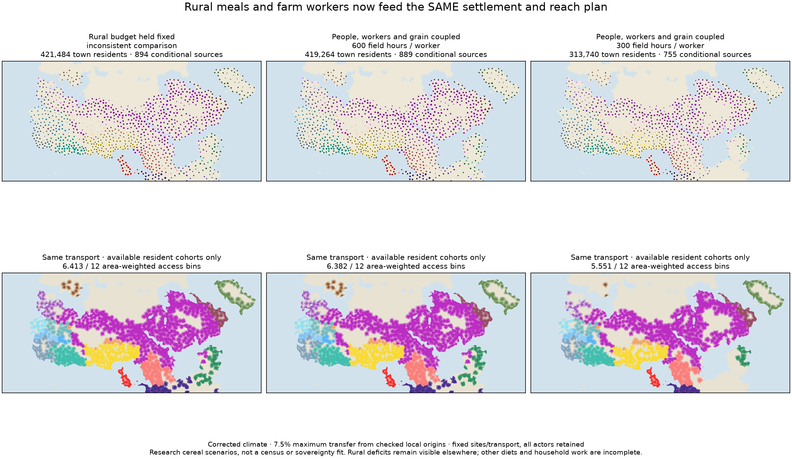
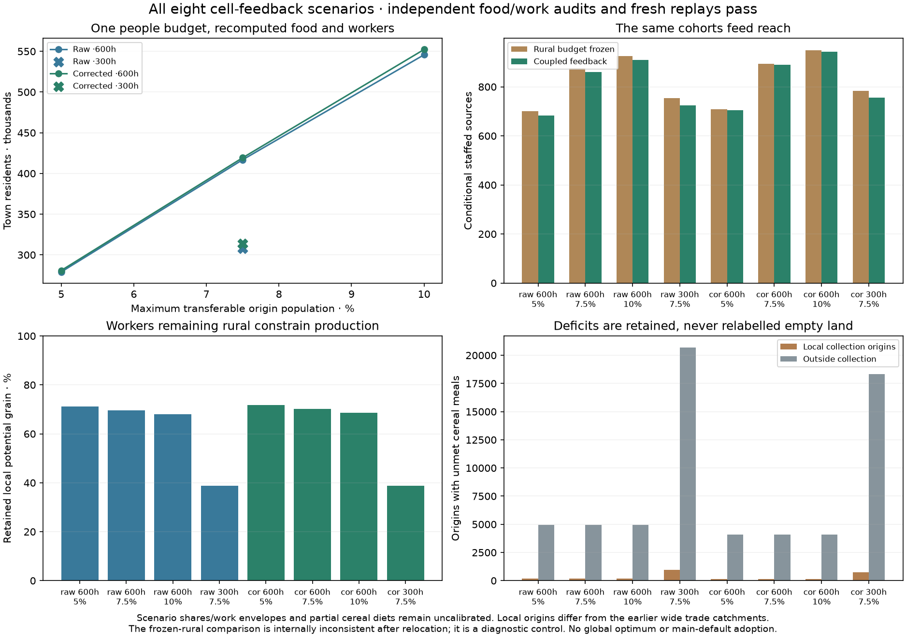

# Cell residents, farm workers and grain now feed the same settlement and reach plan

Eight new research scenarios close the previously missing rural-food feedback.
Moving people changes remaining workers, complete cereal activities, rural meals,
seasonal export stores and destination food before the same resident cohort can
emit political reach. They are available in the normal Earth atlas under
**Experimental & diagnostics → Settlements / Supply-supported reach → Coupled
residents**. Existing defaults and all original climate/food/control packets are
preserved. These are accounting-qualified scenarios, not calibrated city sizes
or a new empirical control adoption.

## Current inputs and one conserved population

The [declaration](../calibration/settlement_feedback_20261112/plan.json) was
committed and pushed in a59cf567 before feedback outputs. We use the current r44
raw/corrected published climate, administrative density, net cereal energies and
listed-work grids. Older November5 production arrays are not substituted.

The transport population is the existing density times its original square cell
area: 53.120M raw /53.429M corrected reference people, explicitly assumed rather
than observed residents. Only the exact local food-collection partition may
transfer them: 19,371 /19,295 cells, containing 5.691M /5.675M people. All other
land populations remain rural in the ledger. This narrower population envelope
differs from the earlier wide trade catchments; totals cannot be advertised as a
paired improvement over the preceding60-scenario study.

Both published land conventions are retained: Harvest includes any positive
coastal land fraction, while transport requires a majority-land cell. Their
3,142 partial coastal cells are not a reason to loosen either rule. Crop area
retains the source's float32 land-fraction multiplication; the independent review
reconstructs this convention explicitly. The local owner IDs reproduce the
published collection partition exactly, and outward/return access is recomputed
on the same parent forest in all12 months. No climate, settlement locations or
tracks are fitted here.

## Feedback and source-food rules

A declared maximum fraction of each origin population is available for transfer,
proportionally within its one destination catchment. Civilians and institutional
residents share that allowance; unused people remain rural. Remaining rural
people provide the assumed40% workforce, with600 or300 annual listed field hours,
8hours/day and a30-day reaping window. Reaping is inside annual work. Complete
cereal activities are limited by both resources before meals are allocated.

Potential grain is the current selected single cereal's net edible kcal/ha times
the existing arable, farmed and sown shares. Rural meals now come from remaining
people at2,500kcal/day, rather than a fraction of potential grain. Rural stores,
export stores, collection, delay, delivery loss and destination stocks each have
explicit inventories. A rural deficit origin exports zero. Any positive town
requires every origin in its catchment to pass the rural-meal gate; a separate
source-food audit also matches its origin shipments to destination arrivals.
Unmet rural meals elsewhere remain reported rather than being erased or exported.

Food availability need not vary monotonically with relocation: fewer rural
mouths can release grain, while fewer workers can reduce it. Each independent
catchment is therefore scanned at33 fractions of its admissible resident request,
then receives24 bracket refinements above its largest feasible sampled point.
Every trial recomputes all workers, production, meals and shipments. This returns
a certified examined allocation, not a global optimum; small feasible islands
can be missed. The final point is evaluated again and independently audited.

## All scenarios and actual downstream reach

|Climate|Annual field hours|Transfer ceiling|Town residents|Conditional sources|
|---|---:|---:|---:|---:|
|Raw|600|5%|279,013|684|
|Raw|600|7.5%|416,832|861|
|Raw|600|10%|545,756|909|
|Raw|300|7.5%|307,918|725|
|Corrected|600|5%|280,827|704|
|Corrected|600|7.5%|419,264|889|
|Corrected|600|10%|552,255|944|
|Corrected|300|7.5%|313,740|755|

The comparison holding rural production/meals fixed after relocation is labelled
internally inconsistent. On corrected climate at7.5%/600hours it proposes421,484
town residents and894 sources; recomputed feedback supports419,264 and889. With
300hours the feedback case has313,740 residents and755 sources. The positive
allocations all pass their catchments' source-food audits.

The SAME institutional residents select existing outward-and-return travel
footprints. Rebuilding all original sources exactly reproduces every published
actor/cell/season reference mask before any new reach is accepted. Independent
assembly verifies every source/month footprint and all18 actor masks. Under the
corrected7.5% case, area-weighted access falls from6.413 frozen-rural bins to6.382
coupled bins; at300hours it is5.551. Food affects available sources, not a
population-to-power multiplier. Unaffiliated sites do not acquire an actor.





## Verification and limits

Independent scalar work bounds and a separate monthly inventory recurrence check
people, remaining workers, harvests, rural meals, stored grain, per-origin
shipments and destination food. Numerical convergence is checked against the
original annual-throughput tolerance, including the tiny difference between a
limiting cycle and a producer cycle within its saved bracket. Initial/final
stocks and actual unmet food are retained; no tolerance is fitted to outcomes.
All eight result JSONs and cell NPZs reproduce byte for byte in fresh runs.
The focused107-test set covers feedback, resident/source food, work, inventory,
old settlement/service budgets, placement and transport kernels.

Positive towns passing cereal support do not mean the whole reference population
is supplied. At600hours there are185 raw /163 corrected local deficit origins,
plus rural deficits outside collection; at300hours the counts increase. Other
foods, livestock nutrition, complete household/draft work, imports, migration,
workforce shares and institutional roles remain incomplete or assumed. No census,
real famine, abandonment, allegiance or sovereignty is inferred. Mobile/nonstate
communities remain unresolved rather than being forced into permanent towns.

The supplement preserves the original manifest/model bytes and opens with the
previous defaults. Packet checksums bind it to the parent and climate. Its menus,
site ledgers, CSVs, origin-budget readouts and cell audits use a separate verified
packet, with caching that safely switches between original and feedback families.
Missing or corrupt optional data leave the original scenarios available.

Release2 still needs empirical resident-size/occupation qualification. This work
advances the shared-ledger part of release3 and publishes optional numeric maps,
without claiming the new calibrated default of release4. The next numerical
check should quantify whether finer feasible-point scans alter these certified
allocations; the next empirical work still needs compatible population, farming
and resident-size observations. Keep the fullS1–S5/all-actor programme.

```sh
.venv/bin/python -I scripts/prepare_settlement_feedback.py --mode raw
.venv/bin/python -I scripts/prepare_settlement_feedback.py --mode corrected
# Run the eight declared mode/hour/share combinations with build_settlement_feedback.py.
.venv/bin/python -I scripts/review_settlement_feedback.py
.venv/bin/python -I scripts/build_feedback_reach.py --mode raw
.venv/bin/python -I scripts/build_feedback_reach.py --mode corrected
.venv/bin/python -I scripts/review_feedback_reach.py
.venv/bin/python -I scripts/publish_settlement_feedback.py
.venv/bin/python -I scripts/plot_settlement_feedback.py
```
