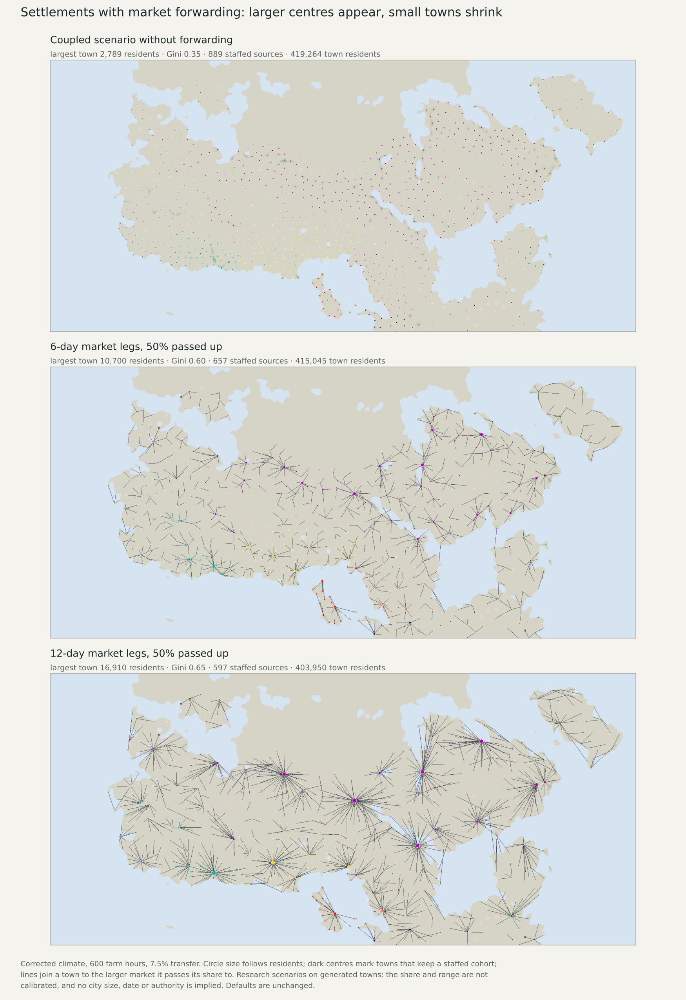
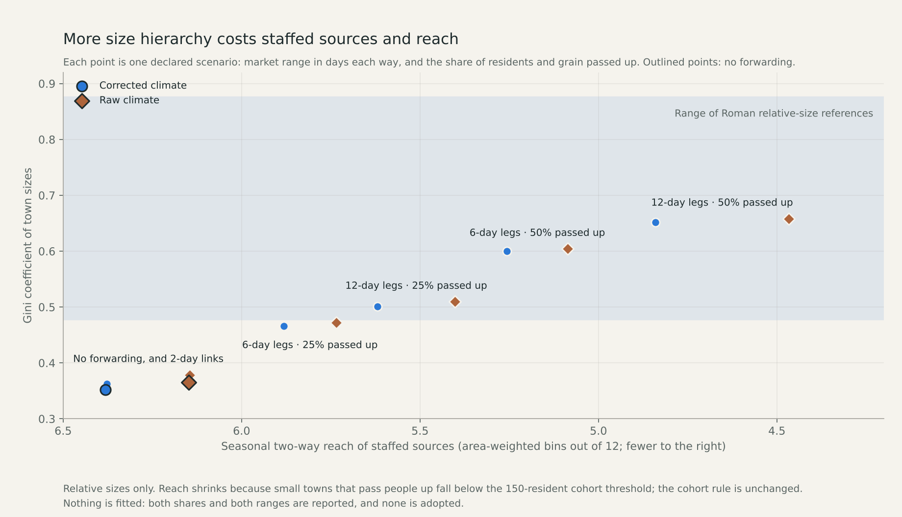

# Market hierarchy: can forwarding between towns produce large centres?

Two declared mechanism tests follow the size-shape diagnostic, which found that
the coupled allocator has no large centres. Both use one mechanism inside the
existing finite ledger. Twelve research maps are now selectable in the normal
Earth atlas; nothing is fitted or adopted, and all defaults are unchanged.

## Mechanism

Every town passes a fixed share of the residents and of the collected grain it
holds to a larger market: the linked town of the same actor with the largest
catchment budget, if that budget is larger than its own. The receiving town
passes the same share of everything it holds to its own market, and so on. A
catchment's draw of people is found by the existing coupled solver with its
existing upper bound, so people leave their origin cells once and rural work
and meals are recomputed exactly as before. Each forwarding leg loses grain and
adds the existing one-month delay. A catchment's draw is accepted only if the
stream that travels its whole chain is still fed every month. The 100-person
cohort and 50-person minimum apply to the people actually present afterwards.

The tests differ only in which towns are linked:

- **Two-day links** (declaration f17deb2a): a town inside the cached two-way
  patrol footprint in all twelve monthly bins. Each leg keeps 95% of the grain.
- **Longer market legs** (declaration 2b2fea71): at most 6 or 12 days each way in
  all twelve bins on the seasonal transport graph (foot, roads, tracks, ferries,
  rivers, harbours, sailing). Each leg keeps 95% per day of its slowest month.

Shares of 25% and 50% are tested in both. With no forwarding the code must
reproduce the published coupled scenario exactly, and it does.

## Results

All scenarios use 600 farm hours and the 7.5% transfer allowance. "Checks
inside band" counts the six declared checks (Gini and log standard deviation at
three tail levels) that fall inside the range of the Roman relative-size
references. Reach is the area-weighted number of monthly bins with two-way
access from a staffed source.

|Climate|Range (days)|Share|Towns with a market|Town residents|Largest town|Gini|Largest / median|Checks inside band|Staffed sources|Reach (bins)|Grain lost on legs|
|---|---:|---:|---:|---:|---:|---:|---:|---:|---:|---:|---:|
|raw|none|–|0|416,832|3,066|0.36|8.0|0 of 6|861|6.15|–|
|raw|2|25%|39 of 1,034|416,814|3,066|0.37|8.5|0 of 6|859|6.15|5%|
|raw|2|50%|39 of 1,034|416,814|3,227|0.38|9.2|0 of 6|858|6.14|5%|
|raw|6|25%|872 of 1,034|411,514|6,969|0.47|24.5|4 of 6|766|5.74|19%|
|raw|6|50%|872 of 1,034|411,514|11,532|0.60|57.4|6 of 6|639|5.09|19%|
|raw|12|25%|970 of 1,034|392,892|10,604|0.51|40.8|5 of 6|706|5.40|30%|
|raw|12|50%|970 of 1,034|392,892|19,475|0.66|109.2|6 of 6|550|4.47|30%|
|corrected|none|–|0|419,264|2,789|0.35|7.6|0 of 6|889|6.38|–|
|corrected|2|25%|31 of 1,053|419,264|2,789|0.36|7.6|0 of 6|888|6.38|5%|
|corrected|2|50%|31 of 1,053|419,264|2,789|0.36|7.8|0 of 6|887|6.38|5%|
|corrected|6|25%|889 of 1,053|415,045|6,431|0.47|22.7|3 of 6|782|5.88|19%|
|corrected|6|50%|889 of 1,053|415,045|10,700|0.60|53.7|6 of 6|657|5.26|19%|
|corrected|12|25%|985 of 1,053|403,950|9,310|0.50|34.6|5 of 6|738|5.62|30%|
|corrected|12|50%|985 of 1,053|403,950|16,910|0.65|92.9|6 of 6|597|4.84|30%|

- **Two-day links are nearly inert.** Only 31 of 1,053 corrected towns can reach a
  larger same-actor town all year within two days. The Gini moves from 0.35 to
  0.36. Towns sit four to six travel days apart.
- **Longer legs produce a hierarchy.** With a 50% share the Gini reaches
  0.60 at 6 days and 0.65 at 12 days (corrected), the largest town grows from
  2,789 to 10,700 and 16,910 residents, and all six declared checks sit inside
  the reference range in both climates. A 25% share gets partway: the upper
  tail is inside the range, the full distribution is still too equal.
- **The hierarchy has a price.** At 50% the staffed sources fall from 889 to
  657 and 597, because small towns that pass people up drop below the
  150-resident cohort threshold; reach falls from 6.38 to 5.26 and 4.84 bins.
  Forwarding legs lose 19% of the grain sent at 6 days and 30% at 12
  days, and total town residents fall by 1.0% and 3.7%.





## What this does and does not show

As fixed in advance: entering the reference range shows that this mechanism
*can* produce a Roman-like relative hierarchy under these assumptions. It does
not validate the share, the range, the link rule, absolute sizes, locations or
dates. Both shares and both ranges are published side by side and none is
selected as calibrated.

- The scenarios are built on the original coupled parents (061e6ef8). The later
  dispatch versions also limit collection by staff hours; forwarding has not
  been re-run on them, so staff work does not yet constrain forwarded grain.
- The cohort is a fixed 100 people per town. A larger centre gets no more staff,
  which is why hierarchy only removes sources here. Whether large centres
  should support more or different institutions is an open S3 question.
- Same-actor links only. Sites without an actor stay unlinked, which is missing
  evidence and not a claim that they have no markets.
- The Roman references are conditional area-based sizes from an exposed
  catalogue; one empire at one date is not a universal target.
- Cereal only. Other foods, household and draft work, mobile and nonstate
  communities remain open.

## Review

The independent reviewer rebuilds the links (from footprints or travel times)
and the forest with its own code, walks every catchment up its chain for
people and grain, recomputes pooled and full-chain food with a separate monthly
recurrence, and checks population and grain closure, the cohort rule,
work-limited production, the rural source gate and all metrics for all twelve
cases. Stored travel times are spot-checked by reverse searches (about 9,900
town pairs per climate). Reach masks are rebuilt by a second, dense
implementation. Fresh runs reproduce all 24 result and field files byte for
byte. Ten unit tests cover the forwarding rules.

In the atlas, all 24 map options (12 per climate, Settlements and
Supply-supported reach) load with exact audit downloads; other scenario
families still load, the default is unchanged and a missing manifest leaves
everything else available. 754 existing atlas data files are verified
unchanged.

## Whole-plan review and next work

Release 2 gains a mechanism that can reach the reference shape, not a
calibrated size model. The next declared steps on this line are: re-run the
forwarding on the threshold-seeded dispatch parents so collection work limits
forwarded grain; and test whether larger centres should carry larger
institutions, which decides whether hierarchy must cost reach. Absolute sizes,
urban share, dated occupancy, the failed geographic transfer, complete diets
and work, and S5 remain open on the [live queue](SETTLEMENT_CONTROL_ROADMAP_20261110.md).

Reproduce:

```sh
.venv/bin/python -I scripts/build_settlement_hierarchy.py --mode corrected --share 0.5
.venv/bin/python -I scripts/build_settlement_market_range.py --mode corrected --travel
.venv/bin/python -I scripts/build_settlement_market_range.py --mode corrected --days 6 --share 0.5
.venv/bin/python -I scripts/review_settlement_hierarchy.py --family market
.venv/bin/python -I scripts/replay_settlement_hierarchy.py --family market
.venv/bin/python -I scripts/build_hierarchy_reach.py --mode corrected
.venv/bin/python -I scripts/review_hierarchy_reach.py
.venv/bin/python -I scripts/publish_settlement_market.py
.venv/bin/python -I scripts/publish_settlement_market_evidence.py
```
