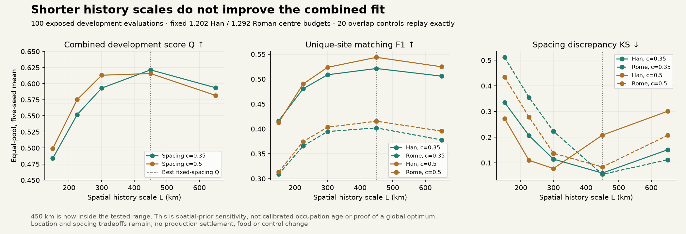

# History-scale boundary tested: retain the current development lead

11 November 2026. **Shorter spatial history scales do not improve the declared
combined score.** The old450km lead is now inside the tested range, rather than
at its minimum. This is a useful robustness result, not an accuracy gain, a global
optimum proof or a calibrated history of occupation. No production adoption.

The protocol/driver were committed at710af13a before the new grid outcomes.
Both Han and Roman pools are already exposed development evidence. The unchanged
adaptive allocator and scorer evaluated L=150/225/300/450/650km, spacing c=.35/.5,
and seeds1/7/19/43/97:100 pool/variant/seed evaluations. Counts stay1202Han and
1292Rome; eligibility, population inputs and the historical raster are unchanged.
L changes the spatial prior's concentration, not occupation age or people.

The20 overlapping450km evaluations replay their previous metrics and site arrays
exactly. Independent checks pass for all100 counts/eligibility, symmetric pair
separation and target-intensity normalization. Original numerical studies remain
unchanged. No new physics or control calculation is part of this experiment.

|Spacing c|L,km|Combined Q|Han unique F1|Roman unique F1|Han spacing KS|Roman spacing KS|
|---|---:|---:|---:|---:|---:|---:|
|.35|150|.4839|.4164|.3088|.3358|.5115|
|.35|225|.5519|.4806|.3657|.2061|.3553|
|.35|300|.5930|.5087|.3948|.1145|.2231|
|.35|450|.6214|.5213|.4020|.0601|.0552|
|.35|650|.5936|.5059|.3778|.1508|.1120|
|.5|150|.4991|.4130|.3133|.2728|.4342|
|.5|225|.5753|.4902|.3746|.1097|.2789|
|.5|300|.6131|.5236|.4034|.0778|.1373|
|.5|450|.6157|.5437|.4155|.2081|.0837|
|.5|650|.5817|.5247|.3956|.3011|.2072|

Each entry is a five-seed mean. Q keeps the previous declared weighting:
.6 uniqueF1 +.2 normalized block rank +.2(1−spacingKS), equal-pool averaged.
It is not percentage accuracy or an independent qualification score. Seed spread
is available in the full results, not interpreted as a confidence interval.

Combined comparisons retain every old fixed/adaptive alternative. The old
c=.35/L450 lead remains best at Q=.62140955; gain over it is exactly zero. Location
weights.4/.6 retain it; .8 selects the old c=.5/L450 alternative. The new c=.5/L300
variant joins the Pareto frontier: its unique matching is slightly better than
c=.35/L450 in both pools, at worse spacing, especially Rome. The combined frontier
also retains the two old450km adaptive variants and fixed18/27km alternatives.
No every-region veto or retrospective replacement of the first study's objective.

This brackets a useful scale within the **tested** family. It cannot rule out a
different local optimum, parameter interaction, model family or historical prior;
both data pools have been repeatedly used. More tuning of this same one-dimensional
scale is now lower priority than actual occupation/role evidence, appropriate
transfer and the shared population/food/staffing/control consumer chain. Keep
S1c/d/e and S2–S5 on the [full roadmap](SETTLEMENT_CONTROL_ROADMAP_20261110.md).

Mechanism framing remains Bevan & Wilson2013, doi:10.1016/j.jas.2012.12.025.
Neither this spatial prior nor inverse-square-root spacing is claimed as a
reproduction of their empirical model or an ancient administrative law.

Reproduce: `.venv/bin/python -I scripts/settlement_history_boundary_earth.py`,
then `.venv/bin/python -I scripts/review_settlement_history_boundary.py`.
Inputs, original outputs and frozen sources are verified before evaluation.
The prior108-evaluation study remains immutable; new results/positions/review are
under `output/settlement_history_boundary_20261111/`.

Verification:89 focused tests pass. The boundary study independently passes all
100 count/eligibility/intensity/pair checks and20 exact overlapping controls. The
new source audit replays byte for byte; all seven previous source-audit/numerical
artifacts remain unchanged against32ca2173. Served-browser checks pass for both
new panels,10 aggregate/document links, the figure, keyboard controls and
344/390px light/dark layouts; previous rural/coordinate panels and evidence
filters/download/error handling also pass. An existing narrow-screen card overflow
was fixed with scoped text wrapping. Full portable ZIP/site copies are not rebuilt
under the disk quota; packaging recipes include the new artifacts.

Focused Windows-style checkout preserves 70 critical files byte for byte;
all 652 local page dependencies resolve. Standalone publication is idempotent
and the standard launcher verifies the refreshed release.
