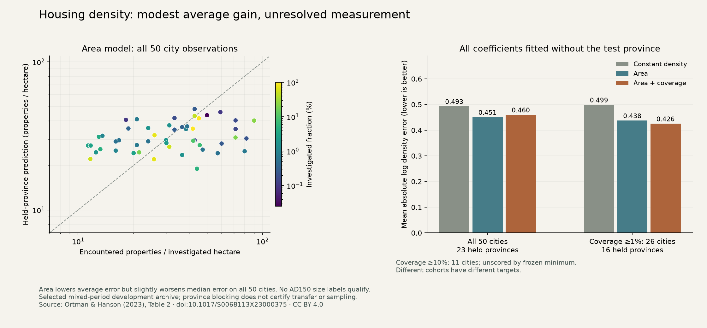

# Province-blocked housing density diagnostic

Site area modestly improves average prediction of encountered housing density
in the exposed 50-city table. It slightly worsens median error, and the coverage
adjustment is sensitive to the observation cohort. This does **not** qualify
AD150 resident sizes or a fantasy population rule. All phase, extent and
representativeness gates remain in place; model defaults are unchanged.

The comparison was [declared](../calibration/settlement_housing_diagnostic_20261112/plan.json)
and pushed in `0161dae2` before any diagnostic scores. It continues the housing
measurement work at `2179335e` on the canonical branch
`claude/friendly-turing-43ygeu`. No new archaeological table or city join was
substituted for the inaccessible sources.

## Observation and comparison

The source is Ortman and Hanson (2023),
[*Estimating the ‘Missing’ Houses of Silchester*](https://doi.org/10.1017/S0068113X23000375),
Britannia 54:167–187, Table 2, CC BY 4.0. The
[prior preparation](SETTLEMENT_SIZE_EVIDENCE_20261112.md) retains all 50 city
keys, raw property counts, investigated areas and whole-site extents. The pinned
PDF was recovered again with the same SHA256. Oxford's current
[project page](https://oxrep.site.ox.ac.uk/cities-database) still links a workbook
that returns 404; the DOI/archive request returns 403. No original workbook,
original 52-case table or independently certified catalogue join was recovered.

The response is `ln(properties / investigated hectares)`. Using sampled density
avoids putting whole-site area into both the response and the predictor. It does
not solve uneven excavation, detection, chronology or representative sampling.
The three equal-city-weight ordinary least-squares models are:

1. Constant log density: an intercept fitted on the training cities.
2. Area: intercept plus log whole-site area.
3. Area and coverage: additionally log investigated fraction. This is an
   observation diagnostic; coverage and density share the investigated-area
   denominator, so a fitted coefficient cannot establish a causal effect.

Every coefficient is fitted without the test province. All observations with
the same exact source province label stay together. The table has 50 distinct
author city keys and 50 distinct normalized ancient-name/province pairs. No
household scenario becomes an extra site. Italia's source region labels remain
distinct. This is coarse geographic blocking of exposed observations, with
uncertified cross-archive identities, not proof of independent sampling or
prospective geographic transfer.

The primary cohort keeps all 50 cities in 23 provinces. Two sampling sensitivities
were frozen before scoring. Coverage of at least 1% retains 26 cities in 16
provinces. Coverage of at least 10% retains 11 cities in eight provinces; it is
**unscored** because at least one held-province fold leaves fewer than the
required ten training cities. Those 11 observations are retained in the results,
and remain included in the primary analysis. No threshold was changed afterward.

## Held-province results

Log errors use natural logarithms. Median factor is `exp(median(abs(log error)))`;
it describes typical multiplicative prediction error, not a confidence interval.
Province MAE averages each province equally; ordinary MAE weights each city equally.

|Cohort|Model|MAE|RMSE|Median factor|Province MAE|
|---|---|---:|---:|---:|---:|
|All 50|Constant|0.493316|0.583418|1.5061|0.538533|
|All 50|Area|0.451165|0.550212|1.5244|0.487090|
|All 50|Area + coverage|0.460445|0.558199|1.5148|0.498049|
|Coverage ≥1%|Constant|0.499350|0.592179|1.6718|0.508241|
|Coverage ≥1%|Area|0.437789|0.538007|1.5111|0.430392|
|Coverage ≥1%|Area + coverage|0.425797|0.522104|1.4306|0.430063|

On the full cohort, the area model lowers city MAE by about 8.5% and province MAE
by about 9.6%. Fifteen province folds improve, eight worsen, and median error
slightly worsens. The descriptive full-cohort area coefficient is 0.274705;
training-fold values range from 0.237219 to 0.321520. These are density
associations within selected mixed-period samples, not a population scaling
law certified for the fantasy world or a historical date.

Coverage adds no average improvement over area on the full cohort. Its descriptive
coefficient changes from −0.008547 in the full table to +0.118668 in the ≥1%
cohort. On that smaller cohort, area improves province MAE but wins in only seven
of 16 province folds; area plus coverage wins in 11. All paired province errors
and coefficient ranges are retained, including losses. The different cohorts
contain different targets, so their absolute scores are not a paired gain.



Multiplying predicted property density by area and an assumed household size is
retained only as conditional algebra in the downloadable predictions. It is not
an observed resident count. Changing the household assumption from three to five
or seven shifts response and prediction together, without changing the held-out
errors. This also shows why household scenarios alone cannot supply additional
independent population-validation targets.

## Verification and decision

An independent standard-library reviewer uses centered scalar normal equations
and an explicit two-predictor solve, without importing the producer or its
least-squares solver. It checks all 228 held-province predictions, 117 model/fold
fits, 234 training coefficients, metrics, paired province differences and 684
household-unit checks. Fresh compilation reproduces `results.json` byte for byte.
Meaningful unit checks protect held-out target isolation, province grouping,
minimum cohort size, household units and refusal of rank-deficient designs.

The previous housing preparation/review/replay and raw/corrected atlas food/model
packets keep their hashes. Three incompatible reported sample phases and 47
unresolved phases remain unchanged; all 50 still lack the additional sampling
and contemporaneous-extent certificates. Zero qualified AD150 labels means
unresolved measurements, not zero residents. No fit is sent to the finite
resident/food/work/staff/reach allocator. The failed Vidarbha transfer is unchanged.

This completes the declared development diagnostic. The
[whole programme](SETTLEMENT_CONTROL_ROADMAP_20261110.md) has been reviewed again:
release 2 remains open, release 3 remains partial cereal implementation, and
release 4 has no new calibrated default. S1 occupancy/transfer, S2 roles, S3
differentiated authority, S4 complete resources/work and S5 mobile/nonstate
occupancy remain required, including all actors and unaffiliated communities.
Further density tuning cannot resolve missing phase/extent evidence. The next
concrete implementation dependency is shared monthly collection, patrol and
service hours on the same supported cohorts; its accounting and controls must
be declared before scenario outputs. Dated housing evidence remains a separate
empirical acquisition task.

Reproduce:

```sh
OPENBLAS_NUM_THREADS=1 .venv/bin/python -I scripts/diagnose_housing_density.py
.venv/bin/python -I scripts/review_housing_density.py
OPENBLAS_NUM_THREADS=1 .venv/bin/python -I scripts/diagnose_housing_density.py --out output/settlement_housing_diagnostic_20261112/fresh
.venv/bin/python -m pytest -q tests/test_housing_diagnostic.py tests/test_settlement_size_evidence.py
.venv/bin/python -I scripts/plot_housing_density.py
.venv/bin/python -I scripts/publish_housing_density.py
```

Normal evidence publication additionally requires the byte-exact replay receipt,
checks local downloads and mobile themes, and preserves the standard launcher
release verification and Windows-style byte identities.

This resumed checkout omits the private `output/land_people/earth/earth.npz`
cache. A full historical evidence republish reaches that pre-existing dependency
in `publish_settlement_vidarbha_transfer.py` and cannot complete. The existing
evidence page and exposure register were restored before applying the reviewed
diagnostic publisher; all previous panels are retained. The new direct publisher
and consumer require only committed housing inputs. No global replacement was
invented, and no full historical source rebuild is claimed.
