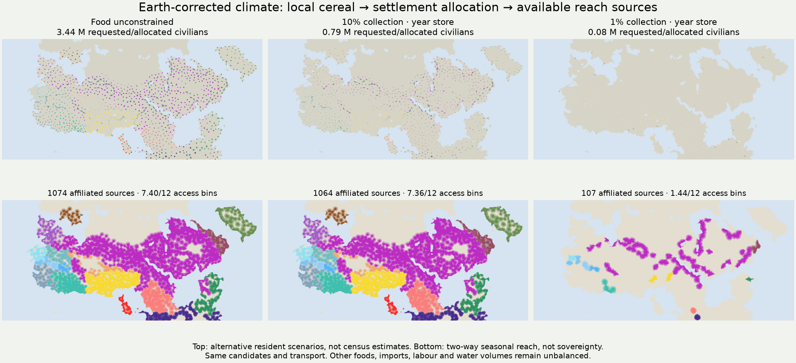

# Seasonal food changes settlements and available reach sources

The existing **Political reach → Settlements** and **Supply-supported reach**
buttons now share a conserved food allocation. The normal `.bat` atlases open
these modes on the year-store scenario. The scenario selector retains an
identical-transport, food-unconstrained reference and the explicitly labelled
legacy maps. No additional map button is needed.

This is the first integration of a resource budget into the main settlement and
reach displays. It does **not** complete the requested integration of labour,
water volumes, livestock nutrition, mobile communities, exchange and institutions.
Those remain necessary work. Climate, crop yields, FORGE, earlier resource
experiments and existing census totals have not been recalibrated or replaced.

## What changes

1. Reuse the published market candidate locations and their served-population
   accounting. Merge co-located market rows before allocation. The civilian
   request is 7.5% of served people, with a 100-person minimum. This is a demand
   scenario, **not a fitted town population**. The earlier failure to predict
   town size from market access remains a negative control.
2. Protect the local rural cereal demand through the full repeating year. A
   cell with unmet rural demand exports nothing, even during a harvest glut.
   The selected least-work wheat/barley crop supplies one explicitly selected
   harvest calendar; alternative harvests are not averaged into extra crops.
3. Partition nearby cereal cells among candidate sites along fixed directed
   collection paths. A cell can feed at most one site. Each seasonal journey
   must remain within one day in both directions along the same path.
4. Store and dispatch a declared fraction of rural overflow. Apply origin
   storage losses, one-bin delivery delay, 95% delivery retention and a separate
   90-demand-day destination store. No free inherited grain is permitted.
5. Solve the largest constant resident group that can meet **every seasonal
   bin**, rather than dividing annual grain by annual rations. Reserve a
   declared 100-person institutional cohort only if it can coexist with at
   least 50 requested civilians. Allocate civilians from the remainder, capped
   by their reference request. Staff and civilians eat from **one pool once**.
   A civilian community may persist when the institution cannot.
6. Recompute actor reach from the available institutional sites. Both outward
   and return travel must use the same origin, within two days per leg and
   four carried ration-days. Those patrol meals are already included in the
   resident ration, not charged as a second population. Food and population
   do not change speed, strength or allegiance.

The smaller-cohort case reserves 25 residents under the same rules. It is a
sensitivity to the staffing assumption, not an inferred ancient unit size.

## Evidence, geography and transport

All 151 marked symbols join bijectively to the evidence registry by compatible
icon and nearby **analysis-grid** position. Original art pixels and atlas pixels
have different scales. Every join has a two-cell limit and ambiguity check;
coastal snapping uses the prepared market node. Names are not fuzzy-matched.
Known affiliation takes precedence over painted claims. Marked places with
unknown or conflicting affiliation retain food-support scenarios without
becoming political sources. Generated administrative/market candidates inherit
painted claims only as an explicit hypothesis.

This covers all represented actors, not only the Empire. It does not transplant
an imperial administrative-seat generator onto unclaimed land. Nor does it
turn a forage map into camps, human food or political authority. Areas and
actors without adequate source information remain unscored; no reach is not
proof of empty land, abandonment or missing local organization.

Food collection uses mapped roads and local walking paths, with fixed off-path
pace and seasonal terrain, snow, mud, heat and crossing costs. It excludes
maritime grain imports and generated tracks. Unlike the earlier 151-site
prototype, the settlement envelope does not impose an arbitrary five-tonne
freight slot at every city. Its finite cargo ceiling is bounded by available
annual exportable grain; **measured freight throughput, crews and draft labour
are not supplied**. It remains a local cereal-support envelope under a fixed
dispatch policy, not an optimized transport capacity.

Patrol/person travel uses directed minimum-cost parallel transport alternatives,
including proposed tracks, river and coastal interchanges. It has no road-cell
authority sources, rank/population strength multipliers or automatic gap fill.
All new cases retain the same transport world, including density-based path
friction and inferred infrastructure; roads do not recursively disappear when
a site loses its cohort. The food-unconstrained reference has exactly these
same candidates, affiliations, paths and patrol budgets. **Only that reference
isolates food's effect.** Legacy maps use a different source/reach engine and
are a historical comparison, not a controlled ablation.

## How to read the two maps

**Settlements:** circle size is the allocated resident scenario, with a dark
centre for an available institutional cohort. Background catchment tint shows
how much of the civilian request is supported. Marked evidence remains present
even when the local cereal scenario fails. Generated candidates below the
minimum are not displayed as viable communities.

**Supply-supported reach:** hue identifies the actor with the most access bins;
opacity encodes that actor's 0–12 seasonal bins. Ties use fixed registry order,
not a sovereignty rule. Pale checks mark land reached by multiple actors at
some time; their access need not coincide. Point tables give exact actor/bin
counts, including zero available sources versus missing inventories. This map
shows conditional sustained reach, **not a validated territorial partition**.

The selected settlement panel follows reference request → seasonal food ceiling
→ allocated civilians and cohort → source availability. Seasonal food tables,
selected-site CSVs, all site ledgers, rural/transport/storage balances and exact
actor masks are downloadable. Optional ledger failure leaves the precomputed
scenario plates available; a failed manifest or Harvest identity restores the
original two modes. Shared links preserve scenario, climate and selected site.

## Scholarly basis

[Campmany Jiménez, Romanowska, Raja & Seland (2022)](https://journals.plos.org/plosone/article?id=10.1371/journal.pone.0273241)
links reconstructed hinterland production and climate to food-support limits
around ancient Palmyra. Its publisher abstract and introduction were read.
It motivates an explicit city-support constraint, not transferring Palmyra's
population, yields or political history to this world.

[Erdkamp (2005), publisher introduction](https://assets.cambridge.org/97805218/38788/excerpt/9780521838788_excerpt.pdf)
distinguishes production, supply security and the social conditions governing
food access. Physical availability cannot establish collection rights or actual
institutional staffing. The complete monograph was not consulted.

The [FAO storage manual](https://www.fao.org/4/t1838e/t1838e19.htm) supplies the
storage/dispatch distinction carried forward from the earlier milestone.
All 7.5%, 1%/10%, 25/100-person, storage, decay and travel values remain declared
scenario assumptions. **None is claimed as a calibrated ancient coefficient.**

See the [model configuration](../data/settlement_integration_model.json) and
[source-access record](../research_notes/settlement_integration_20261104.json).
A mechanism has been integrated; empirical settlement and control accuracy has
not yet been established.

## Computed comparison

These totals are alternative allocations of the reference request, **not** extra people added to any demographic model.

| Climate | Reference civilian request | Year-store civilian allocation | Staffed sources: reference → year-store → 1% collection | Access bins: reference → year-store → 1% |
|---|---:|---:|---:|---:|
| free fit raw | 4.11 M | 0.99 M | 1229 → 1207 → 173 | 7.37 → 7.31 → 1.97 |
| earth fit raw | 3.40 M | 0.80 M | 1059 → 1044 → 121 | 7.30 → 7.24 → 1.61 |
| earth fit corrected | 3.44 M | 0.79 M | 1074 → 1064 → 107 | 7.40 → 7.36 → 1.44 |
| whittaker fit raw | 3.41 M | 0.91 M | 1070 → 1053 → 180 | 7.13 → 7.07 → 2.16 |

Access bins are weighted by mapped land area and unioned across actors; they are not a score of territorial accuracy. Civilian allocations exclude the separately displayed institutional residents. The year-store case preserves most sources while greatly shrinking the unvalidated civilian request: retaining a cohort is easier than satisfying the entire demand.

Only 9–19 candidate communities and 3–4 cohorts remain with 90 origin flow-days; no permanent community is supported without origin stores under this dispatch policy. Those severe sensitivities expose the single-cereal/local-supply assumptions. They do not establish real famine, abandonment or political collapse.

Independent replay checks 268,680 site-bin food ledgers across the five constrained cases and four climate packets. Lower collection/storage cannot increase the food ceiling, removed sources cannot increase reach, unresolved affiliations create no authority, and every constrained reach mask is a subset of the matched reference.

Validation: 84 targeted model tests passed. The joint annual grain residual is below 2.2×10⁻¹¹ of harvested cereal across all four packets. Browser checks cover both existing modes, every case, exact site CSV values, actor-mask readouts, share links, mobile width, legacy comparisons and optional-data/browser failures.
