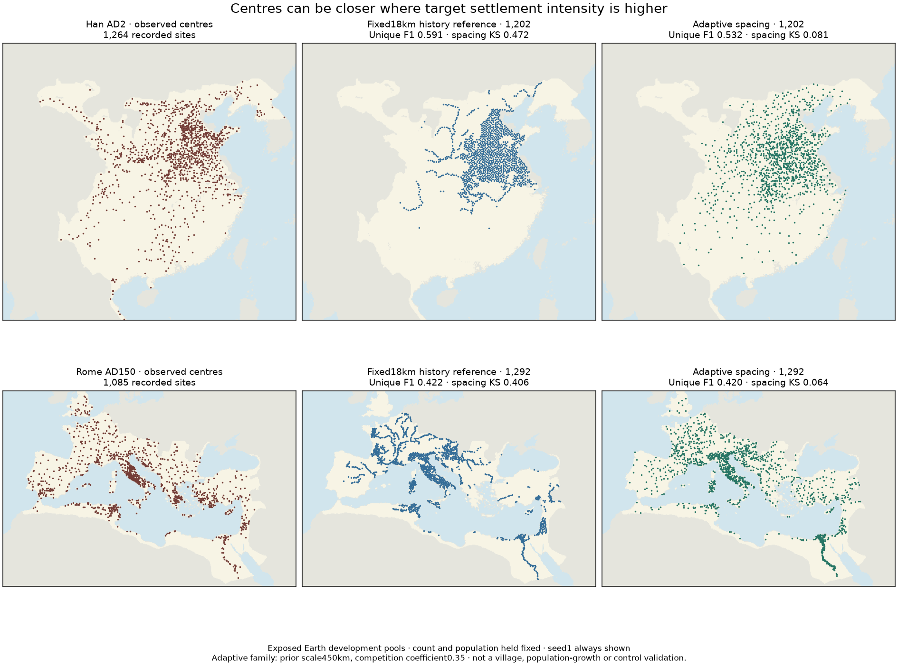
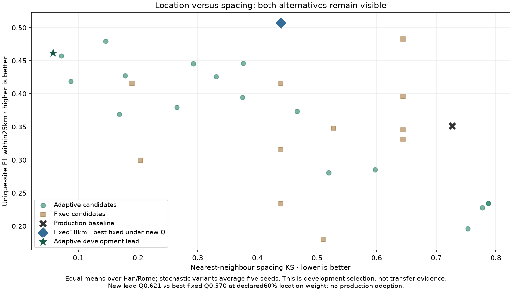

# Relative centre intensity and adaptive spacing — 10 November 2026

**Development result, not adopted.** S1c of the
[settlement/control roadmap](SETTLEMENT_CONTROL_ROADMAP_20261110.md) now has a
locally varying spacing model and explicit sensitivity to historical priors.
Counts, environmental eligibility and the population/food fields remain fixed.
Actual occupation age and prospective transfer remain unfinished.



## Mechanism and frozen comparison

The [protocol](../calibration/settlement_intensity_20261110/plan.json) was committed
at a9a4a635 before any new-family Earth score. The old12-variant experiment and
its original winner/source files remain unchanged. Both Han and Roman pools are
exposed development data; none of the108 new evaluations is an independent test.

Local relative weights combine existing suitability with the supplied old-core
prior. Normalizing their intensity over eligible land gives the requested number
of centres, **1202 Han /1292 Roman**, not a number of people. Desired separation
scales as `c/sqrt(intensity)` and is capped at45km. Accepted pairs must be farther
apart than half the sum of their local separation fields. There is no arbitrary
9km lower cutoff, though distinct proposals still occupy distinct9km raster cells.
High-intensity areas can therefore have nearer centres than low-intensity areas.
This is a normalized **target intensity**. Inhibition and stopping at a fixed
count alter spatial inclusion probabilities; the field is not the exact expected
spatial density of the final draws. Its integral is a normalization check, not a
validation of actual demographic occupancy or ecological carrying capacity.

The inverse-square-root relation is dimensional scaling of point density, not an
Earth-fitted ancient service law. The spatial point-process framing is consistent
with [Bevan & Wilson2013](https://doi.org/10.1016/j.jas.2012.12.025); this is not a
reproduction of their spatial-interaction/dynamical model.

The declared grid crosses history lengths450/800/1500km, coefficients0.25/0.35/0.5,
and deterministic/stochastic ranking. Stochastic variants use the same five
prespecified seeds; deterministic variants use seed1:108 evaluations in all.
Every realization fills its requested count. An independent review checks saved
positions against eligibility, uniqueness, geometric pair constraints and expected
intensity-count conservation; input hashes remain unchanged.

History lengths are **relative location scenarios**. They do not turn food
capacity into actual population, describe the date of first farming or imply that
distance from Rome explains medieval occupation. No residents or staff are added.
The retained WorldClim inputs use modern climatology as a historical analogue;
no AD200 climate/land-use reconstruction is introduced in this comparison.

## Selection and results

The new objective gives distinct historical locations priority:
`Q =0.6*unique_F1 +0.2*(block_rank+1)/2 +0.2*(1-spacing_KS)`.
It is declared diagnostic weighting, not a calibrated likelihood or percentage
accuracy. Both new and all12 old variants are compared under this same objective;
the old experiment's original composite winner is not retrospectively replaced.
Pools are equally weighted; there is no requirement for every region to improve.

The new development lead is stochastic adaptive spacing with coefficient0.35 and
history length450km. Values below are five-seed means where stochastic. Higher
unique F1/block rank and lower spacingKS are better.

|Pool|Variant|Unique F1 within25km|100km block rank|Spacing KS|
|---|---|---:|---:|---:|
|HanAD2|Production baseline|0.336|0.170|0.771|
|HanAD2|Best fixed under new Q:18km|0.591|0.623|0.472|
|HanAD2|Adaptive development lead|0.521|0.621|0.060|
|RomeAD150|Production baseline|0.367|0.383|0.683|
|RomeAD150|Best fixed under new Q:18km|0.422|0.446|0.407|
|RomeAD150|Adaptive development lead|0.402|0.498|0.055|

The adaptive lead has Q0.621 versus the best fixed reference0.570. It greatly
improves spacing and exceeds production unique-location matching in both pools,
but it gives up some of the fixed18km reference's distinct-location gains.
Therefore it is a different tradeoff, not universal dominance.
The450km prior is at the shortest tested history length. This is a boundary of
the declared grid, not an identified universal historical scale or evidence of
convergence to a global optimum.

The Pareto frontier retains two adaptive and two fixed variants. Location weights
0.4 and0.6 choose the0.35/450 adaptive variant; weight0.8 chooses0.5/450. Higher
weighting of location can still favor fixed-spacing alternatives. The choice is
not invariant to what we value, and none of these inspected alternatives is now
an unseen test. The history-scale sweep also uses the same two exposed pools.



Han uniqueF1 ranges0.509–0.532 across the five selected draws, Roman0.387–0.420.
Han spacingKS ranges0.041–0.081, Roman0.047–0.064. These describe generated draws,
not confidence intervals on transfer. Maps always show seed1; table values are
means. Nearest-neighbour agreement and100km counts do not validate every spatial
scale, exact locations, rural village populations or the dates of settlement.

## What remains

* **Occupancy interpretation:** relative centre intensity is now explicit and
  separated from people/food, but historical occupation-age dynamics are not
  implemented or validated. Supplied history remains a scenario.
* **Transfer:** the new [Vidarbha preparation audit](VIDARBHA_PREPARATION_20261110.md)
  rejects its supplied version as a ready geolocated test: no coordinate/settlement
  ID joins, conflicting axes and duplicate records. No predictions were scored.
  Seek source resolution or another role/coverage-appropriate source; do not fake
  a successful transfer by silently swapping coordinates or matching IDs loosely.
* **Joint integration:** S1e still must allocate real resident populations and
  food-supported staff, rebuild tracks and administrative/military reach, then
  evaluate resulting control. A generated dot is not independent authority evidence.
* **Remaining programme:** S2 roles/hierarchy, S3 differentiated authority,
  S4 resources and S5 mobile/nonstate communities remain explicitly required.

Production settlements/control and physical climate r44 remain unchanged. Normal
atlas Earth evidence shows the new experiment beside the earlier fixed-count one.

## Reproduce

```sh
.venv/bin/python -I scripts/settlement_intensity_earth.py
.venv/bin/python -I scripts/review_settlement_intensity.py
.venv/bin/python -I scripts/plot_settlement_intensity.py
```

The tracked prepared Han/Roman arrays are reused without source downloads. Results,
all positions, source/input identities and review are retained under
`output/settlement_intensity_20261110/`. Do not rerun the old experiment against a
modified frozen allocator; its publication/source checks remain intentionally strict.

Verification:45 focused tests pass, including the new intensity/pair invariants,
preparation parser checks and prior settlement/ledger/publication regressions.
All108 saved Earth realizations pass independent count/eligibility/pair and target
normalization checks. A fresh output-directory run reproduces resultsJSON and all
positions byte for byte. Browser checks pass for both new images, seven local
links/downloads, preserved prior research, light/dark mobile views and the existing
evidence filters/failure display. Focused Windows-style checkout preserves29
critical files exactly;628 local page dependencies resolve. The standard launcher
verifies the refreshed release. Full portable ZIP/full-site checkout were not
rebuilt under the workspace's disk quota; packaging includes the new assets/docs.
