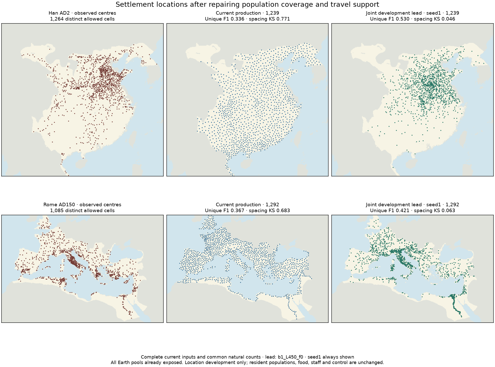
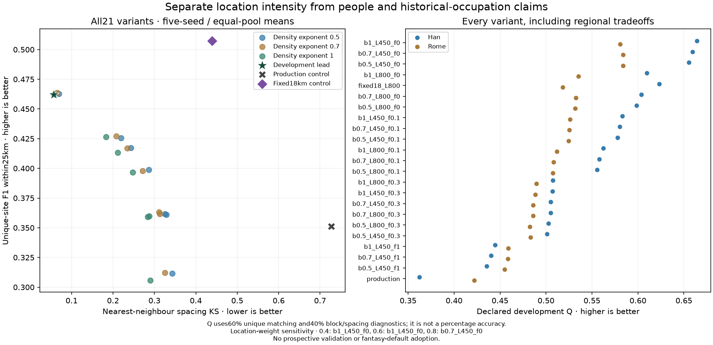

# Complete-input settlement comparison retains the adaptive development lead

The declared 224-placement experiment is complete. The 60% location-weight
development score still selects density exponent 1, history length 450 km and
history floor 0. Lower density exponents and weaker history mixtures do not
replace it. This is development on already-exposed Han/Roman pools, not a new
geographic validation or a calibrated resident-population map.

## Exact comparison and accounting boundaries

The [protocol](../calibration/settlement_joint_locations_20261111/plan.json) was
committed in4c6af479 before these placements or scores. Each pool uses the same
complete current physical inputs: corrected Han ecological coverage, original
Roman population as a paired control, and the supported travel histories checked
in the preceding milestone. Required land has complete, connected travel support.
No source site is an attractor, and no observed count sets a placement budget.

The frozen production allocator, seed1 and no marked anchors, gives 1,239 Han and
1,292 Roman centres. Every alternative keeps that budget, eligibility, people and
food fixed. The earlier Han experiment had 1,202 centres on its smaller population
input family; its old scores are historical evidence, not same-input controls.
The target metric uses 1,264 Han /1,085 Roman distinct allowed source cells. Source
record multiplicity remains a separate count-calibration problem.

The 21 unique adaptive variants vary density exponent [0.5,0.7,1], history
scale [450,800]km and history floor [0,0.1,0.3,1]. Floor 1 duplicates across scales
are omitted. The exponent changes only the existing one-cell-smoothed density
factor; water, coast, roads, flatness, eligibility and physical population remain
fixed. History is `floor + (1-floor)*exp(-distance/scale)` and does not identify
occupation age, allegiance or institutional staffing. Five seeds [1,7,19,43,97]
produce 210 draws. Ten old-clipped-history ablations isolate the history-source
repair on these same current population inputs. Two production and two updated
fixed 18 km controls bring the total to 224. Ablations cannot win selection.

The adaptive competition coefficient remains 0.35, maximum spacing 45 km. Pair
spacing is symmetric. Controls retain their own declared geometry: 18 km exclusion
for fixed spacing, earlier-site exclusion for production. No count relaxation,
best-seed selection or every-region-improves veto is introduced.

## Results and retained tradeoffs

Five-seed means for stochastic alternatives; controls are deterministic.

|Pool / variant|Unique 25 km F1 ↑|100 km block rank ↑|Spacing KS ↓|Q ↑|
|---|---:|---:|---:|---:|
|Han production|0.33560|0.15118|0.77104|0.36227|
|Han fixed18/L800|0.59209|0.62237|0.47231|0.62303|
|Han joint lead|0.52273|0.62443|0.05999|0.66408|
|Rome production|0.36685|0.38267|0.68293|0.42179|
|Rome fixed18/L800|0.42238|0.46054|0.40645|0.51819|
|Rome joint lead|0.40151|0.50338|0.05401|0.58044|

Equal-pool Q is 0.622264 for the lead, 0.570611 for fixed 18 km and 0.392029 for
production. Q gives 60% to unique matching and 40% to block/spacing diagnostics;
it is not percentage accuracy. Fixed 18 km matches more exact sites; the adaptive
lead better reproduces spacing. At density exponent 0.7 the Roman uniqueF1 rises
to 0.40774 while Han falls to 0.51938. The declared aggregate tradeoff retains
exponent 1. Its five-seed Q ranges are 0.65697–0.67151 Han and 0.56971–0.58854 Rome,
descriptive draw variation rather than confidence intervals.

Three alternatives remain Pareto-undominated: `b1_L450_f0`, `b0.7_L450_f0`, and
`fixed18_L800`. Location weights 0.4 and 0.6 select exponent 1; weight 0.8 selects
exponent 0.7 at450km/floor 0. All per-pool/seed outcomes, including poorer mixtures
and ten ablations, remain in the downloadable result.

On the same current population/count inputs, switching from the clipped old
history to supported history changes lead Q by only +0.000479 Han and+0.000462 Rome.
The source repair is necessary for valid geography; this does not establish a
large new skill gain or rescue the earlier failed Vidarbha transfer margin.





## Review and reproducibility

The independent reviewer reconstructs all 224metric sets with dense distances and
minimum-cost full assignment; the producer uses KD trees and sparse maximum
matching. It separately verifies natural production counts, all seed/variant
identities, eligibility, uniqueness, adaptive symmetric spacing, fixed 18 km and
legacy asymmetric exclusions, mean/range summaries, ranking, Pareto membership
and location-weight sensitivity. A fresh 224-placement run reproduces
`results.json` and `positions.npz` byte for byte. Original studies, inputs and
production atlas packets retain their hashes.

This resumed checkout contains the exact committed derived population/travel
NPZs and source-repair certificates. It omits the private upstream global file
`output/land_people/earth/earth.npz`. The new run consumes the checked derived
inputs, validates their identities and archived evidence, and records this
missing transitive source explicitly. It does not claim a fresh reconstruction
of the raw/global preprocessing. That source work remains the previous
milestone's evidence. Reserved climate and Woburn targets are not accessed.

```sh
.venv/bin/python -I scripts/settlement_joint_locations_earth.py
.venv/bin/python -I scripts/review_settlement_joint_locations.py
.venv/bin/python -I scripts/settlement_joint_locations_earth.py --out output/settlement_joint_locations_20261112/fresh
# Compare results.json/positions.npz before recording replay.json.
.venv/bin/python -I scripts/plot_settlement_joint_locations.py
.venv/bin/python -I scripts/publish_settlement_joint_locations.py
.venv/bin/python -I scripts/build_fit_hub.py
```

## Next consumer and release status

No production settlement, population, road, staff, control or climate default is
adopted. Location intensity cannot supply town residents or institutional roles.
Next is an explicit finite resident/catchment allocation feeding the existing
seasonal food-supported `SettlementPlan`, with rural residents retained and
civilian/institutional residents charged once. Availability and urban share are
scenarios until compatible resident-size evidence supports fitting. CountyPOP
is district population; Roman footprints and imputed areas are not resident
counts. No minimum town size may create people from nothing.

Release milestone 2 remains in progress, while shared-ledger fantasy rebuild 3
and numeric atlas publication 4 remain pending. All actors, unaffiliated,
mobile/nonstate communities and the full S1–S5 roadmap persist. The next work
must advance that shared consumer rather than start another institutional detour.
