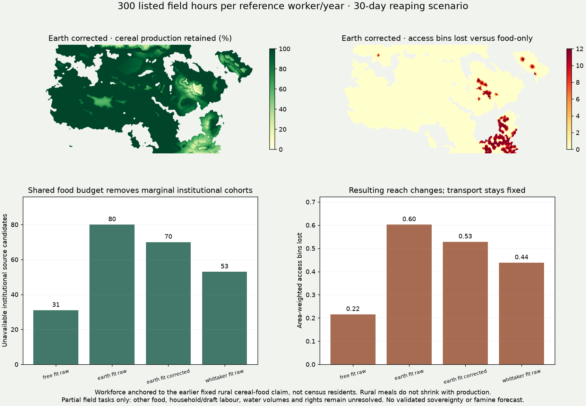

# Listed field work feeds back into settlements and available reach

Three additional scenarios now sit in the **existing Settlements and
Supply-supported reach selectors**, alongside the six earlier cases and legacy
maps. The food-only default is retained: no empirical workforce calibration
selects a new default. No climate, crop yield, census, FORGE or mobility model
has been recalibrated.

The causal chain is now **listed field work → complete crop area → seasonal
grain supply → protected rural meals → resident allocation → available
institutional sources → seasonal reach**. This integrates another previously
standalone utility budget into the same settlement/control scenario.

## A shared workforce and a fixed food claim

For each existing productive cereal cell:

- Keep the least-listed-work cereal, crop yield, potential cropped area and
  single harvest calendar from the preceding food case. There is no new crop
  selection, yield bonus, double cropping or town relocation.
- Keep its earlier protected rural cereal-food claim fixed. Divide that claim
  by the declared ration to define a **reference rural food group**, and
  allocate 40% as reference workers. These are conditional food-ledger units,
  **not census residents or an observed household composition**. They must not
  be added to the separate occupation, census, FORGE or pastoral totals.
- Use Columella's existing listed field-task and reaping work ratios. Limit
  complete annual crop activities by both annual allocated work and the
  reaping subset. A hectare cannot produce a full harvest after receiving only
  a fraction of its required work. Reaping hours are already inside annual
  field work, not a second labour charge.
- Supply 600 listed field hours per reference worker/year and a 30-day reaping
  window, then change **one** assumption: shorten reaping to 10 days with the
  same annual hours, or reduce annual work to 300 hours with the same 30 days.
  The 8-hour conversion day and worker share are declared sensitivities.
- Cap production by the feasible complete-activity fraction. **Do not lower
  rural food needs when production falls.** A cell with an unmet repeating-year
  rural claim exports nothing, even during a harvest glut.
- Route the remaining grain through exactly the preceding year-store,
  10%-collection, delayed-delivery and destination-storage experiment. The
  same single pool supports civilians and the declared institutional cohort.
  Only available affiliated cohorts emit reach, with unchanged transport and
  same-source outward/return limits.

This workforce anchor is not independently observed: it comes from the earlier
60%-of-potential-cereal rural food claim. Consequently, high-potential cells
receive a larger reference group. It provides an internally testable allocation,
not an independent demographic estimate or validation of labour abundance.
A future population calibration must replace the food claim and worker anchor
**together**, rather than mixing a census workforce with incompatible meals.

## What remains outside the work budget

Columella's listed tasks stop at the threshing floor. Draft services are assumed
available; animal feed, other staples, threshing, processing, irrigation work,
care, storage labour, water/fuel collection and household work remain omitted.
Non-reaping field tasks have no new climate-specific deadlines. There is no
hired labour, intercell worker migration or transfer of idle winter hours into
a tighter harvest window. Availability is **already allocated farm-task time**,
not free household time or leisure. Food shortages in this partial scenario are
not a prediction of actual famine, abandonment or institutional collapse.

Generated sites retain painted-claim affiliation as a hypothesis. Marked
unknown affiliations remain unassigned, and land outside the current candidate
system remains unscored. The result applies across represented actors without
assigning statehood or nomadism from biome. Household nutrition, drinking-water
volumes, mobile communities and political rights still need to constrain the
same allocation; this is not their completed integration.

## Scholarly grounding

[Columella, *De re rustica* 2.12.1–2](https://penelope.uchicago.edu/Thayer/E/Roman/Texts/Columella/de_Re_Rustica/2%2A.html)
supplies the normative wheat/barley field-task counts and reaping subsets
already transcribed for the work maps. The cached primary translation and
transcription were reread; the source describes estate advice, not universal
realized productivity. No claim is made that every environment used Roman
estate practices.

The [FAO farm-planning manual, chapter 9](https://www.fao.org/4/w7365e/w7365e0c.htm)
provides the whole-activity, simultaneous-resource-budget approach. It does not
supply ancient worker shares or harvest deadlines. This is a linear feasibility
screen on one retained cereal activity, not a new fitted labour-productivity
model. Access and attribution are recorded in the
[source note](../research_notes/settlement_labour_20261105.json); all budgets
are in the [configuration](../data/settlement_labour_model.json).

## Validation and interpretation

All six preceding cases, their summaries, source masks and collection partition
are preserved **exactly**. New cases can remove food-supported sources and
reach, never add them. Annual-work and reaping constraints share the same
workforce; deficits never generate exports. Direct cell checks independently
replay work bounds and grain reductions, while the site-ledger checks replay
stored food and resident meals. Changing the prescribed cohort can change the
civilian share of the same resident budget; it does not create more grain.

The viewer shows work assumptions, retained grain and fixed rural deficits when
a work-constrained case is selected. Selected-site CSVs include the work budgets.
The downloadable cell audit contains complete production/work/export fields;
its cell indices align with the existing analysis grid. Physical feasibility
does not establish staffing, collection rights, allegiance or sovereignty.

## Computed comparison

All cases below use the same 365-day origin store and 10% rural-overflow collection. Access is area-weighted seasonal bins, not territorial accuracy.

| Climate | Grain retained: 600 h / 30 d | Sources: food-only → 600/30 → 600/10 → 300/30 | Access bins: food-only → 300/30 |
|---|---:|---:|---:|
| free fit raw | 99.33% | 1207 → 1205 → 1204 → 1176 | 7.31 → 7.09 |
| earth fit raw | 99.74% | 1044 → 1040 → 1036 → 964 | 7.24 → 6.64 |
| earth fit corrected | 99.79% | 1064 → 1062 → 1059 → 994 | 7.36 → 6.83 |
| whittaker fit raw | 98.80% | 1053 → 1044 → 1040 → 1000 | 7.07 → 6.63 |

The tighter annual-work case retains 93.6–96.6% of grain overall, yet some marginal institutions lose support. Small aggregate production changes can therefore have larger local effects. This is mechanism sensitivity under supplied budgets, not evidence of improved empirical settlement/control accuracy.

Validation covers 90 targeted model tests, 2,855,541 cell-case work/export checks, 429,888 site-bin food ledgers and all four climate packets.
