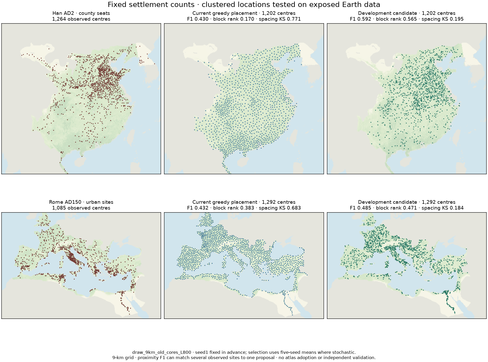

# Fixed-count clustered settlement locations — 10 November 2026

**Status: development experiment completed; no production adoption.** This is
S1a/b of the [five-stage settlement/control roadmap](SETTLEMENT_CONTROL_ROADMAP_20261110.md).
The count-separated allocator works, and a history-weighted stochastic candidate
reproduces clustering much better. Han location matching improves substantially;
Roman unique-site matching does not. Occupancy, transfer and coupled integration
remain unfinished. No settlement, population, food, road or control default changes.



## Protocol and reconstruction

The [protocol](../calibration/settlement_locations_20261110/plan.json) was committed
at 17c73556 before candidate Earth scores. Han AD2 and Roman AD150 are already
exposed development data. This is not independent validation; the previously
inspected Sui, Tang, Hellenistic, medieval-city and Domesday pools remain spent.

The November 7 raw settlement NPZ inputs were missing, along with several source
caches. Recovery used WorldClim2.1 monthly climate, Natural Earth rivers,
ETOPO-derived slope arability and HAND irrigation, the current fallow0.600 and
the default `land_people_earth.compute` recipe (no extra crop-margin override).
These are **new current-source inputs, not exact restoration of November7**.
Every comparison below uses a newly computed paired production baseline on the
same prepared NPZ. Do not compare its numbers directly with the old report.

Han seats/commandery masks are Zheng & Wu's source (figshare30518417, immutable
file59320670). Selected ZIP members were recovered with HTTP ranges and checked
by ZIP CRC; per-member SHA256 and source metadata are retained. We did not verify
the checksum of the entire 563MB archive. Roman towns are Hanson's original Oxford
workbook, roads Itiner-e record17122148, and the footprint pinned Cliopatria0.2.1.
Prepared data retain1264 Han and1085 Roman observed land cells inside their masks.
They describe county seats and urban sites, respectively, not every rural village.

Preparation/source receipts, input arrays, results and all candidate positions are
retained under `output/settlement_locations_20261110/`. Tracking the small prepared
NPZs makes a score rerun independent of the missing historical caches.

## What changed in the experiment

* Compute the unchanged production placement once and preserve its count as an
  explicit budget: **1202 Han,1292 Roman**. This preserves a legacy E1-informed
  budget; it does not derive or fit a new analytic count law. Relative errors
  against the observed counts remain−4.9% and+19.1% for all variants.
* Environmental eligibility remains fixed: base-density threshold, dry-land water
  rule and exclusion around supplied marked anchors. Evaluation centres are not
  supplied as anchors. Production populations and capacities are never rescaled.
* Cross deterministic versus stochastic ranking,9/18/27km exclusions, and no
  history versus the existing old-core `exp(-D/800km)` relative weight. The prior
  changes site scores only, not count, eligibility or the food ledger. Distances
  reuse the declared forest/relief travel rule and cradles+Rome scenario.
* Stochastic ranking uses weighted draws without replacement; deterministic
  ranking is an ablation. All six stochastic variants use seeds1,7,19,43,97;
  deterministic variants use seed1. There are72 candidate/pool/seed evaluations.
  All fill the requested count without relaxing exclusions.
* Rank variants by the predeclared equal-pool ensemble mean of
  `[proximity_F1 + (block_rank+1)/2 + (1-spacing_KS)]/3`. This is a diagnostic
  composite, not a percentage accuracy or a requirement for every region to win.
  Unique matching is separately reported, not retroactively added to selection.

This is a limited point-process experiment inspired by the approach of
[Bevan & Wilson2013](https://doi.org/10.1016/j.jas.2012.12.025), not a reproduction
of their spatial-interaction/dynamical model.

## Results

Development lead: stochastic placement,9km exclusion, old-core800km prior.
Candidate values are five-seed means. Higher F1/block rank is better; lower KS is
better. Proximity F1 permits many-to-one matches within25km. **Unique F1** instead
uses maximum-cardinality one-to-one matching within25km, exposing that limitation.

| Pool | Placement | Proximity F1 |100km block rank|Spacing KS|Unique F1|
|---|---|---:|---:|---:|---:|
|HanAD2|Production baseline|0.430|0.170|0.771|0.336|
|HanAD2|Development lead|0.592|0.577|0.195|0.473|
|RomeAD150|Production baseline|0.432|0.383|0.683|0.367|
|RomeAD150|Development lead|0.460|0.473|0.184|0.358|

Han proximity F1 ranges0.580–0.607, block rank0.543–0.619; Roman F1 ranges
0.442–0.485, block rank0.451–0.508. These are variation over generated draws, not
confidence intervals on Earth transfer. The figure always uses **seed1**, selected
in advance, so its per-draw scores differ from the ensemble means above.

The ablations matter. With9km exclusion and no history prior, stochastic placement
improves spacing but lowers proximity F1 to0.412 Han/0.372 Rome. Deterministic
ranking with the prior reaches0.523/0.481 F1, but spacing KS remains0.553/0.502.
Consequently the combined result does not establish that randomness alone finds
better locations. History supplies missing large-scale concentration; sampling
avoids simply packing the highest-scoring cells together.

An important alternative in the same frozen grid is **deterministic18km with the
history prior**: Han proximityF1/uniqueF1 are0.717/0.591 and Roman0.534/0.422,
both better than baseline. Its spacingKS is0.472/0.407: improved on baseline,
but worse than the selected stochastic9km lead. We retain this alternative rather
than retroactively changing the predeclared composite's winner. The next stage
must examine this location-versus-spacing tradeoff; the lead's Roman unique-match
loss is not a statement that every tested variant loses Roman unique matches.

## Limits and decision

* **Roman unique matching is slightly worse.** More proposals near historical
  clusters can improve proximity scores without recovering more distinct sites.
  This lead does not demonstrate a universal improvement in exact locations.
* **Resolution matters.** The9km exclusion rejects pairs at exactly9km, so the
  nearest admissible diagonal pair is12.7km. About a fifth of observed centres
  have a9km nearest neighbour after rasterization; this creates a spacing-error
  floor. These grids cannot validate village placement or sub-grid town spacing.
* **History remains supplied.** Old-core weights do not model occupation age,
  farming diffusion, abandonment, colonisation or institutional persistence.
  Rome should not be a timeless attractor for medieval European towns.
* **No food-supported control result yet.** Candidate clusters have not been
  allocated residents, transport or staff through the shared ledger. Generated
  sites must not become independent political evidence merely by being placed.
* **Coverage remains incomplete.** Two major agrarian-state datasets do not
  establish transfer to every polity, rural settlement system or mobile society.

Retain existing production settlements/control. Next is S1c/d: resolve occupancy
and measurement/resolution assumptions, freeze a finalist with a defensible
transfer protocol and test role-appropriate independent evidence if available.
Then S1e rebuilds towns/tracks, shared food/staffing and control together if the
candidate qualifies. S2–S5 remain on the roadmap even if this candidate fails.

## Reproduce and verify

With the tracked prepared inputs, no raw-source download is needed:

```sh
.venv/bin/python -I scripts/settlement_locations_earth.py run
.venv/bin/python -I scripts/plot_settlement_locations.py
.venv/bin/python -m pytest -q tests/test_settlement_locations.py tests/test_settlement_locations_earth.py tests/test_settlement_support.py tests/test_settlement_publication.py
```

Verification:31 focused tests pass (including existing settlement-support and
publication regressions); a fresh-directory rerun reproduces resultsJSON and all
archived positions byte for byte. Normal served-atlas browser checks pass for
the new figure/results/downloads, existing evidence filters, light/dark mobile
layouts and the optional-ledger failure display. A focused Windows-style checkout
preserves21 critical asset/input/source files exactly. Research-page dependency
closure resolves620 local assets/documents; the standard launcher release check
passes. The portable recipe includes the new documents, but a full ZIP rebuild
and full-site Windows snapshot were not run in this disk-constrained milestone.

Source recovery: `scripts/recover_settlement_sources.py han` / `rome`.
To rebuild inputs, obtain WorldClim `tavg,tmin,tmax,prec,elev`5m archives and
Natural Earth river GeoJSON at the documented cache paths, run
`scripts/arable_slope_earth.py`, then `scripts/land_people_earth.py --out
output/land_people/earth` (slope/HAND defaults), and finally
`scripts/settlement_locations_earth.py prepare han --out output/settlement_locations_NEW`
(and `prepare rome` with the same `--out`) rather than overwriting tracked inputs. Original source caches can
be large; only newly downloaded/generated scratch copies were pruned when this
workspace reached its disk quota. Source receipts and prepared inputs remain.
