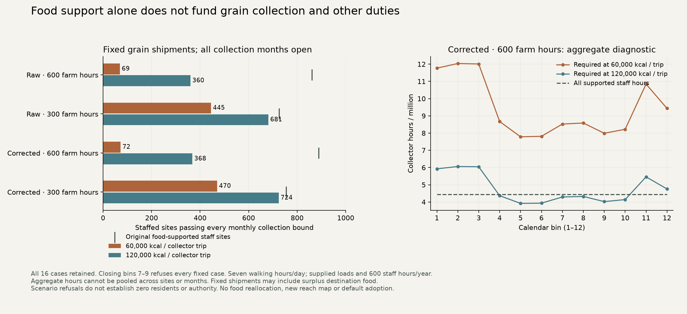

# Collection, patrol and services share one monthly staff budget

The unchanged food-supported settlement plans often fail an additional explicit
collection-work requirement. In the corrected 600-hour farm-work case, 368 of
889 staffed sites pass every month's collection bound at 120,000 kcal per
collector trip, and 72 pass at 60,000 kcal per trip. These are refusals of fixed
shipments under supplied work assumptions. They are not revised historical
populations, a new food equilibrium or political-control estimates.

The [protocol](../calibration/settlement_monthly_work_20261112/plan.json) was
committed and pushed in `7ccd5891` before new paths, work outputs or results.
This continues S4 on the same finite people, rural workers, seasonal grain,
residents and institutional staff established in the
[cell-feedback study](SETTLEMENT_FEEDBACK_20261112.md). All original food plans
and production atlas packets are preserved.

## Routes and collection work

The runner consumes the four central 7.5% relocation cases: raw/corrected climate
and 600/300 annual farm-worker hours. Each has a current independent source-food
review. The original one-day local foot-collection forest is rebuilt from the
published terrain, roads, seasons and river crossings. Destination nodes,
19,371 raw / 19,295 corrected origin indices, owner IDs and all twelve monthly
two-way access masks match the checked feedback inputs exactly.

New packets retain both directed path times and every parent-edge cost. Collection
hours are `ceil(departed kcal / load kcal) × (7 × round-trip days + 0.25)` per
origin and month. Zero shipments use no trips; a tiny positive shipment still
uses one trip. Loads cannot be shared between origins. Seven walking hours per
graph day is the existing foot-edge convention; the handling time and 60,000 /
120,000 kcal loads are supplied stress scenarios. They do not estimate real
porter mass, transport mode, draft-animal work or historical labour productivity.
Existing freight bounds and delivery delay/loss are retained as separate limits.

Institutional residents at the destination supply this particular collection
scenario. They are the SAME staff already inside the food-supported town total,
with 600 supplied work hours per year split into twelve 50-hour bins. No extra
collector population, civilian work, rural work or animal capacity is added.
The second availability profile closes zero-based bins 6, 7 and 8. Those hours
are lost; other months cannot replace them. These closures are calendar stress
tests, not observations of seasonal staffing or farming obligations.

## Qualification and competing duties

A fixed site plan qualifies only when its recorded source-food gate holds and
its entire collection requirement fits in every month. A single shortfall
refuses the whole-year case. The audit reports collection hours that could be
funded, missing hours and unused work, but it never reduces shipments and then
claims the old food-supported residents remain feasible. Fundable collection
work at a refused site is a conditional audit quantity, not a realized delivery.
Positive towns without institutional staff remain explicit refused cases.

Collection is reserved once. Only qualifying sites expose remaining hours to
three secondary channels, which share a common proportional fulfilment factor
per site and month:

* Patrol: one session per institutional resident per month, 14 hours per session.
* Service A: one annual potential request per original town resident, split
  equally over twelve bins, one hour per request.
* Service B: the same annual request count, two hours per request.

These are neutral work units, not observed demand, provider roles, actual patrol
destinations or service-based authority. Unreachable requests at refused sites
and capacity-unmet requests at qualified sites stay distinct. No spare work is
rerouted across sites, months or channels. An explicitly invalid control gives
each channel the whole remaining budget independently; its overspending remains
visible rather than becoming a permissible allocation.

## Fixed-plan results

All sixteen combinations are retained: four food plans, two loads and two
availability profiles. The table shows the eight all-open cases. Every closed-
bin case has zero whole-year collection-qualified sites.

|Climate|Farm hours|Original staffed sites|Qualified at 60,000 kcal/trip|Qualified at 120,000 kcal/trip|
|---|---:|---:|---:|---:|
|Raw|600|861|69|360|
|Raw|300|725|445|681|
|Corrected|600|889|72|368|
|Corrected|300|755|470|724|

Lower farm-work scenarios produce and export less cereal, so their unchanged
shipments can be easier to collect. This does not mean low productivity increases
actual welfare or supports more residents. Qualification counts do not compare
identical food requests across different parent scenarios.

The corrected 600-hour / 120,000 kcal all-open case leaves about 16.85 million
required collection hours unfunded and conditionally qualifies 95,359 of the
original 419,264 modeled town residents at 368 sites. The 60,000 kcal case leaves
about 63.88 million hours unfunded. At the qualified sites in the larger-load
case, independently reusing the remaining budget for each secondary channel
would overspend by about 50,770 hours across the year.

These fixed shipments can include grain unused at destinations. Therefore a
refusal does **not** establish that the original residents could never be fed
after changing dispatch volumes or work allocation. The next coupled solver
must evaluate alternative shipments, storage and work together. An audit of the
fixed parent cannot make that counterfactual claim.



## Review, consumer boundary and next step

An independent reviewer sums directed parent edges along each origin's ancestor
chain, checks its destination root and original access, then reconstructs integer
trips, origin work, per-site/month collection and all secondary allocations using
scalar formulas. It verifies every refusal, actor/unknown-affiliation total and
request ledger, plus all source identities. The old independent rural-grain and
population review receipts remain required. Fresh path/result/field packets are
compared byte for byte; focused tests cover shared competition, one-month
shortfalls, annual-work borrowing, zero staff, source-food failure, integer loads,
unreachable shipments, numerical range and nonmutation.

All 69 focused monthly-work, service, resident/feedback, housing and launcher/
package tests pass. This is not a full-repository test claim. The new collapsed
evidence panel retains all 16 rows and serves nine byte-exact local links and
downloads, including the complete work/path arrays. Keyboard, 344/390-pixel
light/dark layouts and optional-inventory failure isolation pass. Both earlier
housing panels and the general inventory/filter/pagination/download checks pass.
The staged Windows-style checkout preserves 1,706 assets byte for byte and the
standard launcher verifies Earth r44. All 784 active-hub local dependencies resolve.

No climate solve, settlement placement, track regeneration, staff recruitment,
food allocation, patrol footprint or default map follows. Dated provider roles,
full diets, household/draft work, monthly network service destinations and actual
mobile/nonstate occupancy remain unresolved. The historical base evidence
publisher still needs its omitted private Earth cache; this panel is published
directly over the preserved evidence page, as in the housing milestone.

The [whole programme](SETTLEMENT_CONTROL_ROADMAP_20261110.md) has been reviewed.
Release 2 remains open for dated sizes/occupancy and prospective transfer; release
3 remains partial cereal/resource implementation; release 4 has no new calibrated
default. S1–S5 and all actors, unaffiliated and mobile/nonstate communities remain
in scope. Next put collection hours and dispatch choices inside resident/food
feedback before accepting its food/staff plans. Alternative collector labour
must come from an explicit part of the same finite population and work budget.

Reproduce:

```sh
OPENBLAS_NUM_THREADS=1 .venv/bin/python -I scripts/prepare_monthly_work.py --mode raw
OPENBLAS_NUM_THREADS=1 .venv/bin/python -I scripts/prepare_monthly_work.py --mode corrected
OPENBLAS_NUM_THREADS=1 .venv/bin/python -I scripts/build_monthly_work.py
.venv/bin/python -I scripts/review_monthly_work.py
.venv/bin/python -m pytest -q tests/test_monthly_work.py tests/test_service_capacity.py
.venv/bin/python -I scripts/plot_monthly_work.py
```

Use `--out output/settlement_monthly_work_20261112/fresh` with both preparation
commands and the builder to create the independent replay files. The builder
consumes the original checked path packets; fresh preparation separately verifies
their reconstruction. No private global Earth file is needed by these new tools.
