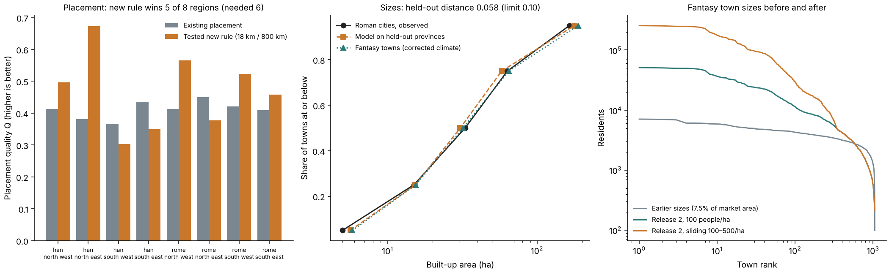
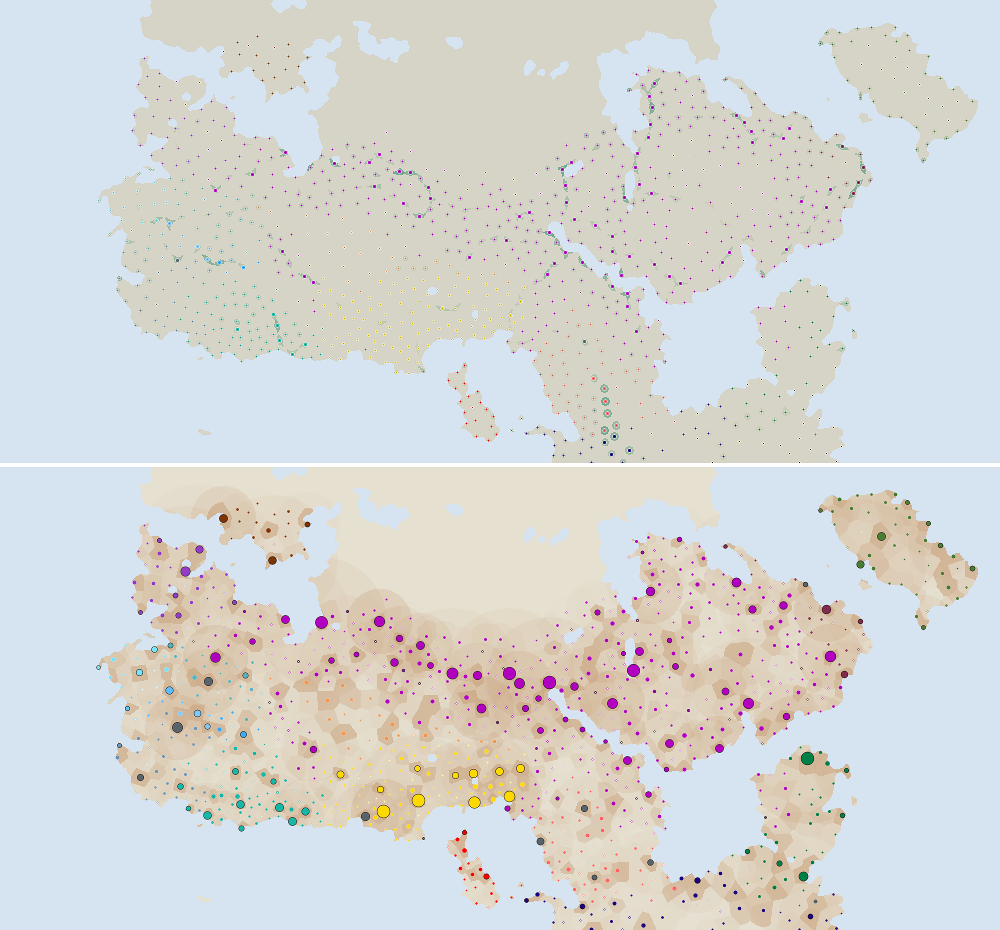

# Release 2: Earth-calibrated town sizes; town positions unchanged

**Outcome.** The atlas has a new Settlements map whose town *sizes* are calibrated
on Earth. The town *positions* are the existing ones: the new placement rule did
not pass its declared test. Because only one of the two tests passed, the new map
is offered as a normal option but is **not** the default.

Protocol: [plan and amendments](../calibration/settlement_release2_20261113/plan.json),
committed (`b13f7a3a`) before any size fit or new placement score.



## What was tested

| Question | Declared test | Result | Decision |
|---|---|---|---|
| How many towns | none new | beta 0.5 gains only 1.86% over 0.7 | keep the existing count rule |
| Where towns go | new rule must beat the existing one in ≥ 6 of 8 pool-quadrants and both whole pools | **5 of 8**; both whole pools better (Q 0.623 vs 0.362 Han, 0.518 vs 0.422 Rome) | **keep existing positions** |
| How big towns are | held-out provinces: distribution distance ≤ 0.10 and total area within 0.80–1.25 | **0.058** and **0.945** | **adopt** |

**Placement.** The surviving candidate after the failed Vidarbha transfer was
`fixed18_L800` (existing count, 18 km minimum spacing, 800 km heartland prior).
It loses in Han south-west, Han south-east and Rome north-east: it packs centres
into the densest region (Han north-east 1,012 centres for 841 observed cells) and
starves thin regions (Han south-west 24 for 87). The existing allocator errs the
other way (377 and 394). The next placement iteration should fix the regional
count split before any spacing rule.

**Sizes.** Data: the official Hanson (2016) OxREP tables, re-downloaded at their
pinned hashes ([audit](../output/roman_city_source_recovery_20261113/audit.json):
1,388 cities, 885 areas, no duplicate or orphan keys). Cohort: catalogue interval
contains AD 150, area present, on Roman land in the model window — 712 cities,
664 without the 57 default-like 20/30 ha values. Four models were compared with
whole provinces held out (four folds):

| Model | Held-out error (ln area) | Held-out R² |
|---|---:|---:|
| Constant | 0.855 | −0.02 |
| + hinterland people (selected) | 0.831 | 0.00 |
| + coast, river, road | 0.834 | −0.01 |
| + distance from heartland | 0.846 | −0.04 |

The selected model is `ln(area ha) = 2.157 + 0.127 ln(hinterland people)` with a
scatter of 1.057. It reproduces the *distribution* of city sizes on held-out
provinces. It does **not** predict which city is large: held-out R² is zero.
Coast, river, road and heartland distance add nothing.

Residents are area times a density scenario. Central: 100 people/ha up to 50 ha
rising to 500 at 400 ha (endpoints from Hanson 2016; the interpolation is ours).
Applied to all 885 official areas it gives 11.1 M, inside Hanson's published
10.6–12.2 M. Low: 100 people/ha throughout.

## The fantasy map



| | Earlier sizes | Release 2 low | Release 2 central |
|---|---:|---:|---:|
| Town residents (corrected climate, 1,053 towns) | 3.08 M | 5.58 M | 13.62 M |
| Share of the world's 53.4 M people | 5.8% | 10.5% | 25.5% |
| Median town | 2,894 | 3,193 | 3,193 |
| Largest town | 7,089 | 51,053 | 255,267 |

Fantasy built-up areas match the Roman quantiles (5/15/32/65/188 ha against
5/15/33/63/165). Raw climate: 1,034 towns, 13.49 M central.

- **People are conserved.** Every resident is taken from rural cells; the ledger
  closes to 10⁻⁹. 156 towns (164 raw) need more than half of their own 60 km
  hinterland and draw 6.7 M people from 120–240 km around. No cell loses more
  than 78% of its people.
- **Food.** Only 249 towns (245 raw) can be fed in the central scenario from one
  day's local grain collection; that collection covers about 1.6 M residents.
  The rest are flagged import-dependent, not shrunk. Wider supply is not modelled.
- **Not rebuilt.** Tracks (positions did not move), political reach, trade,
  administration and the work-calendar layers still use the earlier sizes.

## Two rules changed after first results

Both concern bookkeeping on the fantasy side, not the Earth calibration, and both
earlier builds remain in the commit history.

1. **A1.** The original rule capped every town at half of its own hinterland. It
   removed 48% of calibrated residents and left the capital at 23,900. Replaced
   by the wider regional draw above.
2. **A2.** Since Earth says nothing about which place is large, the largest size
   draws now go to the campaign's capital, major cities, fortified cities and
   fortified towns, in that order; unmarked towns, forts and monasteries share
   the rest. This is a lore choice. Without it seven unmarked sites exceeded the
   capital. The capital still ranks sixth (239,642), behind four fortified cities
   with larger hinterlands.

## Limits

- Every Earth pool used was already exposed. The province and quadrant tests are
  internal hold-outs declared before fitting, not blind validation. No new
  geography is reachable until the private global population cache is restored.
- Areas are catalogue extents with mixed bases (walls 394, inhabited area 235,
  grid 172, other 84) and catalogue dates; 1,350 of 1,388 cities have no end
  date. No housing sample is a qualified AD 150 label (all 50 keys join; 43 site
  areas equal the official value, 7 differ).
- An individual town's size is one seeded draw. The central density scenario
  implies Hanson's high urban share; the low scenario is the cautious reading.

## Reproduce

```sh
.venv/bin/python -I scripts/audit_roman_city_sources.py && .venv/bin/python -I scripts/review_roman_city_sources.py
.venv/bin/python -I scripts/settlement_release2_earth.py && .venv/bin/python -I scripts/review_settlement_release2_earth.py
.venv/bin/python -I scripts/build_settlement_release2.py && .venv/bin/python -I scripts/review_settlement_release2_fantasy.py
.venv/bin/python -I scripts/publish_settlement_release2.py && .venv/bin/python -I scripts/plot_settlement_release2.py
python3 -m http.server 8766 & node scripts/check_settlement_release2_browser.js output/settlement_release2_20261113/browser
```

Both reviews are separate implementations and pass; fresh runs reproduce every
numeric output byte for byte. The browser check passes 8 cases (2 climates × 2
options × desktop/mobile) with the default option unchanged.
