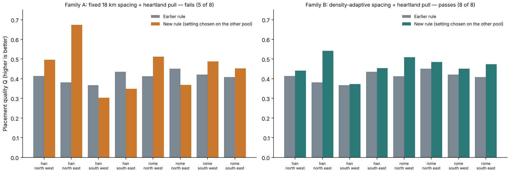
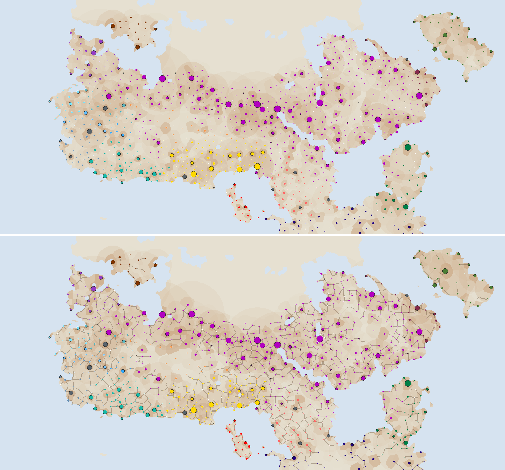

# Release 3: Earth-tested town positions on top of calibrated sizes

**Outcome.** A new placement rule passes its declared test in all 8 regions of
the two Earth pools. The fantasy map's unmarked towns are re-placed with it, the
track network is rebuilt, and the result is the default Settlements map. Sizes
are those of [release 2](SETTLEMENT_RELEASE2_20261113.md), recomputed on the new
positions. The sliding-density map became the default by owner instruction.

Protocols, each committed before its scores:
[family A](../calibration/settlement_placement_iteration_20261113/plan.json),
[family B](../calibration/settlement_placement_iteration_20261113/plan_b.json).



## The test

Each candidate has one free setting, the reach L of a pull towards the old
heartlands (weight exp(−distance/L)). For each Earth pool the setting is chosen
on the *other* pool, then judged in this pool's four quadrants and as a whole.
Pass: better than the earlier rule in at least 6 of 8 quadrants and both pools.

| Candidate | Result | Decision |
|---|---|---|
| A: fixed 18 km spacing + pull | 5 of 8; no L wins more than 5 | rejected |
| B: earlier density-adaptive spacing + pull, count held fixed | **8 of 8**, L = 800 km chosen from both pools | **adopted** |

- **Why A fails.** A weaker pull (1,200 km) gets Han's regional town counts
  nearly right yet still loses the thin regions: fixed spacing is wrong where
  people are sparse.
- **Why B works.** It keeps the earlier rule's wider spacing in thin country and
  only shifts towns towards long-settled land. Every setting tried wins at least
  6 of 8 (800 and 1,200 km win 8), so the result does not hinge on one value.
- **Size of the gain.** Whole-pool quality rises from 0.362 to 0.494 (Han) and
  0.422 to 0.484 (Rome). Han towns per quadrant move from 160/377/394/308 to
  199/575/206/259 against 217/841/87/119 observed: better, still too even.
- A scores higher than B on whole pools (0.623 and 0.518) but fails regionally;
  the declared rule ranks regional robustness first.

## The fantasy map



| Corrected climate | Value |
|---|---:|
| Unmarked towns moved | 420 of 902 |
| Marked places moved | 0 of 151 |
| Town residents, sliding / flat density | 13.62 M / 5.59 M |
| Share of the world's people | 25.5% / 10.5% |
| Largest town (the capital) | 256,701 / 51,340 |
| Towns fed by one day's local grain collection | 256 / 241 of 1,053 |

Raw climate: 419 of 883 moved, 13.45 M / 5.50 M. The town count is unchanged
(one seat per about 27,700 people at the reference density, rescaled so the
pull does not change the total). Lore ranking, the people ledger and the local
cereal flag are as in release 2. Before placing anything, the builder reproduces
the published towns and the reviewed collection catchments exactly.

## Limits

- **Not blind.** Both pools were already used in development, and family B was
  designed after seeing where family A failed. The cross-pool choice of L guards
  against tuning one number, not against the choice of family. No third family
  will be tried on these pools without new Earth data.
- The earlier Vidarbha transfer failure applies to a different candidate and
  stays on record; B has not been run there (the survey is spent and the global
  population cache is missing).
- Political reach, trade, administration and work-calendar layers still use the
  earlier towns and sizes.
- An individual proposed town is one draw from a calibrated pattern.

## Reproduce

```sh
.venv/bin/python -I scripts/settlement_placement_iteration.py --family A
.venv/bin/python -I scripts/settlement_placement_iteration.py --family B
.venv/bin/python -I scripts/build_settlement_release3.py
.venv/bin/python -I scripts/review_settlement_release3.py
.venv/bin/python -I scripts/review_settlement_release2_fantasy.py release3
.venv/bin/python -I scripts/publish_settlement_release3.py
python3 -m http.server 8766 & node scripts/check_settlement_release3_browser.js output/settlement_release3_20261113/browser
```

The placement review re-implements the allocator as an explicit accept/reject
loop and reproduces all 16 Earth placements, their scores, the decision and both
fantasy placements. Fresh runs reproduce every output byte for byte. The browser
check passes 8 cases with release 3 as the default.
