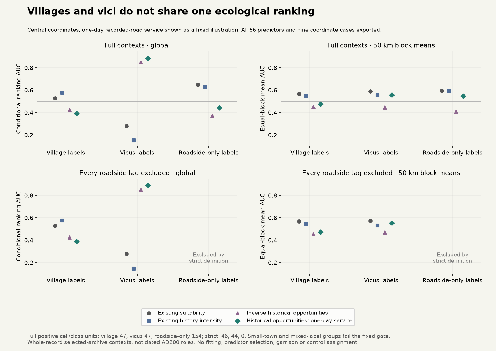

# Source-role composition, 11 November 2026

Villages and vici do not follow one common ecological ranking in the selected
Roman archive. The pooled strict service-demand score concealed this difference.
This finding supports separate observation and demand channels; it does not
qualify a new settlement, garrison, institution or de-facto control assignment.
Active climate remains r44 and production population/control maps are unchanged.

Protocol [5e650062](../calibration/settlement_role_composition_20261111/plan.json)
was committed before subclass support counts or scores. All 66 frozen predictors,
nine coordinate cases and both original cohorts remain. No fitting, predictor
selection, after-outcome merging or ranking reversal occurred.

## Source partitions and support

The original 426 nucleated domestic-only records are partitioned by their recorded
village, vicus and unwalled-small-town labels. Exactly one label gives that group;
multiple labels give a separate mixed group; no such label gives roadside-only.
Co-tags are retained. The strict cohort removes **every** roadside-tagged record,
even if co-tagged village or vicus. The comparator remains the original 2,049
farm/villa-only domestic records, with 797 central represented cell/class units.

|Group|Full source positives|Full positive cell/class units|Strict source positives|Strict positive cell/class units|Scored?|
|---|---:|---:|---:|---:|---|
|Village only|65|47|64|46|Both cohorts|
|Vicus only|84|47|81|44|Both cohorts|
|Unwalled small town only|7|6|7|6|Neither: fixed support gate fails|
|Multiple non-roadside labels|1|1|1|1|Neither: fixed support gate fails|
|Roadside only|269|154|0|0|Full cohort only|

The declared gate requires at least 30 represented units in each class at central
coordinates. Five of ten group/cohort cases pass; all failed cases remain visible
and unscored. Failure does not imply a historical role did not exist. Full village
cells include 37 mixed farm/villa cells out of 47; vici include 9 out of 47. The
9 km grid therefore cannot resolve many countryside contexts as separate places.
All nine coordinate support summaries retain included, out-of-window, nonland and
disallowed record counts by class. No point is rescued onto nearby eligible land.

## Fixed illustrative comparison

The following uses central coordinates and the pre-existing one-day recorded-road
historical-opportunity service field. All other fields and travel cases are in the
download; none is chosen as a winning predictor.

|Group/cohort|Service global AUC|Inverse historical opportunities global AUC|Service 50 km block mean|Suitability 50 km block mean|
|---|---:|---:|---:|---:|
|Village, full|0.3930|0.4249|0.4748|0.5665|
|Vicus, full|0.8822|0.8489|0.5557|0.5879|
|Roadside only, full|0.4428|0.3716|0.5468|0.5934|
|Village, strict|0.3884|0.4249|0.4723|0.5689|
|Vicus, strict|0.8899|0.8537|0.5533|0.5724|

The large global vicus score weakens locally and is already partly reproduced by
inverse opportunities. Village and roadside contexts behave differently. These
are conditional rankings within selected excavations, not percentages of sites
correctly reconstructed, a census, independent transfer or dated AD200 functions.
Spatial blocks have 27/24/41 both-class blocks for full village/vicus/roadside,
and 27/22 for strict village/vicus. They are descriptive local comparisons,
not held-out folds or independent replicates.

## Why distinguish these channels?

Smith et al. (2016), *The Rural Settlement of Roman Britain*, chapter 2, printed
page 38, distinguishes villages and roadside settlements by association with the
Roman road network. Road-derived validation can therefore be partly definitional.
The authors describe vici as civilian settlements originating beside forts and
say that they may have functioned differently and deserve examination as a
distinct group. They also describe differing regional concentrations. Chapter 1,
page 10, explains selection exclusions and that source classifications can refer
to successive phases.

This is evidence for keeping residential, exchange and institutional demand
separate. It is not evidence that each vicus label identifies a contemporaneous
staffed fort, active market or controlling actor. The archive omits many military
and major/walled urban contexts and cannot calibrate a complete sovereignty model.
Exact pinned text identities and short two-column extraction anchors are in the
[source record](../calibration/settlement_role_composition_20261111/semantic_sources.json).
Source archive DOI [10.5284/1030449](https://doi.org/10.5284/1030449);
[chapter 2](https://archaeologydataservice.ac.uk/catalogue/adsdata/arch-3299-1/dissemination/brit_29/disc_1_-_ch_1-11/Romanch2.pdf).

## Verification and next consumer

The independent reviewer reconstructs all ten source partitions and support gates,
directly checks all 2,970 global and 6,270 source-stratum AUCs, and reconstructs
330 local block means. Twenty-one earlier source/numerical artifacts remain
byte-identical. Public results are aggregates; raw coordinates and private matches
are not redistributed.

Next implement capacity-limited potential-service allocation with explicit
staffing, hours and food-supported inputs, and unmet requests. Staff, residents
and food must come from the **same** ledger used by settlements/institutions and
control; the primitive must not manufacture them. Institutional demand is an
input scenario until supported and dated, not an automatic inference from a map
icon or source label. S1c/d/e and S2–S5, prospective transfer and all actors,
unaffiliated/mobile/nonstate groups remain on the full roadmap.
