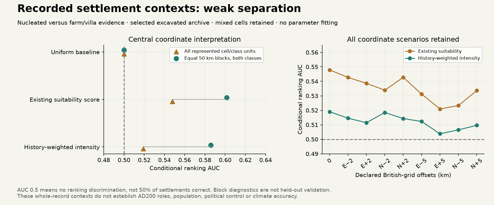

# Existing centre predictors weakly separate recorded settlement contexts

11 November 2026. The first declared conditional role diagnostic is **weak**:
AUC 0.548 for the existing suitability score and 0.519 after the 450 km history prior.
A uniform ranking gives 0.5. These are selected-archive context comparisons,
not percentages of correctly reconstructed settlements, dated AD200 roles or
political control. No parameter fitting or production adoption.

## Question and source scope

The [protocol](../calibration/settlement_role_contrast_20261111/plan.json) was
committed at cccab768 before source-to-grid matching or contrast scores. It asks
whether existing predictors distinguish recorded nucleated contexts from recorded
farm/villa contexts **within** the excavated archive. It never labels unobserved
land as empty or non-nucleated. Britain overlaps the previous Roman development
geography, so no independent/held-out qualification is claimed.

Source: Allen and colleagues2018, [ADS rural Britain](https://doi.org/10.5284/1030449).
The authors'2016 methodology and its [chronology audit](SETTLEMENT_PHASE_EVIDENCE_20261111.md)
explain that roles may be successive; whole-record labels are not precise AD 200
functions. Original collectors are not responsible for this interpretation.
Raw records, matched indices and projected coordinates stay in the private cache.
Public outputs are aggregate diagnostics, protocols and provenance only.

Positive source labels: village, vicus, roadside settlement, unwalled small town.
Comparison labels: farm or villa. Require explicit domestic occupation and labels
in exactly one class. Source preparation gives 426 nucleated-only and 2049 farm/villa-
only records; overlapping/unknown/non-domestic contexts are not reclassified or
silently treated as absence. The target is recorded context, not a market, estate
population, administrator or garrison.

## Geometry, coverage and units

The earlier named-site audit supports operational British-grid X=easting/Y=northing.
pyproj 3.7.2 uses the available non-ballpark OSGB36→WGS84 operation, reported accuracy
2 m. Its more accurate OSTN15 grid is unavailable and network grid fetching is off;
the exact pipeline and warning are recorded. This numerical operation accuracy
does not establish source survey precision. The source coordinate scenarios remain
explicitly uncalibrated sensitivity, not an error distribution.

The original 400×600 Roman input has 9 km cells. Reconstructed spherical AEQD geometry
matches its archived centres before source matching. Nearest centres are chosen
from the FULL grid before land/allowed checks; no nearest-land rescue. Central
coverage is:

|Recorded context|Included|Outside window|Nonland cell|Disallowed|
|---|---:|---:|---:|---:|
|Farm/villa|1938|54|5|52|
|Nucleated|419|2|1|4|

Every represented(cell,class) has total weight 1, regardless of repeat excavations.
There are 797 farm/villa and 249 nucleated units across 891 cells, 155 mixed. Mixed
cells retain both classes/ties; they are not dropped to improve separation.
The declared 30-unit-per-class preparation gate passes. This weighting is not a
physical-place merge or a settlement-population estimate.

## Unfitted ranking results

The same frozen suitability/eligibility code is reused. Suitability includes the
existing density, water/coastal, road and terrain machinery; it is not climate
alone. The history predictor uses the previously selected 450 km prior and original
1292-centre budget; source labels never supply that budget. The spacing coefficient
does not affect the relative intensity ranks. Earth reference inputs use existing
land/people and observed-climate fields; this does not measure r44 rainfall skill.

|Predictor|All represented cell/class units|Equal 50 km-block mean|
|---|---:|---:|
|Uniform|.5000|.5000|
|Existing suitability|.5478|.6015|
|History-weighted intensity|.5190|.5859|

The block diagnostic averages 63 blocks containing both classes, out of 81 observed
blocks. It is a geographic diagnostic, not cross-validation. No parameters were
learned, thresholds optimized, or empty landscape sampled as negatives.

All nine declared coordinate scenarios are retained: central and ±2/±5 km along
each British-grid axis. Suitability AUC ranges .5209–.5478; history intensity
.5038–.5190. Suitability leads in every scenario, without a significance claim.
All region, source fieldwork-string and investigated-AREA strata are exported;
single-class strata have undefined/null AUC rather than fabricated scores. The
AREA bins describe investigation effort, not full settlement size. Stratification
does not eliminate excavation/reporting bias, and small strata should not be
interpreted as stable regional skill estimates.

## Development consequence and next mechanism

Do not promote the centre-placement score into a role classifier. Its good
Han/Roman centre-location tradeoff does not make it a model of villages, estates
or institutions. The result prioritizes an explicit role mechanism and an
observation model, with accessible rural demand, service competition and finite
surplus as hypotheses to test. Spatial interaction/settlement hierarchy remains
grounded in Bevan & Wilson2013, doi:10.1016/j.jas.2012.12.025; this diagnostic is
not a reproduction of their fitted model.

Before adding road-driven role predictors, declare a contrast excluding roadside
labels as a robustness check, to distinguish a substantive mechanism from a
definitional route association. Keep record selection and whole-period timing
limits explicit. Qualified changes must eventually enter the SAME resident,
food, staffing and differentiated-control ledger, across all actors/nonstate
communities. The [S1–S5 roadmap](SETTLEMENT_CONTROL_ROADMAP_20261110.md) remains open.

Reproduce with optional `requirements-settlement-research.txt`, then
`scripts/prepare_settlement_role_contrast.py`,
`scripts/evaluate_settlement_role_contrast.py` and
`scripts/review_settlement_role_contrast.py`. The pinned raw source cache and old
Roman inputs are required. Private matches are not redistributed. Independent
review checks 27 AUCs by direct positive-negative pair comparison rather than rank
sums, and verifies cell/class support and retained mixed ties.

Verification:95 focused tests pass, including tied/perfect/reversed rank cases,
repeat-record invariance, retained mixed cells and no nearest-land rescue. All27
AUCs pass direct pairwise review. Fresh-output preparation and private match arrays
are byte-exact;10 prior numerical/source artifacts remain unchanged against54fcb2f3.
Browser checks pass for the collapsed panel, keyboard opening, five aggregate/doc
links, figure, current source-exposure labels, mobile/dark layouts and preceding
research/evidence functionality. The older rural/continuation publishers preserve
scored exposure; standalone publication is idempotent. Full ZIP/site copies remain
unbuilt under quota; normal launcher and package recipe are updated.

Focused Windows-style checkout preserves 88 critical files byte for byte;
all 658 local page dependencies resolve.
