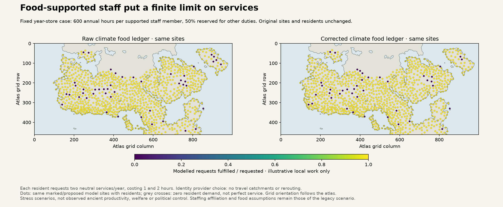

# Shared service-work budget, 11 November 2026

Potential requests can now consume a finite staff-hour budget shared by multiple
service types. The consumer uses staff already supported inside the same resident
and repeating-food ledger. It reports unmet requests and unused hours without
creating people, food, workers or political authority. This is an implementation
diagnostic; service productivity is **not Earth-calibrated** and production maps
and active r44 physics are unchanged.

The [protocol](../calibration/settlement_service_capacity_20261111/plan.json) was
committed as 3d3a6c4e before capacity results. Earlier village/vicus comparisons
motivated separate demand and observation channels, not automatic role labels.

## Shared accounting

`supported_staff_hours` takes a food-supported `SettlementPlan`, an explicit work
envelope per institutional resident and hours already committed to other duties.
It checks that civilians plus staff equal the same total residents, the food
ceiling is respected and the repeating food year meets demand. Gross hours equal
supported staff times the supplied envelope. Existing commitments are subtracted
before service allocation; overspending is rejected. There is no implicit default
of free staff or additional worker recruitment.

`fulfil_services` accepts multiple existing potential-request allocations.
Provider j receives q(j,k) requests in channel k at explicit cost h(j,k) hours.
Total requested work is the sum of q*h across **all** channels. One common factor
min(1, available hours / requested work) rations each provider's requests.
Outputs retain origin served, unreachable and capacity-unmet requests, destination
work by channel and unused provider hours. Conservation holds per origin and
provider, not merely for the global sum.

This is single-pass proportional rationing. Unmet requests are not automatically
rerouted to spare providers, and no maximum-flow, queue, pricing or equilibrium
solution is claimed. Other priority rules need explicit scenarios and evidence.
Work inputs must share one accounting period. Institutional residents are not
assumed to be all adult workers: an empirical work envelope would need age,
participation, subsistence work and existing-duty information.

## Coupling to the current atlas

Both frozen raw/corrected Earth settlement packets contain 1,053 marked/proposed
sites and ten food-constrained alternatives. The unconstrained reference is
excluded. The diagnostic reconstructs all 20 repeating food years from the
recorded arrivals, resident needs and stores; consumption, losses and unused
food match the recorded ledgers. No food reallocation or settlement placement
occurs. Those staff and resident quantities remain alternative legacy scenarios,
not observed ancient populations or a new census added to other subsistence maps.

Exactly three illustrative annual work cases use 600 gross hours per already
supported institutional resident, with 0%, 50% or 100% committed elsewhere. Two
neutral channels each request one service per recorded resident per year, costing
one and two hours respectively. These are declared stress units, **not** empirical
ancient coefficients or rates transferred from manual agricultural work. Identity
choice at the same site tests coupling; no new travel catchment is inferred.

For the fixed year-store case, raw/corrected resident totals remain approximately
807,770 / 812,546 and supported institutional cohorts 98,700 / 101,100. With this
light workload, the model fulfils 98.26% / 98.39% of requests under both 0% and 50%
prior commitments. Much work capacity remains unused. With 100% prior commitments,
fulfilment is zero. This shows that the toy workload is mostly nonbinding and
provider availability matters; it does not establish realistic historical demand,
labour productivity, welfare, service access or authority. Zero total demand yields
null coverage rather than a perfect score. All 60 cases remain in the download.

The figure fixes the year-store case and 50% other-duty commitment. Colours are
modelled requests fulfilled/requested at unchanged sites; grey crosses denote no
resident demand. Coastlines come from the same atlas land lookup. Grid orientation
follows the atlas. These are local work diagnostics, not new political boundaries.

## Verification and limits

Eight unit tests cover heterogeneous channel costs sharing one hour pool,
unreachable versus capacity deficits, zero work, explicit no-rerouting behaviour,
overspending, malformed/tampered inputs, numerical extremes, nonmutation and coupling to an actual
food-supported settlement allocation. The independent reviewer recomputes all
60 cases in closed form for identity choice, checks every origin request and
provider hour budget, replays 20 food cases and compares both source packets
byte-for-byte with commit a9b3858c. Resource conservation validates implementation;
it is not archaeological or independent Earth validation.

The [source-composition report](SETTLEMENT_ROLE_COMPOSITION_20261111.md), including
Smith et al. (2016), chapter 2 p38, supports separating civilian fort-origin vici
from other contexts. The [earlier service report](SETTLEMENT_SERVICE_DEMAND_20261111.md)
documents accessibility and destination-choice literature. Neither supplies an
empirical hours-per-service coefficient here. No such calibration is claimed.

Next connect actual monthly staffed providers and round-trip access to demand,
while quantifying **shared** commitments for collection, patrol and services.
Legacy binary reach does not yet quantify patrol labour, so assuming its staff
are simultaneously free would double-spend work. Dated/source-supported roles,
observation coverage and prospective transfer are still required before map
adoption. Preserve S1c/d/e and S2–S5, and all actors, unaffiliated, mobile/nonstate
groups; affiliation or an icon alone never proves staffing or sovereignty.
