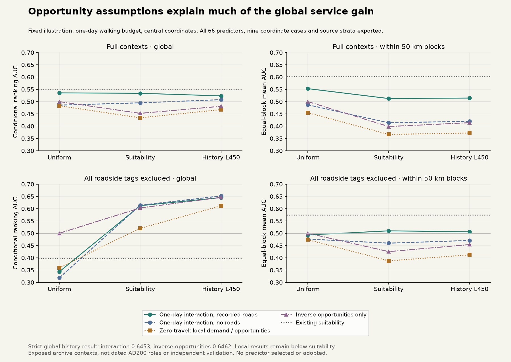

# Service opportunity controls, 11 November 2026

The apparent global service-demand gain is largely reproducible by the assumed
opportunity denominator. This exposed diagnostic does **not** qualify a settlement
role or de-facto control update. No production map, climate, resident, food, staffing
or institutional allocation changed.

Protocol [720fcaa2](../calibration/settlement_service_controls_20261111/plan.json)
was committed before these fields or scores. It retains both earlier context
cohorts, all nine coordinate cases, both road assumptions and all three walking
budgets. No parameter was fitted and no winning predictor was selected.

## What was tested

The existing Roman input and finite-request mechanism remain frozen. Each origin
has potential demand D. Candidate opportunity masses m sum to the same 1,292
expected-centre equivalents over the original eligible window. Three alternatives
use the original historical intensity, suitability without history, or equal mass
per eligible cell. These are opportunity scenarios, not actual staffed settlements.

The same directed land-only round trips and destination-choice allocation generate
54 interaction fields. Nine explanatory nulls give local demand D, zero-travel
requests per opportunity D/m, and inverse opportunity 1/m for each mass case.
Absent candidate cells remain zero; there is no artificial denominator floor.
Together with three original references this gives 66 predictors and 1,188
global AUC comparisons across cohorts and coordinates. Every coordinate, source
region, fieldwork and investigated-area stratum is retained in the downloads.
Interaction-minus-local-null differences are reported, without choosing a winner.

## Representative results

The fixed illustration uses recorded roads and a one-day one-way walking budget.
Values below are central-coordinate conditional ranking AUC, not percentages of
historical settlements correctly reconstructed.

|Opportunity mass|Full interaction|Strict interaction|Strict inverse mass|Full interaction, 50 km blocks|Strict interaction, 50 km blocks|
|---|---:|---:|---:|---:|---:|
|Uniform|0.5356|0.3434|0.5000|0.5528|0.4930|
|Suitability|0.5339|0.6123|0.6031|0.5125|0.5098|
|History L450|0.5233|0.6453|0.6462|0.5146|0.5059|

Existing suitability scores 0.6015 locally on full contexts and 0.5748 on the
strict non-roadside subset. The local interaction values in this illustration
remain lower. Travel improves on some corresponding zero-travel controls, but
that is a narrower statement than validating functional settlement roles.
The inverse-history ranking was an explicitly declared explanatory control:
reversing a full ranking gives 1 minus its AUC mathematically. It is not a newly
discovered role predictor, and is not adopted after observing the scores.

## Interpretation and limits

The positive class is still whole-record nucleated domestic context versus
farm/villa context in a selected excavation archive. The strict cohort excludes
every roadside-tagged record, including co-tags. It has 97 positive and 797
negative cell/class units with 45 mixed cells at central coordinates. Those are
neither AD200 role intervals nor complete settlement counts or true absences.
Nine-kilometre cells, geographical source selection, successive site labels and
heterogeneous village/vicus/small-town meanings remain unresolved.

This test separates local demand, opportunity assumptions and travel interaction.
It supports retaining separate mechanisms and observation models rather than
turning a single spatial intensity into markets, institutions or authority. The
next source-composition check must be declared before new subclass scores, retain
all declared cases and avoid interpreting vicus labels as automatically military
or market functions. S1c/d/e and S2–S5 remain open on the full roadmap.

## Verification

The independent reviewer checks all 1,188 AUCs using direct positive/negative
comparisons, replays 378 previous diagnostics and 18 historical fields exactly,
checks 18 conserved request ledgers and nine local nulls, and compares 54 cases
against the **full original transport window**, including rival normalizers for
all three opportunity assumptions. Tests also cover mass budgets, eligibility,
identity-kernel equivalence and invalid/overflowing denominators. These checks
validate implementation, not ancient service rates or independent transfer.

Public downloads contain model fields, aggregate contrasts, provenance and review;
raw archive coordinates and private matches are not redistributed.

## Academic basis

The framework uses the same sources as the [finite-demand report](SETTLEMENT_SERVICE_DEMAND_20261111.md):
Hansen (1959), *How Accessibility Shapes Land Use*, DOI
[10.1080/01944365908978307](https://doi.org/10.1080/01944365908978307);
Huff (1964), *Defining and Estimating a Trading Area*, DOI
[10.1177/002224296402800307](https://doi.org/10.1177/002224296402800307);
Bevan and Wilson (2013), *Models of settlement hierarchy based on partial evidence*,
DOI [10.1016/j.jas.2012.12.025](https://doi.org/10.1016/j.jas.2012.12.025).
Metadata/abstracts were checked earlier; this is an inspired mechanism diagnostic,
not replication of their fits. The kernel, budgets and availability variants are
declared scenarios, not empirically calibrated ancient coefficients.
