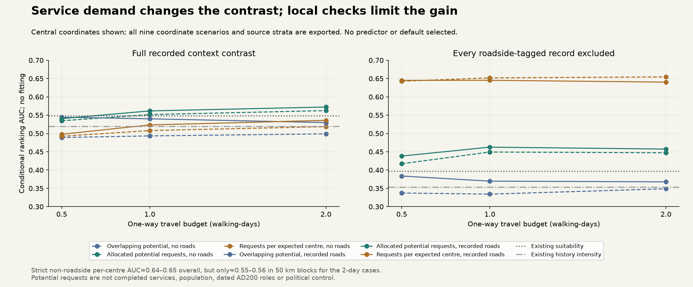
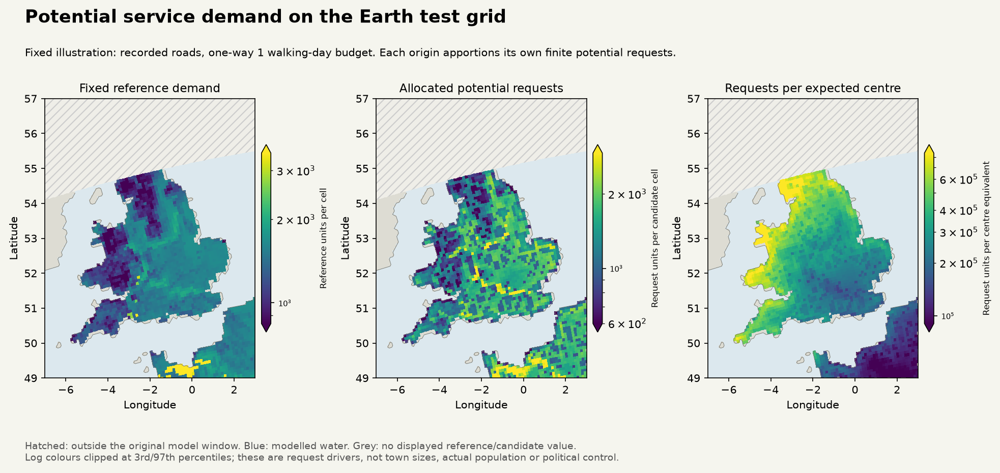

# Finite service-demand choices: implemented, but role gains are not yet robust

11 November 2026. A new mechanism divides a finite potential-request budget among
reachable candidate centres. It conserves each origin's requests, respects both
directed walking legs and distinguishes overlapping accessibility from allocation.
It creates no people, food, staff or completed services. **No production adoption.**

The non-roadside check changes the interpretation. Requests per expected centre
score about0.64–0.65 overall after excluding every roadside-tagged record, but
only0.55–0.56 in50km blocks for the two-day cases. Existing suitability scores
0.575 locally on that same subset. A headline improvement is therefore not yet
evidence for a better local role model. No predictor, coordinate case or default
is selected from these development outcomes.

## Literature and what is actually borrowed

[Bevan & Wilson2013](https://doi.org/10.1016/j.jas.2012.12.025), *Models of settlement
hierarchy based on partial evidence*, motivates spatial interaction with incomplete
archaeological evidence and realistic routes. [Huff1964](https://doi.org/10.1177/002224296402800307)
motivates normalized choice among competing destinations; [Hansen1959](https://doi.org/10.1080/01944365908978307)
provides the overlapping-accessibility comparator. Publisher metadata/available
abstracts were checked; access to some full texts was restricted. Our exponential
kernel, finite cutoff, fractional candidates and travel budgets are **declared
engineering scenarios**, not recovered ancient parameters or a replication of
those papers. No modern retail coefficients are transferred toAD200.

The [protocol](../calibration/settlement_service_demand_20261111/plan.json) was
committed at192c7eb3 before service fields or strict-subset scores were computed.
Earlier archive-context results were already exposed; these are conditional
development diagnostics, not independent transfer or calibrated probabilities.

## Mechanism and ledger contract

For origin i, D_i is the existing reference-density field times cell area, restricted
to the original allowed land. It is one potential request per reference-resident
equivalent, not an estimate of actual rural residents or completed transactions.
Candidate mass m_j is the unchanged L450 centre-intensity field times cell area,
globally summing to1292 expected centres. These are fractional opportunities,
not actual staffed places. Archive labels/positions never supply the candidates.

Both directed shortest walking legs must fit B. With mean leg duration t,
K_ji=exp(−t/(B/2)) inside the cutoff and0 otherwise. The experiment fixes B at
0.5/1/2 walking-days and compares no roads with recorded roads. Existing Tobler
edges use7walking hours, off-path factor.6 and road speed30km/day; both terrain
and return slopes matter. There are no boats, ferries, horses, generated roads,
seasonal closures or political travel walls. Terrain eta=1 is a dry annual
diagnostic scenario, not the full monthly transport model.

Choice normalizer Z_i=Σ_j m_j K_ji. An origin with Z_i>0 assigns
F_ji=D_i m_j K_ji/Z_i; otherwise its requests remain unallocated. The primitive
checks every origin budget and Σ_j A_j+unallocated=Σ_i D_i, where A_j=Σ_i F_ji.
The separate fields are:

* P_j=Σ_i D_i K_ji: overlapping accessible potential, **not additive supply**.
* A_j: allocated potential requests, with each origin apportioned once.
* A_j/m_j: requests per expected centre, **not town population or staff**.

`polity/service_demand.py` exposes normalized choices as well as allocations,
so a later consumer can use supported-resident demand and actual staffed centres
from the SAME population/food/staffing/control ledger. At present there is no
service-capacity, food-fulfilment or institutional-viability claim. Multiplying
all candidate masses by a constant leaves choice shares unchanged and changes
per-centre units; the centre count cannot be learned from this ranking contrast.

## Routes, computational scope and conservation checks

The fixed core is every model cell within49–57°N and7°W–3°E. It is not the archive's
observed site list. A halo of at least twice the maximum travel reach, plus two
cells, includes competing destinations for every core choice. All actual edge
speeds are checked against30km/day. Routes may pass through original non-allowed
land; the political polygon restricts reference demand/candidates, not travel.
Water and diagonal water-corner barriers remain in the existing walking graph.

Six request ledgers conserve the full crop demand to numerical precision. Crop
totals are not full-world totals. Exported core fields exclude halo values, so
summing the displayed maps is not a replacement for the full request ledger.
Independent checks use the FULL original Roman-window graph, both directed legs
and all candidate rivals, for18 deterministic centre/scenario cases. All agree
with the crop results. Original model-window boundaries remain a limitation.

The illustration fixes recorded roads and B=1 before choosing an outcome. Hatched
space is outside the original model window, not sea or absent settlement. These
are model drivers; no archive-site coordinates are plotted or redistributed.
The per-centre field's broad geographic gradient is one reason to retain local
checks rather than call its overall AUC a role-model improvement.

## Full and strict source contrasts

The unchanged [original context contrast](SETTLEMENT_ROLE_CONTRAST_20261111.md)
retains426 nucleated/2049 farm-villa records; central matched support is249/797
cell/class units, including155 mixed cells. The strict check removes EVERY
record carrying a roadside label, including co-tagged village/vicus records:
153 nucleated source records remain,147 are included centrally, representing97
positive units with45 mixed cells. Both subsets pass the declared30-unit gate.
No background land is a negative observation, and mixed cells remain tied units.

|Per-centre predictor|Full AUC|Strict AUC|Full50km-block mean|Strict50km-block mean|
|---|---:|---:|---:|---:|
|No roads,B2|.5186|.6546|.5197|.5479|
|Recorded roads,B2|.5358|.6403|.6083|.5585|
|Existing suitability reference|.5478|.3969|.6015|.5748|
|Existing history-intensity reference|.5190|.3538|.5859|.5462|

The full sample has63 blocks with both classes; the strict sample47, out of81
observed blocks. These means are diagnostics, not held-out validation. The strict
reference rankings reverse overall, so a geographical/opportunity-mass effect
could explain much of the apparent per-centre gain. We do not invert a predictor
after seeing this and call it a newly validated model.

Every combination of two road scenarios, three budgets and three service fields,
plus the three original references, is exported for both subsets and all nine
coordinate cases:378 AUCs. Region, original fieldwork-string and investigated-AREA
strata are retained, including undefined/null scores for single-class strata.
All27 previous reference AUCs replay exactly. Source selection, coarse9km cells,
unknown individual role dates and within-region heterogeneity remain explicit.

## Decision and next controls

Keep this primitive as experimental machinery; do not replace settlement roles
or control defaults. Next isolate candidate-opportunity assumptions with uniform,
environmental and historical masses, and compare zero-travel/local demand and
inverse-mass controls before attributing a gain to interaction. Keep spatial and
non-roadside checks, observation effort and date limitations. No requirement
that every region improve is introduced: the issue is interpreting what a score
measures, not imposing a regional veto.

Only qualified role allocations should feed actual supported settlements and the
shared resident/food/staff/institution/control consumers. Service requests cannot
become political authority directly. All actors and mobile/nonstate communities
remain in scope; the [full S1–S5 programme](SETTLEMENT_CONTROL_ROADMAP_20261110.md)
and the separate physics queue remain open.

Reproduce with `build_settlement_service_demand.py`,
`evaluate_settlement_service_demand.py`, `review_settlement_service_demand.py`,
then `plot_settlement_service_demand.py`. Inputs and private matched archive cache
must be present; public outputs contain model fields, aggregate scores and
provenance, not raw archive records. Original source collectors are not responsible
for this model's interpretation. No new climate/population estimate or world map
default was produced.

Verification after environment recovery:104 combined tests pass. All378 AUCs are
checked by direct pair comparison;6request ledgers,27exact prior references and
18 full-original-window route/rival checks pass. Fresh-output fields/manifest/
results/review reproduce byte for byte;13 prior numerical/source artifacts are
unchanged against56c9f3ff. Served-browser tests pass for8rows,2figures,6links,
byte-exact modelNPZ download, preserved source exposure and344/390px light/dark
layouts. Prior role panels and existing evidence filters/download/failure UI pass.
Full ZIP/site copy remains unbuilt under quota; packaging contains new assets.

Focused Windows-style checkout preserves 108 critical files byte for byte;
all 666 local page dependencies resolve. Standalone publication is idempotent.
