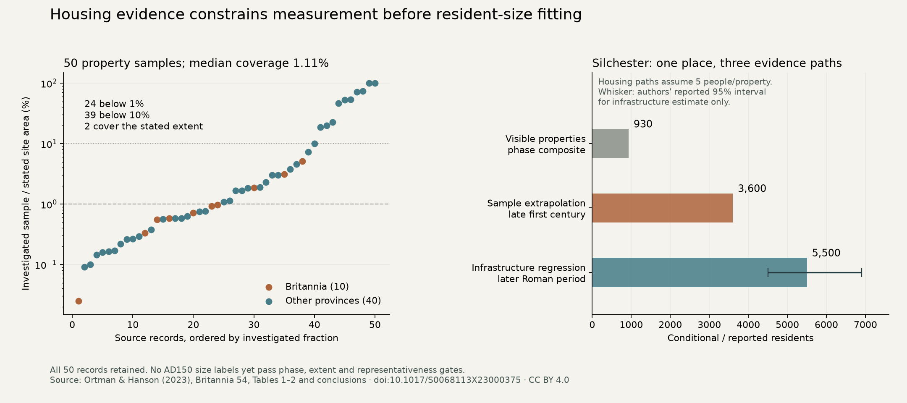

# Housing samples and resident-size measurement

The size-reference compiler now retains 50 housing samples from Ortman and
Hanson (2023), with an executable gate against treating them as dated censuses.
All 150 numeric source fields match the published PDF; independent decimal
arithmetic checks all 150 household scenarios. Eighteen focused checks pass,
and a fresh compilation reproduces the result bytes. No fantasy model is fitted
or scored, and no atlas default changes. The normal evidence panel passes nine
byte-exact local downloads/links, keyboard opening and mobile light/dark checks.
The Windows-style checkout preserves 1,695 assets and the standard launcher
verifies r44; the combined size/launcher/package checks pass all 23 tests.

The [preparation declaration](../calibration/settlement_size_evidence_20261112/plan.json)
was committed in 8745b931 before extraction. The original author-hosted 2017
paper link returned 404; its publisher PDF URL returned an HTML abstract page.
The original pinned city-workbook URL also returns 404. The
[source amendment](../calibration/settlement_size_evidence_20261112/source_access_amendment.json),
committed in fef3e9e8 before extraction, specifies the open 2023 source. Its PDF
identity is pinned. Its supplemental CSV returns 403 and is not represented as
recovered. Source-access failures do not justify substituting an unverified file.

## What was recovered

Ortman, S. and Hanson, J. (2023),
[*Estimating the ‘Missing’ Houses of Silchester*](https://doi.org/10.1017/S0068113X23000375),
Britannia 54:167–187, CC BY 4.0. Table 2, p174 supplies site area, investigated
area and encountered residential properties for 50 city keys, including ten in
Britannia. This is not the unrecovered original 52-case sample. The authors
explicitly identify the keys as those of Hanson's 2016 database, which supplies
stronger identity candidates than guessed name joins. The unavailable workbook
prevents certifying current city/date/area joins. No source coordinates are used.

The [transcribed table](../data/source/roman_housing_2023/table2.csv) and
[attribution and measurement notes](../data/source/roman_housing_2023/source.json)
are retained. Province spelling and all records are preserved. A reviewer compares
PDF text with the manual transcription, including every name, province and numeric
field; the rendered source page was also visually inspected. This verifies the
extraction rather than the underlying archaeological measurements.

The table contains 20,321 encountered properties. Sample area ranges from 0.025%
to 100% of the stated extent; the median is 1.1108%. Twenty-four samples cover
less than 1%, and 39 cover less than 10%. Two equal the stated site extent. These
are descriptive diagnostics, not residual-selected exclusions or certificates
that large samples are representative.

## Conditional estimates and year-specific gates

For a declared household scenario h, a reference is

`properties / investigated hectares × stated site hectares × h`.

The source discusses three to seven people per household, with five as the usual
assumption. All three scenarios are retained. Their spread is a sensitivity range,
not a 95% confidence interval, and each reference stays explicitly model-derived.
Investigated area is the denominator for sampled buildings; it cannot replace
whole-site area or itself be relabelled a population measurement.

The typed `HousingSample` refuses nonpositive/nonfinite inputs, fractional property
counts, sample area exceeding site area, reversed dates and overflow. A
year-specific calibration reference additionally requires a bounded sample phase,
explicit site representativeness and a contemporaneous extent. Catalogue-wide
occupation dates cannot certify these properties. An explicit source phase
exclusion takes precedence over any broader date span.

None of these 50 records yet clears all AD150 gates: 47 have unresolved sample
phases and three have explicitly incompatible reported phases. Calleva uses a late
first-century sample; Verulamium uses late third/fourth-century buildings;
Corinium uses fourth-century excavations. All 50 still lack an independently
certified representative sample and contemporaneous extent in this preparation.
This is an unresolved measurement problem, not evidence of zero inhabitants.
Relative phrases such as “post-Boudiccan” are retained without invented endpoints.



Silchester illustrates why separate evidence paths cannot be pooled as independent
resident observations. The visible-property inventory implies 930 people at five
per property; a small earlier housing sample extrapolates to 3,600 over a different
extent; a later infrastructure model reports about 5,500 with a reported interval
of 4,500–6,900. Detection, dates and extent differ. Their common place identity
must stay in one group in any later comparison.

## Whole-plan review and next work

This completes initial housing preparation and the measurement adapter. It does
not qualify resident sizes, rescue failed geographic transfer, validate institutional
roles or complete all-world diets. The existing finite population, rural-work and
grain feedback remains the consumer for any later qualified size requests.

The [whole roadmap](SETTLEMENT_CONTROL_ROADMAP_20261110.md) is reviewed after each
completed step. New dependencies are explicit phase/extent reconstruction,
observation selection and city-key joins before a year-specific fit. A separate
mixed-period housing diagnostic may be useful if its groups, baselines, metrics
and uncertainty treatment are declared before scoring; it cannot certify AD150
allocator sizes. Keep S1–S5, all actors, unaffiliated and mobile/nonstate communities,
complete resource/work integration and normal-atlas publication on the queue.

Reproduce:

```sh
.venv/bin/python -I scripts/prepare_settlement_sizes.py
.venv/bin/python -I scripts/review_settlement_sizes.py
.venv/bin/python -m pytest -q tests/test_settlement_size_evidence.py
.venv/bin/python -I scripts/plot_settlement_size_evidence.py
```

The independent PDF review requires the pinned local source PDF and `pdftotext`;
the compiler and prepared reference data do not require the unavailable workbook.

Follow-up: the separately declared [province-blocked density diagnostic](SETTLEMENT_HOUSING_DIAGNOSTIC_20261112.md)
now scores these exposed observations. The preparation above remains its historical
checkpoint; none of the year-specific measurement gates has been cleared.
