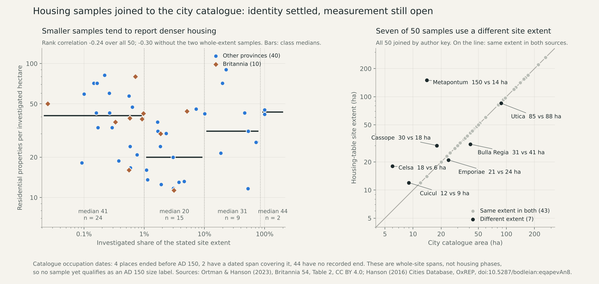

# Housing samples joined to the city catalogue

All 50 housing samples now join the pinned Hanson (2016) city catalogue by the
authors' own key. Identity is settled; measurement is not. No sample qualifies
as an AD 150 size label, no model is fitted or scored, and no atlas default
changes.

## Source recovery

The earlier address of the catalogue workbook still returns 404. The same
workbook is served from the project's older host,
`https://oxrep.classics.ox.ac.uk/oxrep/docs/Hanson2016/Hanson2016_CitiesDatabase_OxREP.xlsx`
(360,677 bytes). Its SHA-256, `5b9fc019…549b6c`, is exactly the hash pinned by
the earlier Roman count audit, which satisfies the parent rule to recover the
workbook only on an exact match. The copy deposited under the database DOI is a
different file (340,440 bytes) and was not opened. The original 2017 housing
table (52 cases) and the 2023 supplementary CSV remain unavailable.

The [declaration](../calibration/settlement_size_identity_20261112/plan.json)
was committed in 94e7266c before any workbook row was read. The first run
joined nothing, because catalogue keys are strings of the form
`Hanson2016_<n>` while the housing table prints bare integers. A
[key-format amendment](../calibration/settlement_size_identity_20261112/key_format_amendment.json)
was committed in 79bb070f before any joined row was read. It records that the
zero-join run had already printed the sampling correlations, which use only the
housing table and do not depend on the join.

Before joining, the recovered workbook had to reproduce the published counts of
the earlier audit, and it does: 1,388 cities, 885 with one positive area record
and 503 without; 1,354 in the AD 150 cohort, 862 with an area and 492 without.

## What the join shows

| Check | Result |
|---|---|
| Joined by author key | 50 of 50, one catalogue row each |
| Ancient name | 49 identical; Corinium is "Corinium Dobunnorum" in the catalogue |
| Province | 50 identical, including the catalogue's own spelling "Silicia" |
| Same place twice | none: 50 place groups |
| Site extent | 43 equal to the catalogue area, 7 different |
| Catalogue dates and AD 150 | 4 ended earlier, 2 dated spans cover it, 44 have no recorded end |
| Already exposed in the AD 150 development cohort | 46 |

The seven differing extents are Metapontum (150 ha in the housing table, 14 ha
in the catalogue), Celsa (18, 6), Cassope (30, 18), Cuicul (12, 9), Bulla Regia
(31, 41), Emporiae (21, 24) and Utica (85, 88). The housing table and the
catalogue therefore do not always describe the same extent, and a density
extrapolated over one cannot be compared with an area taken from the other.

Cassope, Morgantina, Herculaneum and Pompeii have catalogue end dates of 30 BC,
25 BC, AD 79 and AD 79. Their housing samples cannot describe AD 150. Glanum and
Cosa have dated spans that include AD 150. The other 44 have the text `NULL` as
an end date, which is a missing value and not evidence of occupation. Himera,
for example, carries a start of 700 BC and no end.

Catalogue dates describe a whole site. They are not housing phases, so they
clear no gate: all 50 samples keep their phase, representativeness and extent
blockers, and the three explicit phase exclusions (Calleva, Verulamium,
Corinium) stand. Equal areas certify only that two sources state the same
number.

The catalogue records the basis of each area: walls for 17 of the 50, inhabited
area for 14, an urban grid with or without walls for 15, and four other or
unspecified. A walled circuit and an inhabited area are different measurements.

## Sample selection

Property density, the number of residential properties per investigated
hectare, does not depend on the household assumption.

| Investigated share of stated extent | Samples | Median properties per ha | Range |
|---|---|---|---|
| Below 1% | 24 | 40.8 | 16.0–81.8 |
| 1% to below 10% | 15 | 20.0 | 11.3–45.7 |
| 10% to below 100% | 9 | 31.3 | 11.7–90.1 |
| Whole stated extent | 2 | 43.5 | 41.9–45.2 |

| Rank correlation of density with | All 50 | Without whole-extent (48) | Britannia (10) | Other provinces (40) |
|---|---|---|---|---|
| Investigated share | −0.24 (p 0.10) | −0.30 (p 0.04) | −0.16 (p 0.66) | −0.20 (p 0.21) |
| Stated site area | +0.36 (p 0.01) | +0.34 (p 0.02) | +0.01 (p 1.00) | +0.44 (p 0.005) |
| Investigated area | −0.21 (p 0.15) | −0.26 (p 0.07) | −0.58 (p 0.09) | −0.12 (p 0.47) |

The p values come from 20,000 fixed-seed shuffles and describe this selected
sample only. Twelve correlations were declared and all are shown; none is
corrected for multiple comparisons.

Two readings fit these numbers and the data cannot separate them. Larger sites
may truly be denser, as the source authors argue. Or small trenches may be dug
where housing is densest, and large sites are the ones sampled by small
trenches. Either way, the tendency of small samples to report denser housing
supports keeping the representativeness gate, as declared in advance. The
absence of a relationship in Britannia rests on ten samples.



## Review

The [reviewer](../scripts/review_settlement_size_identity.py) reads the workbook
XML directly, without the producer's spreadsheet library. It recomputes the
recovery counts, every join class for all 50 rows, the four class summaries and
all twelve correlations with its own rank routine. It also compares the twelve
Cities fields of the 50 keys with a separately exported CSV from the same host
(SHA-256 `5df8a1b9…97081`): all 600 fields agree. A fresh producer run
reproduces the result bytes, and 30 focused tests pass.

The reviewer verifies reading, joining and arithmetic. It does not certify the
archaeological measurements, phases or extents.

The archive record carries Oxford University Research Archive terms of use. The
workbook and CSV stay in the local cache; the published result holds only the
joined fields of these 50 records and aggregate counts.

## Whole-plan review and next work

This closes roadmap step 4 for identity: later comparisons can keep repeated
estimates for one place in one group through `place_groups`. It does not
qualify resident sizes, repair the failed geographic transfer or complete
release 2.

Two dependencies are new. A sample from a place that had ended before the
comparison year should be refused outright rather than left as "unresolved";
that needs its own declared rule. And any use of catalogue areas as size
references must state which extent basis it accepts.

The catalogue is now available again, so a size comparison no longer depends on
the housing samples alone. The next step is to declare, before any score, how
conditional size references built from catalogue areas would be compared with
the allocator's town-resident distribution: groups, baselines, metrics,
exclusions and what would count as support. S1–S5, all actors, mobile and
nonstate communities, complete diets and work, and normal-atlas publication
remain on the [live queue](SETTLEMENT_CONTROL_ROADMAP_20261110.md).

Reproduce (the cached workbook and CSV are required):

```sh
.venv/bin/python -I scripts/join_settlement_size_identity.py
.venv/bin/python -I scripts/review_settlement_size_identity.py
.venv/bin/python -I scripts/replay_settlement_size_identity.py
.venv/bin/python -m pytest -q tests/test_settlement_size_identity.py
.venv/bin/python -I scripts/plot_settlement_size_identity.py
```
