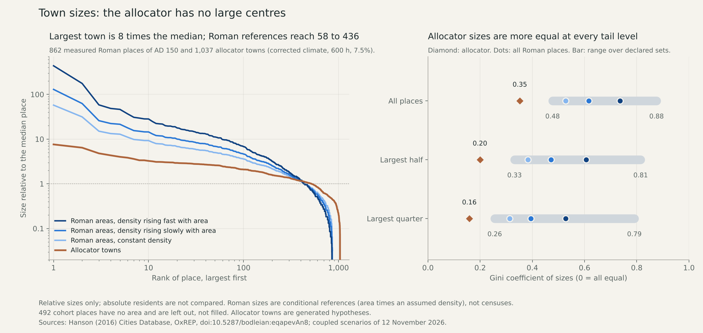

# Town-size shape: the allocator has no large centres

The coupled allocator's town sizes are more equal than every conditional Roman
reference, at every declared tail level and in both climates. This is a
development diagnostic of relative sizes on exposed evidence. Nothing is fitted
or adopted, and no absolute resident number is compared.

The [declaration](../calibration/settlement_size_shape_20261112/plan.json) was
committed in e52e6d89 before any metric was computed. It recorded in advance the
expectation that the allocator would be more equal, the support rule and what
each outcome would mean.

## What is compared

**Roman references.** The AD 150 cohort of the Hanson (2016) catalogue holds
1,354 places; 862 have one positive area record. A conditional size is area
times an assumed density, with density constant or rising with area as
area^0.2 or area^0.5. Those two exponents are the bounds implied by settlement
scaling theory and are not fitted here. Household size and the density constant
cancel in every metric. The 492 places without an area are left out, not filled.

**Allocator.** Positive town residents (civilian plus staff) in the eight
coupled scenarios of 12 November: 950 to 1,037 towns per scenario. These towns
are generated hypotheses.

A new date gate refuses places that had ended or were not yet founded in the
comparison year and flags an unrecorded end. It refuses 22 ended and 12
unfounded catalogue places, and the four ended housing places (Cassope,
Herculaneum, Morgantina, Pompeii). 1,338 of the 1,354 cohort places have no
recorded end.

## Result

Corrected climate, 600 hours, 7.5% transfer, against all 862 measured places:

| Metric | Allocator | Constant density | Density ~ area^0.2 | Density ~ area^0.5 |
|---|---|---|---|---|
| Gini coefficient | 0.35 | 0.53 | 0.62 | 0.74 |
| Share held by the largest 1% of places | 4% | 11% | 17% | 29% |
| Share held by the largest 10% | 25% | 40% | 48% | 62% |
| Standard deviation of log10 size | 0.32 | 0.44 | 0.53 | 0.67 |
| Largest place over the median | 7.6 | 58 | 129 | 436 |
| Rank-size slope, largest 100 | −0.22 | −0.45 | −0.54 | −0.67 |

The declared support rule uses the Gini coefficient and the log standard
deviation at three tail levels, against the range over all declared Roman sets
and density scenarios:

| Places compared | Allocator Gini (raw / corrected) | Roman range | Allocator log sd (raw / corrected) | Roman range |
|---|---|---|---|---|
| All | 0.36 / 0.35 | 0.48–0.88 | 0.32 / 0.32 | 0.41–0.76 |
| Largest half | 0.21 / 0.20 | 0.33–0.81 | 0.16 / 0.15 | 0.24–0.48 |
| Largest quarter | 0.17 / 0.16 | 0.26–0.79 | 0.12 / 0.12 | 0.19–0.49 |

All twelve checks fall below the Roman range, so the declared conclusion is
"allocator more equal than every reference". The allocator's value is 60–79% of
the lowest Roman value.



The result does not depend on the scenario. Across all eight cases the
allocator's Gini lies between 0.35 and 0.37. The frozen-rural references give
0.35–0.40. The civilian requests before the finite budget are flatter still, at
0.20: the largest request is under three times the median. The flatness is
therefore already in what towns ask for, not introduced by the food and labour
ledger.

Among Roman sets, the lowest values come from places measured by inhabited area
at constant density (Gini 0.48) and the highest from the 86 places with other or
unspecified bases, which include the 1,783 ha maximum (Gini up to 0.88).
Resampling the 862 places gives a Gini range of 0.49–0.57 at constant density.
That range shows sensitivity to which places are listed; it is not a confidence
interval for the historical value.

## Limits

- Catalogue areas mix walls (382), inhabited areas (228), urban grids (166) and
  other bases (86). A walled circuit is not an inhabited area.
- Measurement is uneven: all 14 places of the top map rank have an area, against
  502 of 791 at the third rank and 194 of 368 at the fourth or fifth. Missing
  small places would most likely raise Roman inequality, so the gap is unlikely
  to be an artefact of the omission; this is not tested.
- The catalogue lists places with urban characteristics; the allocator keeps
  every supported town down to 100 residents. The tail-matched rows address this
  only in part.
- One empire at one date is not a universal target, and the fantasy world is not
  required to match Rome. The finding is that the allocator cannot produce a
  hierarchy of this kind at all.
- The housing samples give a log density on log area slope of 0.27 across 50
  selected, mixed-period samples. It is quoted for context and defines no
  scenario.

## Review

The [reviewer](../scripts/review_settlement_size_shape.py) rebuilds the cohort
and basis groups from the workbook XML, recomputes 63 Roman metric sets with a
pairwise Gini, reproduces 378 resampling ranges from the declared seed with a
Lorenz-curve Gini, recomputes 78 allocator and request sets, and re-derives the
reference range and the conclusion. A fresh producer run is byte exact. Fifteen
analytic tests cover the metrics and gates.

## Whole-plan review and next work

As fixed in advance, the outcome is recorded as a missing size mechanism and no
parameter is tuned. Raising the transfer share scales every town alike and
cannot change these metrics; the three shares tested give the same Gini.

The mechanism that sets relative sizes is the civilian request, which is nearly
flat. Three candidate dependencies now sit explicitly on the queue before any
size fit: a market hierarchy in which higher-order centres draw on lower-order
ones (S2), supply of large centres from beyond one local catchment (S4), and
concentration of administrative residents at seats (S3). Each needs its own
declared mechanism test against the same metrics, with the finite people, food
and work ledger kept as the constraint.

Release 2 remains open. Absolute sizes, urban share, dated occupancy, the failed
geographic transfer, complete diets and work, and mobile and nonstate
communities are unchanged on the [live queue](SETTLEMENT_CONTROL_ROADMAP_20261110.md).

Reproduce (the cached workbook is required):

```sh
.venv/bin/python -I scripts/compare_settlement_size_shape.py
.venv/bin/python -I scripts/review_settlement_size_shape.py
.venv/bin/python -I scripts/replay_settlement_size_shape.py
.venv/bin/python -m pytest -q tests/test_settlement_size_shape.py
.venv/bin/python -I scripts/plot_settlement_size_shape.py
```
