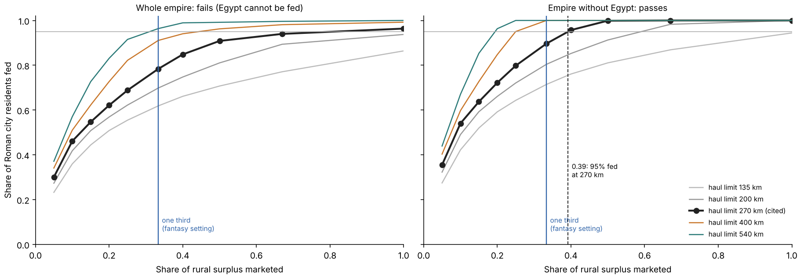

# Earth calibration of grain supply: real harvests and the seasonal freight network

**Outcome.** The grain supply model now runs on the Roman Empire with the same
production, network and allocation code as the fantasy map.

- **Whole empire: fails.** Egypt cannot be fed in the model, so the east never
  reaches 95% and west and east disagree.
- **Empire without Egypt: passes its declared rules.** The cited 270 km haulage
  limit is confirmed, the setting transfers between west and east, and 95% of
  city residents are fed at a marketed share of **0.39**.
- **Fantasy map:** the owner adopted the fitted share 0.3923 in commit `7d9e418a`.
  The current headline is 91% fed, with 850 self-fed towns, 174 supplied by
  imports and 29 short. The previous one-third scenario was 85% fed.
- **Open upstream problem:** the harvest model gives Egypt about half its
  historical output. A delta rule was added and is not enough.

Protocol: [plan and amendments](../calibration/settlement_supply_calibration_20261113/plan.json).
The original plan preceded all output; amendments A1 and A2 followed results and
say what was known.



## What was rebuilt

The inputs the pilot lacked are back, from public sources: WorldClim climate,
ETOPO relief, Natural Earth rivers and NCEP winds. Three recorded hashes match
(elevation, rivers, arable shares). The Earth harvest grid is a rebuild, not the
lost file: it reproduces the committed Roman people field to 0.35% in total.

## Earth and fantasy production agree

| | Roman Empire | Fantasy world |
|---|---:|---:|
| Rural surplus per rural resident (person-years of grain) | 2.15 | 2.2 |
| Grown as a share of cereal potential (600 field hours) | 57% | 53% |
| Urban share of people | 16.8% | 25.5% |

## 1. Whole empire (original declaration): fails

| Haul limit (road-km) | Fed at one third | Share needed for 95%: all | west | east |
|---:|---:|---:|---:|---:|
| 200 | 70% | not reached | 0.62 | not reached |
| **270 (cited)** | **78%** | 0.81 | 0.38 | not reached |
| 400 | 91% | 0.44 | 0.22 | 0.57 |
| 540 | 96% | 0.31 | 0.14 | 0.35 |

West/east agreement is best at the edge of the grid and still off by a factor
2.5; the western setting feeds only 53% of eastern residents.

**Cause: Egypt.** At 270 km and one third, Egyptian cities are 22% fed, Greece
and the Balkans 71%, Italy 84%, Asia Minor 94%, the Levant 99%, the north-west
100%. Egypt was the empire's granary; in the model it has a capacity of 2.3 M
people and about 1 M inhabitants, against 4.5–5 M historically.

## 2. Delta irrigation added to the Earth build (amendment A1): not enough

The fantasy map irrigates land inside a river's delta fan; the Earth build did
not. Applying the same rule on Earth with the observed delta areas (465 deltas
in the window) doubles the irrigated area of the Nile delta but lifts Egypt only
to 2.8 M. The model irrigates about 14,500 km² in Egypt; roughly 25,000 km² were
cultivated. The calibration is unchanged (79% fed at 270 km and one third).

Other regions barely move (North China Plain 34.06 → 34.12 M), so the option is
harmless but does not solve the problem. It is off by default
(`--deltas observed`); no committed Earth input changed.

## 3. Empire without Egypt (amendment A2): passes

Egyptian cities and land are removed from both demand and supply. This is not
blind: a post-hoc score had already shown the direction. It also deprives Rome
of Egyptian grain, which makes the test harder for the importers.

| Haul limit | Fed at one third | Share needed for 95%: all | west | east |
|---:|---:|---:|---:|---:|
| 200 | 80% | 0.59 | 0.60 | 0.57 |
| **270 (cited)** | **90%** | **0.39** | 0.37 | 0.42 |
| 400 | 100% | 0.25 | 0.22 | 0.29 |
| 540 | 100% | 0.19 | 0.14 | 0.21 |

| Declared rule | Result |
|---|---|
| West/east agreement at the cited 270 km within a factor 1.25 | 1.11: **cited limit kept** |
| Western setting feeds ≥ 90% of eastern residents | 92% |
| Eastern setting feeds ≥ 90% of western residents | 98% |
| Fantasy one third between the 95% share and twice it | below it (0.33 < 0.39): **"low"** |

1,030 city cells, 7.7 M residents, 14.6% urban. Rome is fully fed from a
marketed share of 0.5 and 65% fed at one third.

## What this means for the fantasy map

| Fantasy headline (sliding sizes, 270 km) | Residents fed | Towns short |
|---|---:|---:|
| One third marketed (previous) | 85% | 41 |
| 0.3923 marketed (Earth value, adopted) | 91% | 29 |

The owner adopted the Earth-supported share 0.3923; the cited 270 km haul limit
is retained. These fantasy outputs are published. The Egypt failure and the
limits of the without-Egypt calibration remain unchanged.

## Limits

- One pool, already used in development, with an internal west/east check. Han
  China has no city sizes and cannot test this.
- The passing variant excludes the empire's largest grain exporter and was
  declared after a post-hoc look.
- The least-work rule picks barley on every Earth cell; Roman farming was
  wheat-heavy.
- City sizes are areas times a density reading; 600 field hours covers listed
  field tasks only.
- No state grain fleet, no other foods, no shipping capacity.

## Next step

A flood-basin irrigation rule for desert rivers in the harvest model, fitted and
tested on Earth (Nile, Mesopotamia, Indus), then this calibration rerun on the
whole empire. That is upstream work and would also change the fantasy map's
harvests along desert rivers.

## Reproduce

```sh
# public inputs: WorldClim 2.1 5m (tavg,tmax,tmin,prec,elev), Natural Earth rivers, NCEP 1981-2010 surface winds
.venv/bin/python -I scripts/arable_slope_earth.py
.venv/bin/python -I scripts/land_people_earth.py --out output/land_people/earth   # then: git checkout output/land_people/earth/regions.json
.venv/bin/python -I scripts/land_people_earth.py --out output/land_people/earth_deltas --deltas observed
.venv/bin/python -I scripts/settlement_supply_calibration.py
.venv/bin/python -I scripts/settlement_supply_calibration.py --out output/settlement_supply_calibration_20261113/without_egypt --without-egypt
.venv/bin/python -I scripts/review_settlement_supply_calibration.py [without_egypt]
```

The review recomputes production, the whole fed-share surface, the thresholds
and the decision rules for the whole-empire and without-Egypt runs; both pass.
Fresh runs reproduce both byte for byte. The three delta-grid runs are recorded
but not separately reviewed.
