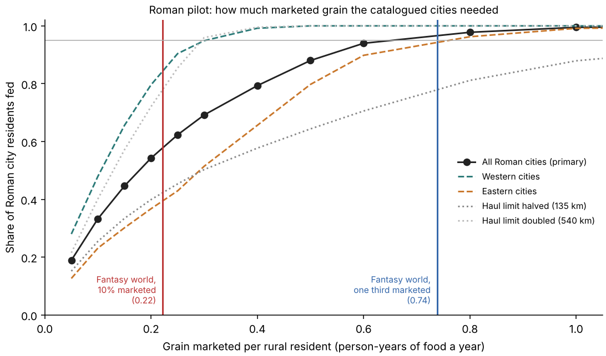

# Towards an Earth calibration of grain supply: a Roman pilot

**Outcome.** The catalogued Roman cities give a usable Earth test of the grain
supply model. In a first pilot, feeding 95% of their residents needs about 0.6
to 0.8 person-years of grain marketed per rural resident. The fantasy world
markets 0.74 at one third of surplus and 0.22 at 10%. The pilot therefore
supports the one-third level and rules out 10%, which would feed only about 57%
of Roman city residents. The result depends strongly on the assumed haulage
limit and differs between west and east, so it is a pilot, not a calibration.

Protocol: [plan](../calibration/settlement_supply_earth_20261113/plan.json),
committed before any output.



## The idea

The Roman cities existed and were fed. Run the same supply code on the Roman
window and ask how much marketed grain the model needs before it can feed them.
That amount is a lower bound for any world meant to hold Roman-like cities.

This checkout has Roman city sizes, model people per cell, roads, rivers and
coasts, but no harvests or labour data. So the pilot cannot separate yield,
labour and the marketed share. It estimates their product, **m**: person-years
of grain marketed per rural resident a year, assuming marketed grain is
proportional to rural people. The fantasy ledgers give the same quantity.

## Results

| Case | m for 50% fed | m for 95% fed | West / east m for 95% |
|---|---:|---:|---:|
| **Primary** (1,085 city cells, 9.1 M residents, 16.8% urban) | 0.2 | 0.8 | 0.4 / 0.8 |
| Off-road cost 1.5× or 3× road | 0.2 | 0.8 | 0.3–0.4 / 0.8 |
| Haulage limit halved (135 km) | 0.3 | 1.5 | 0.8 / not reached |
| Haulage limit doubled (540 km) | 0.15 | 0.3 | 0.2 / 0.4 |
| Cities without an area left out | 0.2 | 0.6 | 0.3 / 0.8 |

m is read on a coarse grid (0.05 … 1.5); at m = 0.6 the primary case feeds 94%.

- **Rome itself** is fed once m reaches about 0.25–0.3: it draws on the whole
  Mediterranean by sea.
- **What is hard to feed is the inland and eastern cities**, not Rome.
- **Fantasy against Earth.** At m = 0.74 the Roman cities are 97% fed; the
  fantasy towns, with a higher urban share (25.5% against 16.8%), are 85% fed.

## What this does and does not establish

- **Supports:** the order of magnitude of marketed grain. One third of surplus
  is in the range Roman cities required; 10% is not.
- **Does not pin down:** the haulage limit. Halving or doubling it moves the
  answer by a factor of five. The 270 km figure stays a cited assumption.
- **Weak transfer:** the west needs half the grain the east does. A calibrated
  method should not show that.
- **Proxy production:** grain is taken as proportional to rural people. Real
  yields vary (Egypt, Africa), which is probably why the east looks hard.
- **Static network:** no winds, seasons or closed seas, unlike the fantasy one.
- Both the cities and the people model are already-used development data.

## What a real calibration needs

1. Earth cereal potential and field labour on this grid (the missing global
   cache `output/land_people/earth/earth.npz`), to replace the proxy and
   estimate the marketed share itself.
2. The seasonal sea and river network on the Roman window (monthly winds).
3. Then fit the haulage limit and the marketed share jointly on one half of the
   empire and test on the other, and on the Han pool for transfer.

The code path is ready: `scripts/settlement_supply_earth.py` uses the same
`polity/wide_supply.py` functions as the fantasy scenario, so better inputs drop in.

## Reproduce

```sh
.venv/bin/python -I scripts/settlement_supply_earth.py
.venv/bin/python -I scripts/review_settlement_supply_earth.py
```

The review recomputes shortest paths for sample cities with its own routine,
the demand and supply totals, and the whole fed-share curve; it passes. A fresh
run reproduces the results byte for byte.
