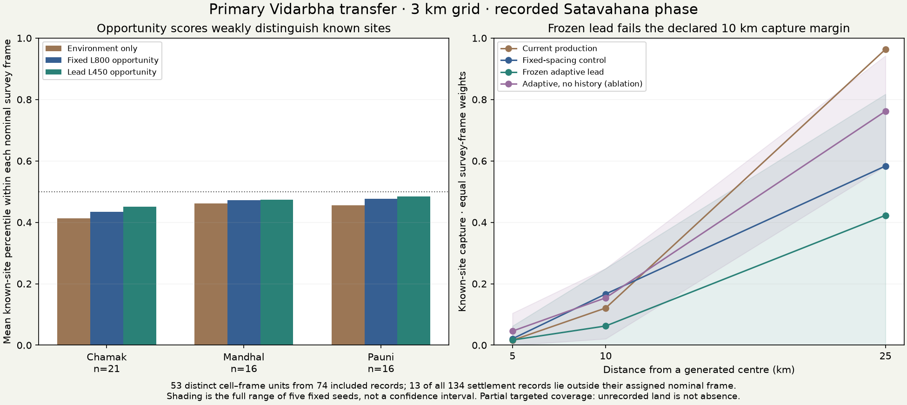
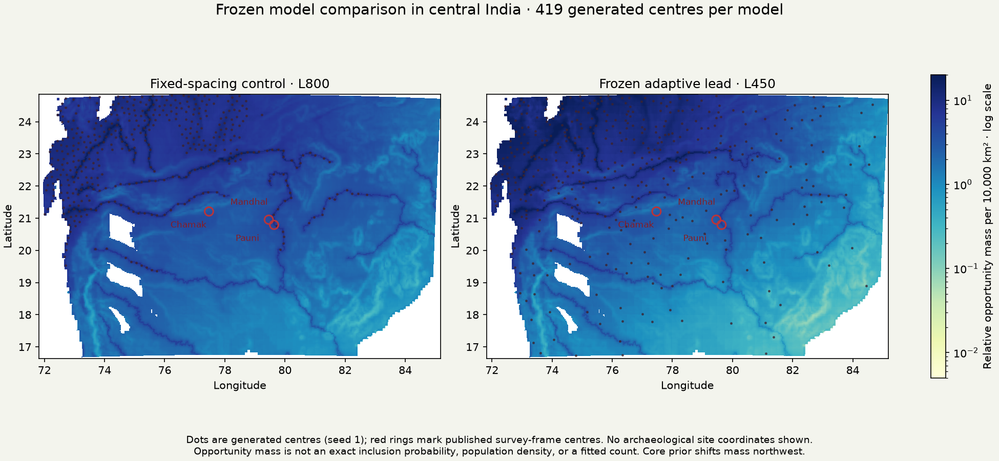

# Frozen settlement placement: Vidarbha geographic transfer

The frozen adaptive candidate **does not pass** the declared geographic diagnostic.
Its local opportunity ranks improve slightly, but its generated centres capture
fewer recorded sites within 10 km than the selected fixed-spacing control. No
fantasy settlements, population totals, tracks, institutional staffing or control
defaults change on the strength of this result.

## Source and comparison

Abbas, Toraskar and Hawkes (2020), *The Archaeology of Vidarbha, Maharashtra:
2016 Regional Survey Data*, [Zenodo v2, DOI 10.5281/zenodo.3670055](https://doi.org/10.5281/zenodo.3670055),
CC BY 4.0. Methods: Hawkes, Abbas and Toraskar (2020),
[*Multi-Period Regional Survey Data from Vidarbha, Maharashtra, India*](https://doi.org/10.5334/joad.61).
See [the source preparation](VIDARBHA_SURVEY_20261111.md) for exact joins and limits.
This is a different primary field survey from the previously rejected literature
catalogue; its usable coordinates do not repair that older source.

The comparison rules were committed in `d0c65f94` before regional environmental
lookup or prediction scores. The lead and fixed-spacing control were selected
from previously exposed Han/Roman development results. Upstream Earth predictors
and prior India city comparisons were already exposed; this is prospective for
the frozen placement-parameter comparison, not globally blind validation of the
entire population model. This survey is now spent for further tuning.

The targeted three 13 km radius frames covered about 7.5% of their nominal areas.
The observations therefore support conditional known-site diagnostics, not a
complete census or absence labels. Of 134 exact settlement joins, 121 lie inside
their assigned nominal frame; 13 are retained as exclusions, never reassigned to
a neighbouring frame. Of 82 recorded EH-S/Satavahana phase records, 74 remain
inside their frame and become 53 distinct cell–frame units on the primary 3 km
grid. Broad phase compatibility does not establish exact continuous AD 200
occupation, city status, or administrative function.

## Results of the frozen test

| Primary 3 km / EH-S / central coordinates | Fixed L800 control | Adaptive L450 lead |
|---|---:|---:|
| Mean within-frame opportunity percentile, equal frame weights | 0.4610 | 0.4698 |
| Known-site capture within 10 km, equal frame weights | 16.67% | 6.25% |

The lead capture is the mean of all five declared seeds; the control is the
declared deterministic placement. The capture change is **−10.42 percentage
points**, just beyond the predeclared −10 point engineering tolerance. The rank
change is +0.0088, within its declared tolerance. Support passes (53 units, all
three frames have at least eight). All 24 count/eligibility/uniqueness/spacing
checks pass. A code-review pass is separate from a model passing the diagnostic.
These tolerances are not statistical confidence bounds or significance tests.

Both grids use identical common inputs across alternatives. Natural current-model
budgets are 419 centres at 3 km and 375 at 9 km; observed survey counts never set
these budgets. All three cohorts, nine coordinate offsets, five candidate seeds,
no-history ablation, and the secondary 9 km check remain in the results. No best
offset, cohort, seed or grid is selected. The 9 km grid has only 4–6 land-cell
centres per frame, so its local ranks are particularly coarse.

The global density/occupation, WorldClim elevation, Natural Earth rivers and
existing core-travel prior remain unchanged. Roads are zero because an ancient
road layer is unavailable here. Common global annual aridity replaces the old
window monthly resampling and is explicitly a transfer-input limitation. A 3 km
grid does not supply 3 km observed climate; the frozen scorer also smooths by one
cell, so physical smoothing differs between grids. Finite nearest elevation
defines land, bilinear elevation defines terrain, and nearest matching is to the
full grid before land/eligibility checks. No coastal rescue or source anchors.

## What this changes in the plan

Earth reference preparation and the first regional comparison are now concrete.
The candidate cannot be called geographically qualified. Opportunity ranks near
the middle of the local reference distributions and the weak capture results
also argue against simply declaring the older control accurate.

Next, keep counts and settlement roles separate from locations: the Han-derived
administrative-centre budget is not a rural-site census. Audit count and resident
size evidence on existing exposed Earth pools, and compare the point allocator
with the underlying opportunity field at multiple scales. Any use of Vidarbha
to change the core prior or spacing is development, not another fresh holdout.
Population/count fitting, the shared-budget fantasy rebuild and normal atlas
publication remain the next release milestones. Detailed institutional roles,
all actors, mobile populations and nonstate communities remain on the full roadmap.

## Reproduction and review

Run `scripts/settlement_vidarbha_transfer.py`, then
`scripts/review_settlement_vidarbha_transfer.py`. The review independently reads
the source CSVs, checks 2,412 full-grid point matches using direct spherical
comparisons and a separate projection implementation, reconstructs 7,290 scalar
metrics and all 24 placement constraints. Parent artifacts retain their hashes.
A fresh replay checks numerical NPZ identities and byte-exact result JSON.
Raw third-party rows, site identifiers and coordinates remain in the private
cache; public maps and NPZ fields contain model inputs/outputs only.
