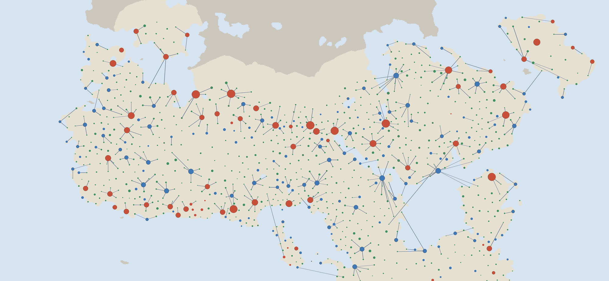

# Wider grain supply for the release-3 towns

**Outcome.** When grain is allowed to travel, 987 of the 1,053 release-3 towns
can be fully fed at the ledgers' existing 10% grain extraction. The 66 largest
cities cannot: they hold 6.5 M of the 13.6 M town residents, and the capital is
only 23% fed. At one-third extraction every town is fed. This is a declared
scenario on the atlas's existing freight costs; nothing is fitted to Earth.

Protocol: [plan](../calibration/settlement_wide_supply_20261113/plan.json),
committed before any output.



Green: fed by its own freight hinterland. Blue: fed with shipments from other
towns. Red: still short. Lines: the 400 largest shipments.

## Results (corrected climate; raw is within a point)

| Town sizes | Surplus marketed | Own hinterland | With imports | Short | Residents fed |
|---|---|---:|---:|---:|---:|
| **Sliding density (headline)** | **10%** | **816** | **171** | **66** | **73%** |
| Sliding density | 33% | 981 | 72 | 0 | 100% |
| Flat 100/ha | 10% | 925 | 128 | 0 | 100% |
| Flat 100/ha | 33% | 1,047 | 6 | 0 | 100% |

Grain ledger for the headline case, in person-years of food: 20.0 M marketed;
3.3 M never leaves cells beyond any town's reach; 6.5 M is consumed by
transport; 10.0 M is eaten in towns; 0.3 M is excess nobody can use. The ledger
closes exactly.

- **What limits the big cities is the 10% share, not distance.** Marketed grain
  (20 M) only modestly exceeds what towns need (13.6 M), and a third of it is
  spent on carriage. The short towns have a median of 90,000 residents.
- **Most towns need no imports.** The freight hinterland (up to 270 road-km
  equivalents, much farther by river or sea) feeds 816 towns, against about 250
  for the earlier one-day foot collection.
- **Exporters are small towns in rich country**, shipping up to 48,000
  person-years each to a nearby city.
- 86% of land lies within grain-carrying reach of some town.

## How it works

1. **Grain available.** Each cell markets 10% of its cereal potential above what
   its remaining rural people eat (the fraction the published ledgers use).
2. **Transport is paid in grain.** A path costing c road-km equivalents delivers
   1 − c/270. The 270 km is the atlas's existing figure for road haulage eating a
   staple's whole value (Duncan-Jones 1982). Sea, downstream river and road cost
   1 : 5 : 28 per km (Diocletian's Price Edict). Costs come from the seasonal
   freight network, rebuilt on the release-3 towns and tracks, averaged over four
   trade months.
3. **Hinterland.** Every cell sends its grain to the town it reaches most cheaply.
4. **Between towns.** Towns with excess ship to towns in need, cheapest link
   first. Imported grain is not shipped on.

## What changed in the atlas

- Two new Settlements options: grain supply at 10% and at one third.
- On the default settlement maps the white centre now means "fed, including
  grain shipped in" (10% case). Town sizes are unchanged.

## Limits

- **Not an Earth test.** No Earth pool in this checkout has both harvests and a
  freight network, so the scenario could not be fitted or checked against real
  cities. The roadmap's earlier checks that the food budget feeds 94–99% of real
  Chinese and Roman seats used the local-collection rule, not this one.
- **The extraction share decides the answer** and is an assumption. 10% is the
  existing ledger value; one third is the order of rents plus taxes in agrarian
  empires. No source here pins it down.
- The shipment plan is feasible, not optimal: a different order could feed
  slightly more.
- Wheat and barley only. No fish, livestock, other crops, prices, shipping
  capacity, storage through the year, or state grain fleets.
- Independent review recomputes the allocation and ledgers, not the freight
  costs, which come from the atlas network.

## Decision this leaves

Feeding calibrated residents into the reach chain now has a food model to stand
on, but the outcome depends on the extraction share: at 10% the 66 largest
cities would be cut to roughly a quarter to a half of their size; at one third
nothing is cut. The flat-density sizes are fed either way.

## Reproduce

```sh
.venv/bin/python -I scripts/build_wide_supply_release3.py
.venv/bin/python -I scripts/review_wide_supply_release3.py
.venv/bin/python -I scripts/publish_wide_supply_release3.py
python3 -m http.server 8766 & node scripts/check_wide_supply_release3_browser.js output/settlement_wide_supply_20261113/browser
```

Review passes on all 8 scenario-climate cases; a fresh build reproduces every
output byte for byte; the browser check passes 8 cases.
