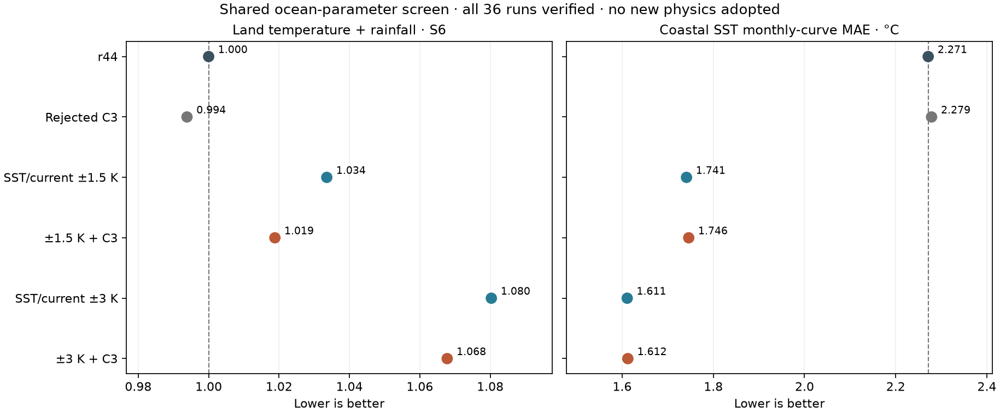

# Shared SST/current screen — 9 November 2026

**Result:** all four new directions improve the coastal SST diagnostic but worsen the combined land
temperature/rainfall score. None advances as an improvement; r44 remains adopted.

The frozen plan is `calibration/shared_sst_screen_20261109/plan.json` (commit 4fba2f09 before runs).
Six configurations × six already-seen regions = 36 verified runs. Fresh r44/C3 baselines use the same
code, observations and geometry. Actual case hashes match across configurations, and an automated check
allows changes only to SST offset/current strength and the three predeclared C3 exchange settings.

The four directions raise the existing global SST offset by 1.5 or 3 K and reduce current-anomaly strength
by the same amount, with either r44 exchange or rejected C3 exchange. These are shared phenomenological
response parameters, not a resolved ocean heat budget. There are no regional knobs, observed-SST/wind
substitutions, or changes to Earth's orbital/radiative forcing, terrain or numerical tolerances.

| Configuration | Land T MAE, °C | Rain loss | S6 | Coastal SST curve MAE, °C | Marine-air curve MAE, °C |
|---|---:|---:|---:|---:|---:|
| r44 | 1.6836 | 0.42662 | 1.0000 | 2.271 | 1.621 |
| Rejected C3 | 1.7071 | 0.41543 | 0.9938 | 2.279 | 1.639 |
| Offset +1.5, current −1.5 | 1.7392 | 0.44119 | 1.0336 | 1.741 | 1.665 |
| Same + C3 | 1.7349 | 0.42969 | 1.0188 | 1.746 | 1.563 |
| Offset +3, current −3 | 1.9097 | 0.43787 | 1.0803 | 1.611 | 2.080 |
| Same + C3 | 1.9034 | 0.42875 | 1.0678 | 1.612 | 1.974 |

S6 = 0.5 × mean(T MAE)/r44 + 0.5 × mean(canonical rain loss)/r44, with equal region weights.
Marine metrics are MAE of regional coastal-sea monthly mean curves; they are not per-pixel errors or
observed fluxes. The six regions are Levant, Japan, Korea and spent-h Top End, New Guinea, Ivory Coast.
Reference periods, levels, coarse coastal interpolation and hemisphere conventions are described in
[the exchange audit](AIR_SEA_AUDIT_20261109.md).

The SST metric improves 23–29%, but S6 worsens 1.9–8.0%. C3's slightly better aggregate S6 does not pass
the declared screen because its temperature component worsens 1.4% (the limit is 1%). Its actual earlier
independent test also failed. This is not an every-region veto: the four new directions fail the aggregate
score itself. A dramatic Top End improvement does not cancel the larger new errors elsewhere.

## What this says about local minima

This is a coordinated parameter screen, not an optimization from multiple starts, and cannot prove r44
globally optimal. It shows that changing only the sea parameters and exchange switches is insufficient in
these directions. Land responses were fitted around the existing sea; correcting one part exposes the
compensation in another. A physically motivated start can have a worse initial land score and still merit
a joint refit; it cannot be published as an accuracy gain on these results.

The next search should refit shared ocean and land responses together from dispersed starts, including r44
and the +1.5/C3 profile. The latter improves both marine diagnostics while starting 1.9% worse on S6. Use
the existing v3 aggregate policy, not the obsolete per-group penalties in the old maritime-refit plan.
Evaluate broadly rather than optimizing only these six selected coasts, report marine adequacy separately,
keep forcing/numerical checks fixed, then require finer-grid and a separately declared independent milestone.
No new blind pool, correction retraining, atlas climate replacement or adoption occurs in this screen.

All results and the comparison are in `output/shared_sst_screen_20261109`; the normal launcher serves
the figures under Climate accuracy and joint fit. The actual r44/v2.2 atlas climate remains unchanged.
