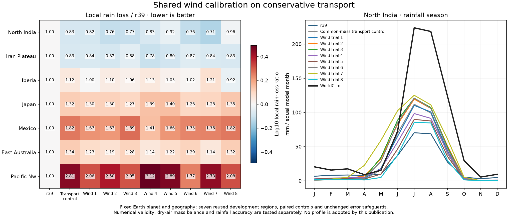
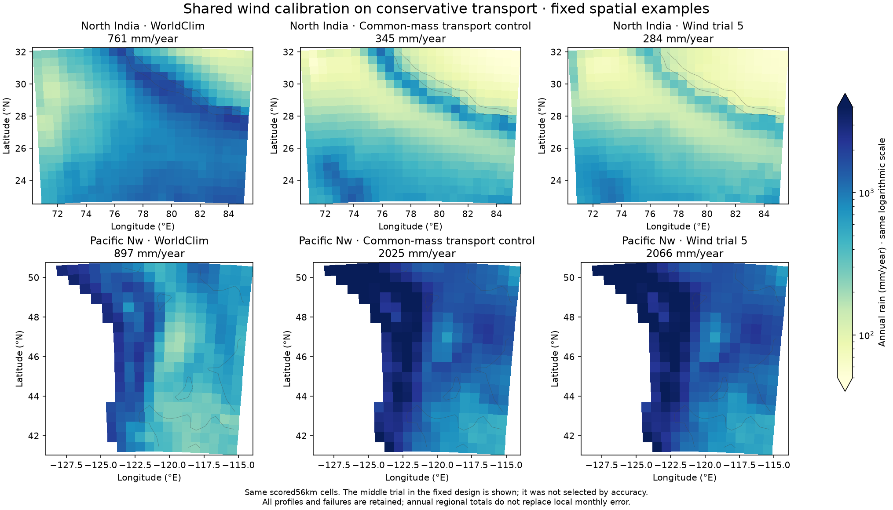

# Shared wind calibration on conservative transport

The preceding common-mass transport correction improves North India's rainfall
but leaves several coastal climates too wet. This round asks whether realistic
changes to atmospheric circulation closures can resolve that tradeoff with
Earth's tilt, orbit, rotation, radius, sunlight and greenhouse forcing fixed.

The committed plan `calibration/shared_wind_20261026/plan.json` specifies eight
scrambled six-dimensional Sobol samples, seed20261026, before any new result.
They vary land drag5e-5–1e-4/s, ocean drag2e-5–4e-5/s, trade speed6–10m/s,
westerly speed5–10m/s, large thermal-pressure amplitude1.3–2.0 and local
amplitude0.3–0.6. All are shared atmospheric parameters, with no regional
rainfall multipliers. This small exploratory design is not an optimum.

Common-mass two-branch water transport, lower mass fraction0.25, upper/lower
humidity ratio0.2,1km thermal shear, saturation and rainfall closures remain
fixed. Fourteen controls run before the56 candidate cases: seven originalr39
and seven corrected-transport controls. Every archived array, observation,
budget and available native wind control reproduces exactly. Strict residual
limits and all regional, temperature, ocean, outside-wind, dry-mass and separate
branch speed protections are unchanged. Numerical damping/work is declared
separately and does not relax accuracy or residual limits.

## Completed results

All70 integrations pass numerical checks. None of the eight candidates passes
all accuracy safeguards; no full31-region, ocean, finer-grid or established-set
candidate stage runs. Qualified Earthr39, published world Earthr38 and every
normal atlas climate/farming/population/trade packet remain unchanged.

| Profile | North India annual mm | NI monthly MAE mm | Seven-region S | Rain-loss ratio | T-MAE ratio |
|---|---:|---:|---:|---:|---:|
|reference|256.3|50.01|1.0000|1.0000|1.0000|
|transport_control|345.1|43.67|1.1535|1.3217|0.9852|
|wind01|351.7|43.78|1.1026|1.1986|1.0067|
|wind02|410.1|43.44|1.1122|1.2204|1.0040|
|wind03|411.7|43.93|1.1278|1.2383|1.0173|
|wind04|327.1|44.07|1.1208|1.2547|0.9870|
|wind05|284.4|45.70|1.1460|1.3014|0.9906|
|wind06|397.6|42.90|1.0965|1.1815|1.0114|
|wind07|496.3|45.24|1.1407|1.2568|1.0247|
|wind08|251.1|45.87|1.1229|1.2621|0.9838|

North India's observed annual mean is760.83mm. Trial6 reduces monthly MAE from
50.01 to42.90mm and has the smallest combined score among these eight samples,
but mean seven-region rainfall loss is still18.15% worse thanr39. Japan,
Mexico and the Pacific Northwest fail local protections; temperature also
misses the1% aggregate safeguard. Trial7 gets India's annual mean closer
(496mm) while its monthly MAE is worse than trial6, illustrating why annual
agreement alone is insufficient. None is adopted.

The figures retain all eight trials. Map examples use trial5, the fixed middle
index in the declared design, rather than a best-outcome selection. Sources,
records and saved arrays are hash-verified before publication. Full six-field
parameter updates are included in the downloadable companion JSON.

## Interpretation and next experiment

Changing shared mean circulation within these bounds helps some rainfall and
reanalysis-wind comparisons but does not remove wet coastal errors. These
results do not prove that all possible circulation calibrations fail. The model
still imposes a vertical humidity shape and uses a broad nonlocal Gaussian for
unresolved storms. Improved dry-mass accounting is independent of observed
rainfall accuracy. The next useful attribution is to separate storm mixing
geometry from local condensation on this corrected transport basis, using
explicit controls and the same accuracy gates.

This campaign used source4dd3ff6, output
`output/shared_wind_20261026_thread1/`, and a supervised detached runner with
OPENBLAS/OMP numerical threads fixed at1. It completed in810.9seconds. A first
launch in `output/shared_wind_20261026/` was stopped before any control completed
because thread settings had not been pinned; its protocol is retained, and it
adds no completed simulation to the reported counts. No background calibration
remains active after the corrected70-case completion.

These seven regions are reused development data. Global/city headline scores
are unchanged. Reanalysis winds are monthly partial-column constraints with
period and covariance limitations; this is conditional regional simulation,
not a coupled global atmosphere or independent validation.
