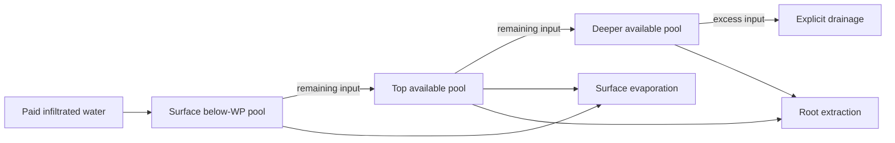
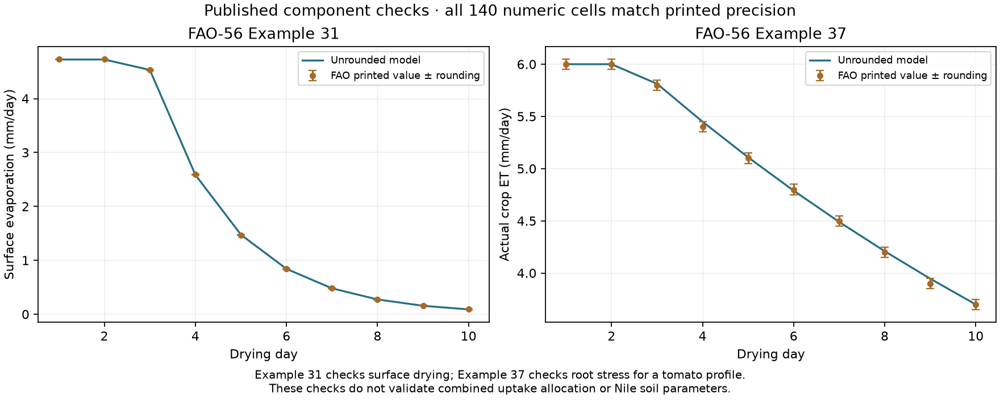
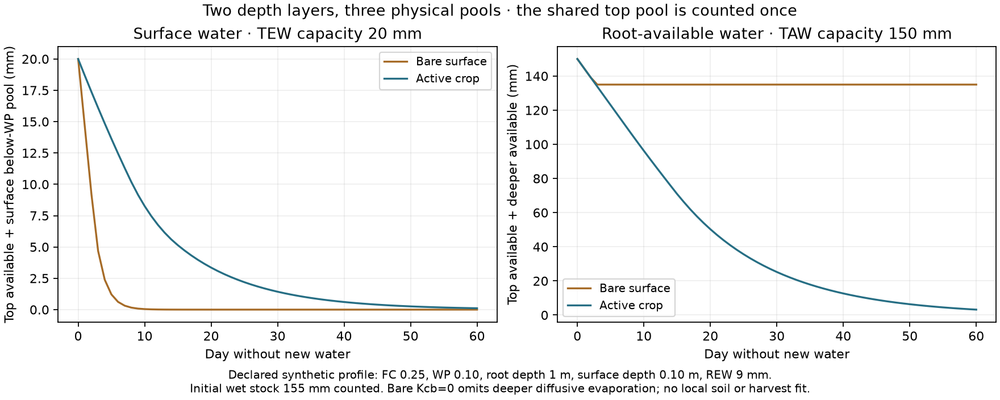

# Surface drying, root stress and an exact supplied clock

The next soil-water components are implemented and independently checked.
Surface evaporation and root extraction share a finite water ledger, and a new
clock preserves supplied partial-month event boundaries without changing
monthly water totals. No new Earth field, crop-yield or population score is
computed in this stage.

[Open the component checks and downloads](../atlases/earth_evidence/soil_drying/index.html).
Declaration `ab8afa29` preceded implementation and new model outputs;
clock amendment `d0739f3f` preceded calendar outputs.
[Original protocol](../calibration/soil_drying_20261114/plan.json) ·
[Clock amendment](../calibration/soil_drying_20261114/clock_amendment.json).

## Water shared by the surface and roots is stored once

FAO's surface evaporable water (TEW) overlaps its plant-available root water
(TAW). Adding those as independent stores would count the topsoil twice.
The implementation uses two depth layers and three disjoint water pools:

- Top plant-available water, usable by evaporation and roots.
- Deeper plant-available water, usable by roots.
- Additional surface water below wilting point, removable by evaporation but
  unavailable to roots.

For supplied field-capacity water content FC, wilting-point content WP, root
depth Zr and surface evaporation depth Ze:

`top = 1000 (FC − WP) Ze`, `deep = 1000 (FC − WP) (Zr − Ze)`,
`surface below-WP = 500 WP Ze`, with depths in metres and stocks in mm.

Thus TAW = top + deep, TEW = top + below-WP, but physical variable water is
top + deep + below-WP. Fixed inaccessible water below the reference floors is
not an input or an extractable supply. The synthetic example has TAW 150 mm and
TEW 20 mm, yet its total variable water is 155 mm, rather than 170 mm.



## Explicit physical operator

Beginning-of-step input refills the surface's below-WP pool, then top available
water, then deep available water. Remaining input drains before ET. Surface
drying coefficients and root stress are calculated from the wetted state.
Evaporation uses the top available pool first, then its below-WP pool. Root
uptake then draws proportionally from remaining plant-available top/deep water.
Neither flux can exceed the water left for it.

Wetting order, drainage before ET, evaporation priority and proportional root
uptake are declared approximations. The component benchmarks do not validate
these allocation choices. There is no implicit groundwater, ponded-water supply,
root-depth growth or automatic refill to field capacity. The caller must account
for every initial stock and incoming transfer.

## Published component checks

FAO-56 Example 31 supplies a ten-day surface-drying case with TEW 20 mm, REW
9 mm, ETo 4.5 mm/day, Kcb 0.15 and Kcmax 1.2. Its printed Kr equation RHS is
preserved as source evidence; no malformed source parentheses are silently
repaired. Example 37 supplies a ten-day tomato root-stress case with TAW 160 mm,
p 0.4 and initial depletion 55 mm. It supplies no Nile cereal parameters.

All **140 daily numeric cells** match the source tables within their published
rounding precision. Stage indicators are exact. An independent HTMLParser
extracts the source tables, while the producer uses raw regex parsing. The
review computes both recurrences with 40-digit Decimal arithmetic and checks
the CSV and all plotted JSON summaries. Unrounded model differences from that
independent arithmetic are below 4e-15.



These are known published component benchmarks, not untouched regional tests.
Example 31 checks the surface recurrence alone, including the source's basal
background ET term. It does not validate the combined model's proportional
root extraction. Example 37 checks the root-stress response.

## Combined synthetic water balances

The declared 200 synthetic profiles span supplied soil-water contents and
depths. Their 180-day runs include paid intermittent water, varying reference
ET, crop coefficients and depletion fractions. Fully wet initial water is
counted explicitly. An independent scalar simulation checks every flux and
**108,000 compartment states across 36,000 profile-days**. All physical pools
remain bounded.

Both daily and whole-run ledgers close:

`initial water + input = final water + evaporation + root extraction + drainage`.

Maximum observed model daily closure error is about 1e-13 mm; model state
differences from the independent simulation are below 4e-13 mm. Those are
numerical checks, not physical accuracy estimates.

The separate fixed 60-day drydowns demonstrate that bare-surface evaporation
cannot directly consume the deep root store. The bare case retains its deeper
135 mm, while the active crop can use deeper plant-available water.
The pure-bare example sets Kcb to zero and omits deeper diffusive evaporation;
its preserved deep stock is a consequence of that declared routing policy, not
evidence that a real bare field retains deep water indefinitely. FAO Example
31's basal background ET is checked separately and must not be classified as
crop uptake in a future bare-field adapter.



## Exact supplied calendar, without inferred local dates

`harvest.field_clock` splits the caller's twelve climate bins at their edges,
regular daily boundaries and explicitly supplied event boundaries. Every step
is at most one day. Water or energy totals are divided by duration fraction;
temperatures and rates are repeated without scaling. The soil step receives
each actual segment duration, including fractional days. Calling every segment
a whole day would overstate ET.

The declared mathematical example has 379 segments in 365 days. Its capture
window spans 106.458333 days, and its wrapping crop window 121.666667 days.
Their supplied boundary is shared without overlap. Independent Decimal overlap
integration recovers all twelve input totals in both source columns. Tests also
cover unequal climate bins, fractional year ends, empty/full-year distinction,
multidimensional inputs and rejection of unsplit event endpoints.

These are supplied phase windows, not qualified sowing/drainage dates. Uniform
within-bin disaggregation is an explicit forcing scenario, not daily rainfall
or flood observations. The clock does not infer a crop calendar or inundation.

## Verification and publication

Ninety controls pass: the previous 52 flood controls, 23 soil controls and 15
clock controls. The independent review checks source tables, Decimal equations,
scalar stocks, daily/global balances and calendar integration. Three fresh
numeric files reproduce byte for byte. All 904 Earth-fit files and all three
numeric files underlying the 96 earlier Earth field cases remain unchanged.

[Review](../output/soil_drying_20261114/review.json) ·
[Results and source/code hashes](../output/soil_drying_20261114/results.json) ·
[All source/model numeric cells](../output/soil_drying_20261114/benchmarks.csv) ·
[Daily forcings, states and clock fields](../output/soil_drying_20261114/fields.npz).

```sh
# Recreate pinned public source caches if needed:
.venv/bin/python scripts/qualify_flood_storage_sources.py
.venv/bin/python scripts/soil_drying_benchmarks.py
.venv/bin/python scripts/review_soil_drying.py
.venv/bin/python scripts/publish_soil_drying.py
.venv/bin/python scripts/build_fit_hub.py --date 2026-11-14
# With the repository served at http://127.0.0.1:8766:
python scripts/check_soil_drying_browser.py
```

The normal evidence publisher hook runs after the earlier field-water panel.
The direct publisher preserves earlier panels. Browser checks compare every
displayed numeric row and calendar metric, keyboard access, actual downloads
and their bytes, navigation and six viewport/theme combinations.
Those checks pass, as does a fresh Windows-style checkout with a verified release.
Both field NPZ copies are tracked despite the repository's general ignore rule.

## Next field implementation

Declare the daily river-to-field adapter and pond/drainage rules before new
Earth runs. Keep net infiltration, diverted volumes, field areas, efficiency
losses and transfers in compatible units and account for them once. Rainfall
disaggregation, root development and any groundwater supply need explicit
policies, as does any deeper bare-soil diffusive flux. All require qualified
inputs; the clock supplies none of them automatically.

Actual soil profiles, crop/drainage dates, Tigris coverage, flood access and
independent regional evidence remain open. Require Nile improvement and
Mesopotamian non-inflation on a frozen harvest rule before map adoption and the
unchanged whole-empire supply calibration. The current atlas and its Egypt
failure are unchanged.

Sources: [FAO-56 Chapter 7, equations 71/74 and Example 31](https://www.fao.org/4/x0490e/x0490e0c.htm);
[Chapter 8, equations 82–85 and Example 37](https://www.fao.org/4/x0490e/x0490e0e.htm).
