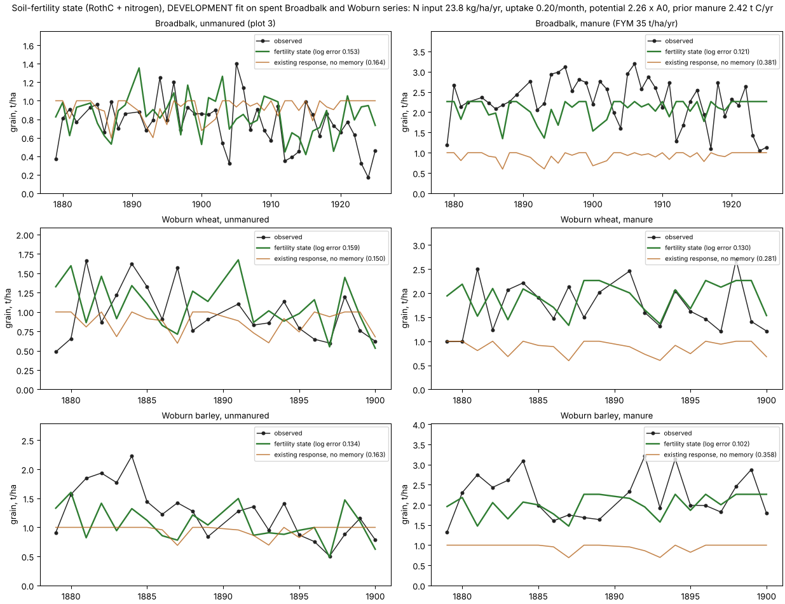
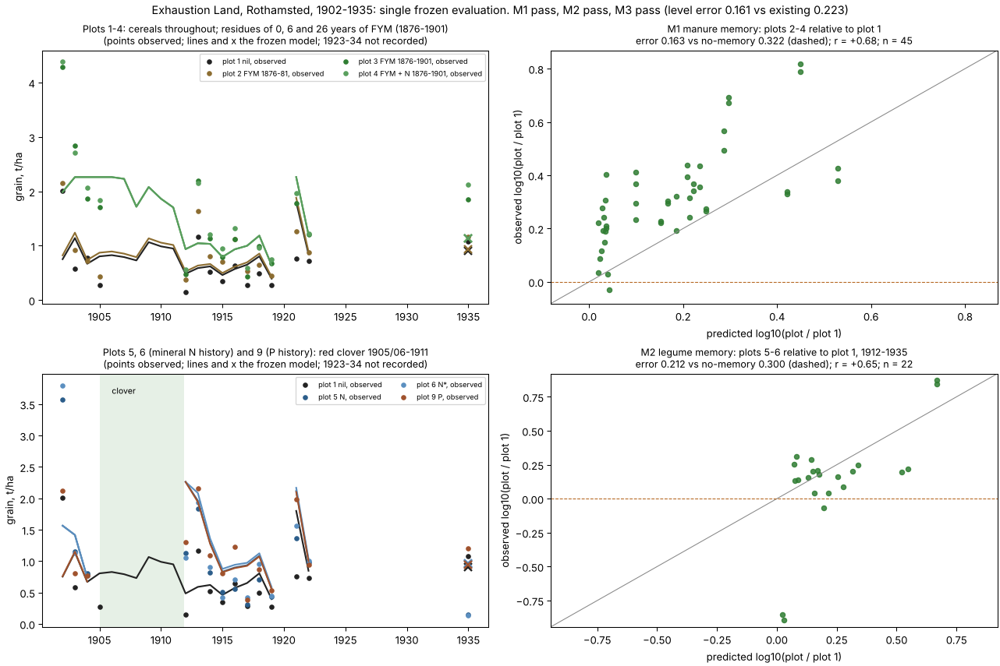
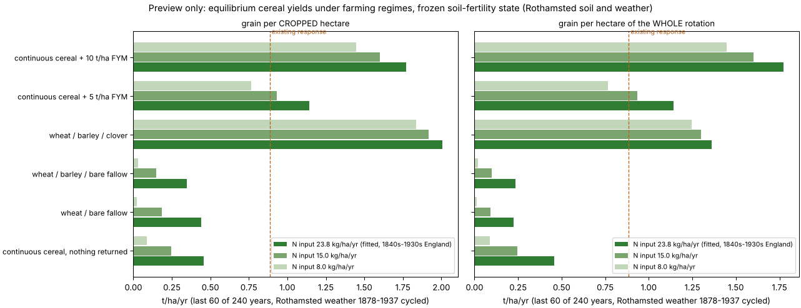

# A soil-fertility state: land remembers manure and legumes, and the memory passes a blind test

Part of the Earth-calibrated basis for the control map (grain → residents →
institutions → reach). **No production crop, climate, settlement or control value
changes in this round.**

## Why

Two English sites showed that weather explains little of low-input cereal yields
(reports/CROP_WATER_WOBURN_20261106.md). What they do show:
- yields **run down** under continuous cropping with nothing returned;
- they **hold** under manure;
- old manure is **remembered for at least 15 years**.

The production response has no such memory: every field in a year gets the same
yield whatever was done to it before.

## The model (`harvest/soil_fertility.py`, 5 tests; 21 soil tests pass)

**Carbon** follows RothC-26.3, exactly as published in Coleman and Jenkinson's
model description:
- four active pools with decay rates 10, 0.3, 0.66 and 0.02 per year;
- the published temperature, topsoil-moisture and plant-cover rate factors;
- the clay-dependent split between CO₂ and new biomass/humus;
- manure entering as 49 % decomposable, 49 % resistant and 2 % humus.

**Nitrogen** follows SUNDIAL (Bradbury et al. 1993):
- biomass and humus hold nitrogen at C:N 8.5;
- net mineralization is what decomposing pools release minus what new biomass
  and humus take;
- one mineral pool gains that and a non-fertilizer input;
- crops take up from the mineral pool;
- nitrate leaches with the month's drainage from the FAO-56 dual water ledger,
  in the single-reservoir form of Burns (1974).

Grain is the smaller of two limits: the nitrogen taken up, or a climate
potential set as a multiple of the existing response. The nitrogen ledger
closes to rounding in every run.

## Protocol (all committed before the step it governs)

| step | commit |
|---|---|
| plan frozen before any fit or any Exhaustion Land Phase II yield was read | 288d1eaa |
| amendment before any fit (below) | 7aaddff3 |
| development fit and frozen selection; scorer committed | 66c67e7b |
| single evaluation | 55774a8a |

**The amendment.** RothC's own Rothamsted table puts evapotranspiration at
0.75 × open pan = 448 mm a year. The Hargreaves PET we use gives 717 mm, about
1.6 times too high in this humid climate. Hargreaves is therefore rescaled
month by month to RothC's table, for both decomposition and drainage. The check
behind this involved no yields:
- equilibrium carbon under RothC's documented Hoosfield input moved to 25 t
  C/ha, close to RothC's 31 (it had been 46);
- drainage moved from 94 to 190–250 mm a year, about what Rothamsted's soils
  drain.

**Disclosures.**
- The e-RA page of the separate Alternate Wheat and Fallow experiment states its
  aggregate fallow effect, so that experiment is development evidence only.
- The scorer crashed twice before writing or printing anything (once on
  serialisation, once on a path). The completed run is the same deterministic
  computation.

## Development fit (spent Broadbalk and Woburn series only)

**Fitted parameters:**
- non-fertilizer N input **23.8 kg/ha/yr**;
- crop uptake **0.20 of the mineral pool per month**;
- climate potential **2.26 × the existing response**;
- pre-experiment manuring **2.42 t C/ha/yr**.

| series | fertility state | existing response | observed mean (t/ha) |
|---|---:|---:|---:|
| Broadbalk, unmanured | 0.153 | 0.164 | 0.76 |
| Broadbalk, 35 t FYM | **0.121** | 0.381 | 2.27 |
| Woburn wheat, unmanured | 0.159 | 0.150 | 0.98 |
| Woburn wheat, FYM | **0.130** | 0.281 | 1.72 |
| Woburn barley, unmanured | 0.134 | 0.163 | 1.26 |
| Woburn barley, FYM | **0.102** | 0.358 | 2.22 |

All errors are mean absolute log10.

## The blind test: Exhaustion Land, Rothamsted, 1902–1935

**The plots.** Ten plots carried 46 years of different treatments (1856–1901),
then received nothing:
- **plots 2–4** carry 6 or 26 years of manure residues;
- **plots 5–10** grew red clover from 1905/06 to 1911.

**What the model was given.** Each plot's management history, the observed
weather, and the parameters above. Nothing else.

| frozen criterion | fertility state | no-memory null | Pearson r | pass |
|---|---:|---:|---:|:---:|
| M1: manure memory, plots 2–4 vs plot 1, n 45 | 0.163 | 0.322 | +0.68 | ✓ |
| M2: legume memory, plots 5–6 vs plot 1 after clover, n 22 | 0.212 | 0.300 | +0.65 | ✓ |
| M3: absolute level, all 144 cereal plot-years | 0.161 | 0.223 (existing response) | +0.61 (existing −0.59) | ✓ |

**It qualifies on all three.** The existing response is *anti*-correlated with
these plots. Its year-to-year weather signal points the wrong way, and it cannot
tell a manured field from an exhausted one.

**Misses:**
- **Manure memory lasts longer than modelled.** FYM plots relative to the nil
  plot:

  | period | observed | modelled |
  |---|---:|---:|
  | 1902–04 | × 2.97 | × 2.61 |
  | 1912–19 | × 2.24 | × 1.66 |
  | 1921–35 | × 1.96 | × 1.31 |

  The six-year-manured plot 2 is × 1.49 observed against × 1.07 modelled. RothC's
  description reports the same miss on Hoosfield's plot that was manured only
  1852–71.
- **The clover benefit is overpredicted:** × 1.31–1.42 observed against
  × 1.71–1.77. The declared residue input (1.5 t C/ha/yr at C:N 15) is too
  generous.
- **Phosphorus and potassium residues** add on top of nitrogen. The PK plots are
  × 2.0–2.4 observed against × 1.7–1.8; these were reported, not qualified.
- **1935 wheat nearly failed on plots 5–6** (0.14–0.15 t/ha against 1.08 on
  plot 1), with no note in the data.

## Preview for the control map, and why it is not ready to adopt

`scripts/soil_fertility_regimes.py` runs each farming regime for 240 years on
Rothamsted's 1878–1937 weather.

What the preview shows:
- **Manure and legume breaks dominate.** 10 t/ha FYM gives about 1.8 t/ha; a
  wheat / barley / clover rotation gives 2.0 per cropped hectare (1.4 per
  hectare of the whole rotation).
- **The long-run floor is too low.** Continuous unmanured cereal settles at
  0.46 t/ha. Broadbalk plot 3 actually held 0.7–1.0 t/ha for over a century, and
  its soil carbon stayed nearly constant. The fit reached 1879–1925 yields partly
  through a run-down from a high start (prior manuring 2.42 t C/yr), not through
  a sustainable balance.
- **Bare fallow gives nothing.** The model shows no fallow benefit, where
  Rothamsted's alternate wheat–fallow experiment shows +0.14 t/ha in the long
  run.
- **The floor scales with the N input.** At the fitted 23.8 kg/ha/yr, which
  includes 19th-century coal-smoke deposition, the floor is 0.46; at 8 kg it
  nearly vanishes. Pre-industrial deposition was a few kg/ha/yr, so the AD 200
  value matters and must be grounded separately.

## Status and next steps

**What is established.** The *memory* of past management (manure, legumes)
passes a blind test. That is the component the control map needs to tell
long-cropped, manured, rested and fresh land apart.

**What is not.** Its *equilibrium* levels are not yet credible.

**Next steps, before any integration:**
1. Constrain the long-run balance with development evidence: Broadbalk plot 3's
   near-constant soil carbon and long-run yield plateau, and the wheat–fallow
   aggregate.
2. Revise the clover residue input against the literature.
3. Ground the AD 200 non-fertilizer N input (pre-industrial deposition plus
   free-living fixation).
4. Test on a fresh reserved record, for example the Saxmundham rotations in
   Suffolk: a different soil, with legume and manure rotations.

Regime choice (fallow, manure, legumes) belongs to the shared settlement chain:
manure comes from livestock, and livestock from pasture. It is not a new
independent map.
