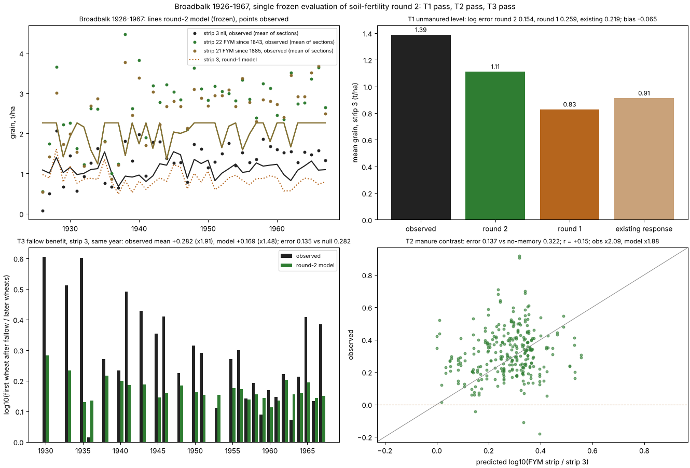
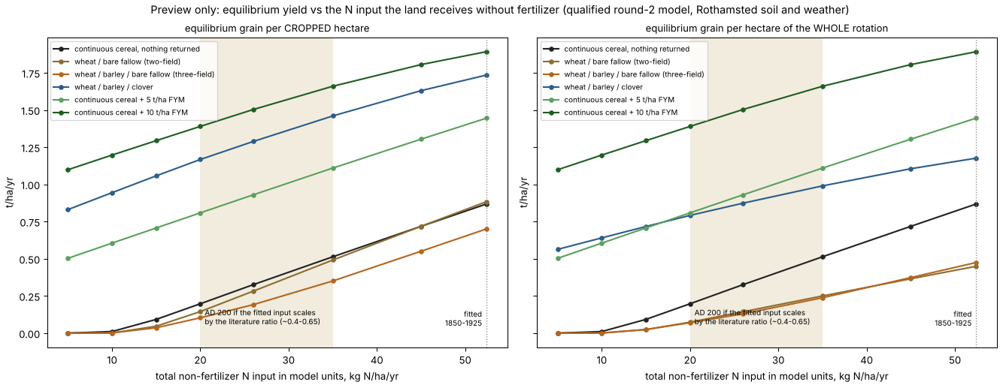

# Soil fertility, round 2: a credible equilibrium, a second blind pass, and what AD 200 hinges on

**No production change in this round.**

## Changes, each frozen before it was fitted

**Plan** (`calibration/soil_fertility_20261106/plan_round2.json`, commit 517f33da), committed before any fit and before any Broadbalk 1926–1967 yield was read:
- **Starting state from measurement.** Broadbalk starts at 28.8 t C/ha, e-RA's estimate for 1843. Round 1 had started it near 66. Hoosfield starts at 33.8, RothC's documented value. No prior manure is assumed at Rothamsted.
- **Nitrogen input.** The input is Rothamsted's *measured* wet deposition plus a fitted constant F. The wet deposition is nitrate plus ammonium in rain, 4 kg N/ha/yr in 1855 rising to 18 by 1980 (Goulding et al. 1998). F stands for free-living fixation, seed and dry deposition.
- **Uptake.** Crops take up nitrogen in every month they are growing, scaled by temperature.
- **Manure.** The share of manure that becomes humus was made a fitted parameter. The fit returned RothC's own 2 %.
- **Clover.** Residues were cut to literature values for cut swards: about 105 kg N in roots and stubble at ploughing.

**Amendment** (`amendment_round2.json`, commit d5b57277), the only one. It was made after a first development fit and before any test data was read. That fit had made the bare-fallow benefit four times too large, because a seedling could take up nitrogen as freely as a mature crop. Uptake is now capped by a cumulative crop-demand curve: winter wheat takes up only 12 % of its season's nitrogen before March, following the UK wheat-growth pattern (Sylvester-Bradley et al. 2008). The superseded fit is kept in `output/soil_fertility_round2_20261106/superseded_fit_A`.

## Development fit (spent data only)

**Fitted parameters:**
- F = 43 kg N/ha/yr;
- uptake 0.15 per month;
- potential 2.26 × the existing response;
- manure humification 0.02;
- Woburn's prior manuring 1.55 t C/yr.

**Fit quality:**
- **Soil carbon:** the measured 1865–1914 values on Broadbalk's manured plots are matched. Plot 2.2 is modelled at 71.6 t C/ha against 71.2 measured in 1914; plot 2.1 at 56.9 against 58.6.
- **Fallow benefit:** in the long run it is +0.29 t/ha against +0.14 observed, and +0.73 against +0.6 in the first decade.
- **Unmanured plot 3:** 0.87 t/ha modelled against 0.76 observed.

**Remaining misses:**
- plot 3's carbon stays near 30 t C/ha, where the measured value fell to 24;
- Woburn's never-manured wheat is overpredicted.

## The blind test: Broadbalk 1926–1967 (temporal holdout, same strips)

From 1926 each Broadbalk strip was split into five sections, each fallowed one year in five. In any year, sections at different points of the cycle share the same weather.

| frozen criterion | round 2 | round 1 | null / existing | pass |
|---|---:|---:|---:|:---:|
| T1: unmanured level, strip 3 (n 142) | 0.154, bias −0.065 | 0.259, bias −0.215 | existing 0.219 | ✓ |
| T2: manure contrast, strips 21 and 22 vs 3 (n 284) | 0.137, r +0.15 | 0.185 | no memory 0.322 | ✓ |
| T3: fallow benefit, strip 3 (27 years) | 0.135 | 0.117 | no memory 0.282 | ✓ |

**Round 2 qualifies; round 1 fails T1.** Observed versus modelled:
- **Unmanured level:** 1.39 t/ha observed, 1.11 modelled.
- **Manure contrast:** × 2.09 observed, × 1.88 modelled.
- **First wheat after fallow:** × 1.91 observed, × 1.48 modelled. The rest is probably weed control, which fallowing provided and the model does not represent.

**Secondary results:**
- **Manured strips:** they show a small fallow benefit (× 1.3) that the model, which is not nitrogen-limited there, gives as zero.
- **Fertilised strips:** the model underpredicts them at the highest nitrogen rates, because the climate-potential ceiling binds.

## Equilibria, and the one number AD 200 hinges on

`scripts/soil_fertility_regimes_r2.py` runs each regime for 360 years on Rothamsted weather.

**At the fitted input** (about 52 kg N/ha/yr, 1850–1925 England), continuous unmanured cereal holds **0.87 t/ha**. That is the Broadbalk plateau, so the equilibrium round 1 got wrong is now credible.

**In equilibrium, bare fallow barely helps per cropped hectare and halves output per hectare of land.** Its benefit is a short pulse, as the 1926–67 cycle and Rothamsted's alternate wheat–fallow experiment both show. Outside dry climates, its lasting value is weed control.

**Legumes and manure dominate.** A wheat / barley / clover rotation and 5–10 t/ha of manure keep yields up even at low inputs.

**What AD 200 hinges on: the nitrogen input without fertilizer.**
- **Why it can't be read off directly.** The fitted 52 kg lumps the real 19th-century inputs together with the model's own nitrogen-loss error. The real inputs include coal-era dry deposition; Jenkinson's famous "missing nitrogen" on plot 3 is part of the same question. So the AD 200 value cannot simply be taken from the literature.
- **The literature.** It gives:
  - free-living fixation in temperate arable soils of 1–15 kg/ha/yr;
  - seed nitrogen of about 3 kg/ha/yr;
  - pre-industrial deposition of 0.5–2 kg/ha/yr (Dentener et al. 2006);
  - so roughly 5–20 kg in total for AD 200, against perhaps 20–35 in 1850–1925.
- **The resulting setting.** Scaling the model's fitted input by that ratio (about 0.4–0.65) gives **20–35 model kg** for AD 200. On that band:

  | regime | grain per hectare of land |
  |---|---:|
  | unmanured continuous cereal | 0.2–0.5 |
  | two- or three-field bare fallow | 0.07–0.25 |
  | wheat / barley / clover | 0.8–1.0 |
  | 5 t FYM | 0.8–1.1 |
  | 10 t FYM | 1.4–1.7 |

**For the control map, then, sustained grain depends on legumes and manure.** Manure comes from livestock, and livestock from pasture: a land-allocation question for the shared settlement chain, not a new map.

## Next (integration, its own declared step)

1. **Set the AD 200 input:** the band above, or a decision.
2. **Express the regime as land shares:** cropped, fallow or legume, pasture, and the manure that pasture supports.
3. **Compute equilibrium grain per hectare of land** in each map cell, from its climate and soil. Rothamsted's soil parameters will need replacing with the world's soil classes.
4. **Feed that into the existing grain → residents → institutions → reach chain.**

Before production use, check the climate-ceiling multiplier outside England. It was fitted on English sites only.
