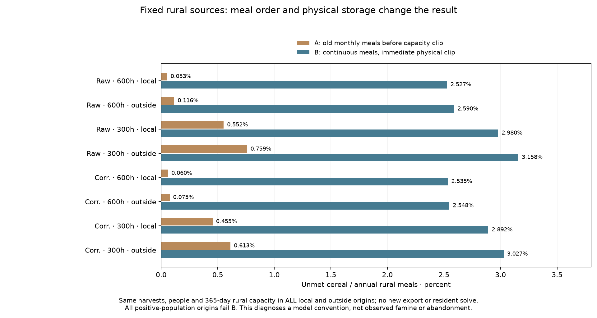
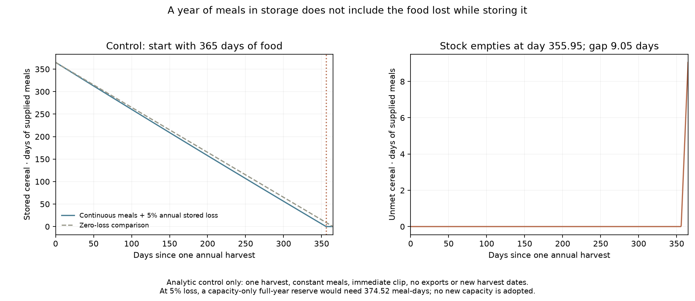

# Fixed rural meals: monthly convention versus continuous physical storage

Declaration `38d918bd` preceded all scores. All four continuous-destination resident
parents retain their exact rural/outside people, produced cereal, harvest-boundary
bits and 365-day rural store. The first eligible harvest bin is the same as the
old fixed_rural_food rule. The audit includes every origin, including existing
source deficits and outside origins; outside owners and actor identities remain
explicitly unscored (-1). No new food, exports, residents, workers, dates or maps.

A exactly reproduces the old rural ledger: annual cereal at its declared bin,
monthly meals immediately, then storage capacity clip and stored decay.
B uses the SAME harvests and meals with immediate physical capacity clip,
continuous meals and decay. This changes the inventory convention as a whole;
A-to-B is not attributed solely to shipment timing. Both use 2500 kcal/day,
365 days, 5% annual stored loss and minimum repeating reserves. Food pass uses
the unchanged unmet<=1e-8*max(1,annual needed kcal) diagnostic. All zero-population
and zero-production origins stay visible and are not inferred communities.

Every positive-population origin fails B. The 365-day capacity stores exactly
a year of meals without allowance for decay. With one annual pulse and immediate
clip, even unlimited harvest cannot fill a store above that capacity. The
analytic control empties after 355.947249 days and leaves 9.052751 meal-days unmet.
A full-year capacity-only bound is 374.523152 meal-days at the same loss; it is NOT
a fitted or adopted new capacity. Production deficits add to this limitation.
This does not show observed famine, abandonment or historical impossibility.

Old monthly A channels exactly match all saved parent rural channels and outside
unmet fields. Independent one-pulse fixed-point equations and scalar monthly/
continuous ledgers review every origin/account, every stock path and unmet bin,
all 16 summary rows and local actor summaries. All origin CSV rows are checked.
Path tolerance is 1e-9 of annual meals; the old periodic solver itself uses an
annual-energy-scaled convergence tolerance. Thirty-two controls pass before
production; all nine model/field/CSV outputs reproduce byte for byte. Test
wall-clock timings are audit logs rather than deterministic data outputs.

Full NPZs retain every annual conservation channel and all 13 boundary stocks,
12 unmet bins, fixed node/owner/actor IDs and harvest choices for A and B. CSVs
provide one auditable origin row with fixed IDs, people, production, both gaps
and flags. Outside contexts receive no invented provider or actor affiliation.

No new exportable stream is computed here. The earlier point maps remain
conditional on monthly source availability; the destination-calendar/food gate
cannot repair source food or qualify complete provisioning. Next declare an
explicit shared rural/export chronology with actual withdrawal events before
new source-stock scores. Crew-carried food/location, complete diets and work,
dated occupation/roles/sizes, prospective transfer and mobile/nonstate/unaffiliated
resources remain open across release1–4/S1–S5. Keep the physics queue separate.

## All declared outcomes

|Climate|Farm h|Context|Inventory|All origins|Positive-person origins|Positive-person food passes|Unmet kcal|Unmet %|
|---|---|---|---|---|---|---|---|---|
|Raw|600|local|A|19371|19371|19186|2,573,077,327.170|0.052995|
|Raw|600|local|B|19371|19371|0|122,719,122,999.928|2.527496|
|Raw|600|outside|A|222518|222518|217571|50,058,783,315.820|0.115665|
|Raw|600|outside|B|222518|222518|0|1,120,765,596,076.439|2.589617|
|Raw|300|local|A|19371|19371|18425|27,303,389,121.809|0.552478|
|Raw|300|local|B|19371|19371|0|147,248,868,654.349|2.979547|
|Raw|300|outside|A|222518|222518|201835|328,578,181,579.317|0.759206|
|Raw|300|outside|B|222518|222518|0|1,366,714,099,058.549|3.157900|
|Corrected|600|local|A|19295|19295|19132|2,903,233,060.042|0.060063|
|Corrected|600|local|B|19295|19295|0|122,522,367,356.846|2.534795|
|Corrected|600|outside|A|222594|222594|218521|32,585,225,203.136|0.074780|
|Corrected|600|outside|B|222594|222594|0|1,110,465,384,884.449|2.548401|
|Corrected|300|local|A|19295|19295|18532|22,396,016,267.853|0.455024|
|Corrected|300|local|B|19295|19295|0|142,341,292,824.192|2.891973|
|Corrected|300|outside|A|222594|222594|204274|267,019,498,988.332|0.612782|
|Corrected|300|outside|B|222594|222594|0|1,319,088,780,257.100|3.027169|

