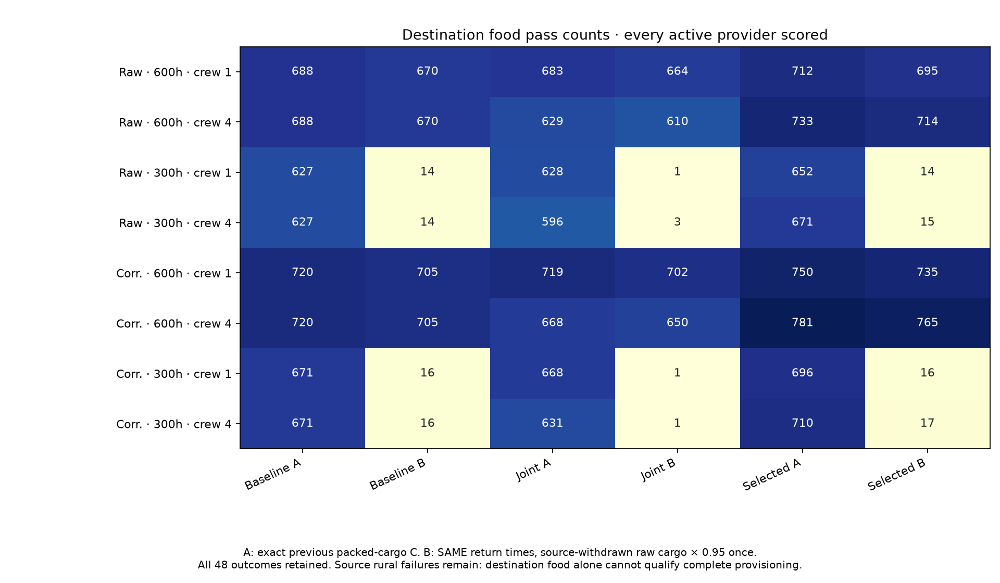
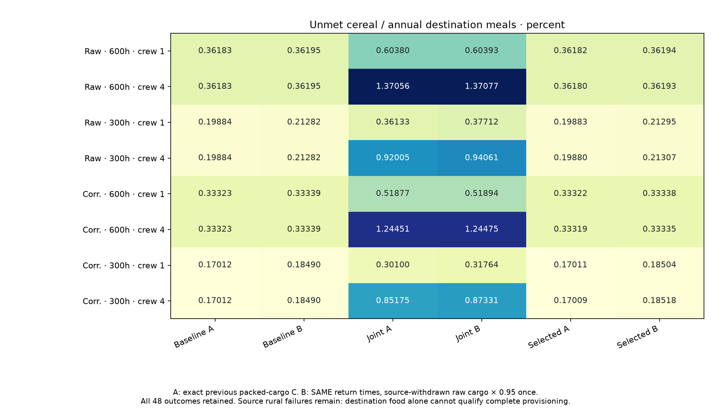

# Fixed source withdrawals propagated to destination food

Declaration `203fc49b` preceded every output. All24fixed source/calendar plans
remain: eight point plans × baseline, joint and previously selected whole years.
Every active provider is scored, including partial deliveries and failed calendars.
Parent people, destination90-day stores, routes, actual worker jobs, return phases,
original imposed one-bin lag and numerical food threshold remain unchanged.

A EXACTLY reproduces each previous OWN-calendar C destination account: all packed
raw requests ×0.95 at their recorded lagged return phases. B uses the SAME jobs,
return times and food convention, replacing each raw load with its source-store
withdrawal ×0.95 ONCE. No extra lag, retention or food is added. Every original
(month,origin,serial) request ID joins exactly once; missing, duplicate or changed
cargo is rejected. An unfilled source request is counterfactual demand, not an
actual transport loss. Raw request=withdrawn+unfilled; retained missing potential
is explicitly a counterfactual destination amount.

Destination time=((origin month+1)*365/12+job end hours/7) modulo365 days.
Source pickup time and destination return time stay distinct. Continuous cereal
meals include staff once at2500kcal/person/day,365days,5%stored loss,90-day physical
capacity and minimum repeating reserves. Food pass remains unmet<=1e-8*max(1,annual
needed kcal). This is an unchanged numerical diagnostic, not a fitted famine
threshold. Physical mandatory-year, source-export, source-rural and destination
food flags are distinct before their conjunction.

In selected raw300h plans destination food passes decline from652 to14(crew1)
and671 to15(crew4); corrected300h from696 to16 and710 to17. These discontinuous
pass counts reflect the strict no-shortage threshold and conditional resident
plans near their earlier food bound. Aggregate selected300h gaps increase about
0.0141–0.0151percentage points. They are not mortality, abandonment or historical
hunger estimates. B creates no new food passes, and unmet energy never improves
under the same clocks. All48declared rows remain; no winning subset is promoted.

EVERY source rural conjunction remains failed under the frozen365-day source
store convention. ZERO providers pass all source, work and destination gates,
including providers whose destination food passes B. B is a diagnostic propagation
of physical export-store withdrawals, not certified provisioning or permission
to ignore local source meals. No residents, capacities, calendars, map points or
defaults are replaced. Earlier destination packets remain byte identical.

Twelve new ID/partial/zero/retention controls plus source/event/partition controls
make50passes BEFORE production. Independent review reconstructs all
64,804,832request joins and
9,816,816grouped return events. Separate scalar
stocks, bracketed minimum-periodic roots and conservation check every one of
38,736active provider inventories
and864actor rows. A fields are exact prior C; B pass
sets are subsets of A. Full source-rural failures stay exposed throughout.
All49model/field/event files freshly reproduce byte for byte.

All50,088provider/account CSV records are independently checked, including inactive
sources explicitly unscored. The24source-to-active-destination raw-grain mass
ledgers close: actual diagnostic transport loss is0.05of SOURCE-WITHDRAWN raw
cargo only. No transport loss is charged on unfilled source requests. Remaining
source stores, rural meals/losses, export losses/uncollected grain and destination
stocks/meals/losses/overflow are explicit. These scoped ledgers exclude outside
cells and inactive destination meals; conservation does not establish whole-world
food sufficiency. All3CSV/chain export files freshly reproduce byte for byte.
Full NPZs preserve each provider/account/flag and every grouped return pulse,
original packed potential, source-filled cargo and retained missing potential.

The next dependency is the source reserve convention itself: one year of nominal
meal energy in storage cannot also pay storage loss between annual harvests.
Derive and expose a loss-aware minimum reserve bound with explicit units before
any new source-capacity scenario; do not tune capacities or dates to these scores.
Actual storage buildings/utilization, crew-carried food and food location, complete
diets/household/draft work, dated occupation/sizes/roles, prospective transfer and
mobile/nonstate/unaffiliated integration remain open across release1–4/S1–S5.
Keep the physics queue separate. No calibrated/default/map adoption or authority
claim follows from destination food or a balanced numerical grain ledger.

## All48matched outcomes

|Climate|Farm h|Crew|Calendar|Food test|Active providers|Destination food pass|Mandatory year pass|Source export pass|Source rural pass|ALL gates|Unmet kcal|Unmet %|
|---|---|---|---|---|---|---|---|---|---|---|---|---|
|Raw|600|1|baseline|A|861|688|734|840|0|0|1,220,533,578.121|0.361830|
|Raw|600|1|baseline|B|861|670|734|840|0|0|1,220,942,164.955|0.361951|
|Raw|600|1|joint|A|861|683|715|840|0|0|2,036,757,832.468|0.603802|
|Raw|600|1|joint|B|861|664|715|840|0|0|2,037,199,170.040|0.603933|
|Raw|600|1|selected|A|861|712|734|840|0|0|1,220,495,193.788|0.361819|
|Raw|600|1|selected|B|861|695|734|840|0|0|1,220,900,533.428|0.361939|
|Raw|600|4|baseline|A|861|688|734|840|0|0|1,220,533,578.121|0.361830|
|Raw|600|4|baseline|B|861|670|734|840|0|0|1,220,942,164.955|0.361951|
|Raw|600|4|joint|A|861|629|630|840|0|0|4,623,212,719.412|1.370563|
|Raw|600|4|joint|B|861|610|630|840|0|0|4,623,901,850.308|1.370767|
|Raw|600|4|selected|A|861|733|734|840|0|0|1,220,421,031.294|0.361797|
|Raw|600|4|selected|B|861|714|734|840|0|0|1,220,874,199.962|0.361931|
|Raw|300|1|baseline|A|724|627|670|44|0|0|498,498,854.087|0.198844|
|Raw|300|1|baseline|B|724|14|670|44|0|0|533,524,336.932|0.212815|
|Raw|300|1|joint|A|724|628|657|44|0|0|905,858,655.603|0.361334|
|Raw|300|1|joint|B|724|1|657|44|0|0|945,431,109.259|0.377119|
|Raw|300|1|selected|A|724|652|670|44|0|0|498,454,368.228|0.198826|
|Raw|300|1|selected|B|724|14|670|44|0|0|533,856,532.647|0.212948|
|Raw|300|4|baseline|A|724|627|670|44|0|0|498,498,854.087|0.198844|
|Raw|300|4|baseline|B|724|14|670|44|0|0|533,524,336.932|0.212815|
|Raw|300|4|joint|A|724|596|598|44|0|0|2,306,537,654.694|0.920046|
|Raw|300|4|joint|B|724|3|598|44|0|0|2,358,092,324.042|0.940610|
|Raw|300|4|selected|A|724|671|670|44|0|0|498,389,640.721|0.198801|
|Raw|300|4|selected|B|724|15|670|44|0|0|534,160,776.530|0.213069|
|Corrected|600|1|baseline|A|889|720|778|869|0|0|1,149,752,299.952|0.333231|
|Corrected|600|1|baseline|B|889|705|778|869|0|0|1,150,306,532.415|0.333392|
|Corrected|600|1|joint|A|889|719|754|869|0|0|1,789,916,093.801|0.518769|
|Corrected|600|1|joint|B|889|702|754|869|0|0|1,790,522,095.055|0.518944|
|Corrected|600|1|selected|A|889|750|778|869|0|0|1,149,714,418.817|0.333220|
|Corrected|600|1|selected|B|889|735|778|869|0|0|1,150,274,356.565|0.333382|
|Corrected|600|4|baseline|A|889|720|778|869|0|0|1,149,752,299.952|0.333231|
|Corrected|600|4|baseline|B|889|705|778|869|0|0|1,150,306,532.415|0.333392|
|Corrected|600|4|joint|A|889|668|668|869|0|0|4,293,939,714.477|1.244506|
|Corrected|600|4|joint|B|889|650|668|869|0|0|4,294,772,297.886|1.244748|
|Corrected|600|4|selected|A|889|781|778|869|0|0|1,149,595,277.163|0.333186|
|Corrected|600|4|selected|B|889|765|778|869|0|0|1,150,157,251.639|0.333348|
|Corrected|300|1|baseline|A|754|671|710|31|0|0|436,721,673.684|0.170124|
|Corrected|300|1|baseline|B|754|16|710|31|0|0|474,657,131.907|0.184902|
|Corrected|300|1|joint|A|754|668|695|31|0|0|772,687,577.854|0.300999|
|Corrected|300|1|joint|B|754|1|695|31|0|0|815,399,243.593|0.317637|
|Corrected|300|1|selected|A|754|696|710|31|0|0|436,682,298.726|0.170109|
|Corrected|300|1|selected|B|754|16|710|31|0|0|475,002,306.636|0.185036|
|Corrected|300|4|baseline|A|754|671|710|31|0|0|436,721,673.684|0.170124|
|Corrected|300|4|baseline|B|754|16|710|31|0|0|474,657,131.907|0.184902|
|Corrected|300|4|joint|A|754|631|633|31|0|0|2,186,496,751.463|0.851746|
|Corrected|300|4|joint|B|754|1|633|31|0|0|2,241,855,206.227|0.873311|
|Corrected|300|4|selected|A|754|710|710|31|0|0|436,638,790.809|0.170092|
|Corrected|300|4|selected|B|754|17|710|31|0|0|475,366,143.586|0.185178|

