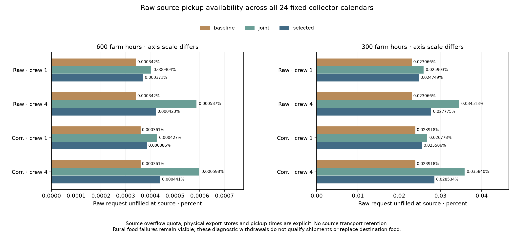
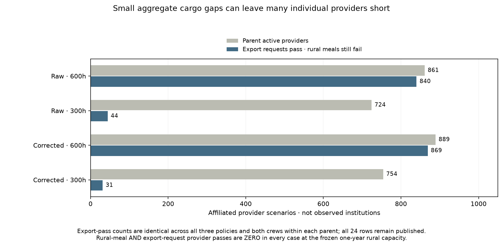

# Fixed source pickups: physical grain availability and rural meals stay separate

Declaration `049ba98e` preceded these source event outcomes. All eight NEW point
plans retain baseline, joint and the previously selected whole-provider-year
calendars: 24 fixed cases. Every actual packed collector request remains in the
audit, including jobs at rural-food-failed and calendar-unqualified sources.
There is no new job ordering, capacity/date adjustment or resident reallocation.

Harvest fills the physical rural store first; continuous local meals and decay
use the SAME fixed rural people, first eligible harvest-bin start and 365-day
capacity. ONLY actual rural overflow ×0.1 enters a separate physical export
store. Its capacity is the unchanged parent export_harvested field: the original
annual quota input under its365-day export reserve convention. Remaining rural
overflow and export-store overflow are explicit uncollected grain. Both stores
lose 5% annually. Grain in rural storage is never available to pickup requests.

Pickup time = origin bin start + (recorded collection start +7*outward graph
days +0.25handling hours)/7. All handling is placed before departure from source;
this is a supplied assumption, not a recovered historical location. Every pickup
occurs by the recorded job end. It is distinct from the destination's still
imposed one-bin lag. Equal-time harvest precedes requests; stable ascending
(month,origin,serial) IDs determine equal-time pickup priority. Raw request
min(120000,planned origin departure-120000*serial) is unchanged. No 0.95 transport
retention is applied at source. The earlier cargo/worker IDs remain exact.

Each origin has minimum repeating rural stock, its actual overflow quota pulses,
and minimum repeating export stock with discrete withdrawals. Request = withdrawn
+ unfilled exactly. Each store and their combined raw-grain ledger conserve mass.
An unfilled source request is counterfactual demand, not actual transport loss
or newly created unshipped grain. Diagnostic withdrawals are not shipment
qualification when rural meals fail. Destination food and every earlier map
remain unchanged; propagating source-filled cargo requires a separate audit.

Export request pass uses unfilled<=1e-8*max(1,annual raw request); rural food uses
the same fixed annual-energy-scaled numerical no-shortage diagnostic. These are
numerical ledger flags, not fitted famine thresholds. Every positive-population
origin still fails rural meals under the exposed one-year store convention.
Thus ZERO provider entries pass BOTH source gates in every case. Export-only
passes are840/861raw600h,44/724raw300h,869/889corrected600h and31/754corrected300h,
identical across both crews/all three fixed policies in each parent. Raw unfilled
volume nevertheless differs with pickup timing, ranging0.000342–0.035840% of
requests. A small aggregate deficit does not qualify every source.

Twenty-one new primitive controls cover local grain priority, exact quota/raw
mass, export capacity, same-time priority, partial/empty pickups, decay and
minimum periodic stocks without loans. Combined source/event/chronology suite:
37 passes BEFORE cohort outputs. Independent bisection/scalar two-store review
checks 200 synthetic cases/1539pickups, not historical observations. Full review
checks64,804,832actual request IDs/clocks/cargo,
463,992origin two-store years and
432actor summaries. Rural accounts match the prior
independently reviewed continuous-source audit. Separate compiled scalar export
ledgers check every raw withdrawal and partial request. All 25model/results files
and3origin/provider export files freshly reproduce byte for byte.

Full NPZs retain fixed origin/provider/actor IDs, people, harvest bin, capacities,
every annual rural/export mass channel and pass flag, and every pickup ID, origin,
month/serial, time, raw request, withdrawal and deficit. CSVs retain every origin
and provider, including failed and inactive flags. Harvest-bin and pickup-month
indices in the full fields/origin CSV are zero-based. No actor or source is removed
to improve reported totals; outside rural contexts remain in the preceding audit.

Next recompute destination inventory with source-filled raw cargo×0.95 ONCE,
keeping exactly the existing jobs, return phases and imposed lag. Keep source
rural failures separate and visible; no resulting destination pass can repair
them. Crew-carried rations/food location, complete diets and household/draft work,
dated occupation/sizes/roles, prospective transfer, mobile/nonstate/unaffiliated
integration and the independent physics queue remain open across release1–4/S1–S5.
No calibrated/default/map adoption, observed famine or authority inference.

## All 24declared outcomes

|Climate|Farm h|Crew|Calendar|Parent providers|Export pass|Rural AND export|Raw requested kcal|Raw unfilled kcal|Unfilled %|Rural unmet kcal|
|---|---|---|---|---|---|---|---|---|---|---|
|Raw|600|1|baseline|861|840|0|354,719,275,803.978|1,214,443.148|0.000342|122,719,122,999.929|
|Raw|600|1|joint|861|840|0|353,842,258,632.502|1,430,661.351|0.000404|122,719,122,999.929|
|Raw|600|1|selected|861|840|0|354,719,275,803.978|1,317,086.059|0.000371|122,719,122,999.929|
|Raw|600|4|baseline|861|840|0|354,719,275,803.978|1,214,443.148|0.000342|122,719,122,999.929|
|Raw|600|4|joint|861|840|0|351,059,071,347.203|2,061,883.587|0.000587|122,719,122,999.929|
|Raw|600|4|selected|861|840|0|354,719,275,803.978|1,500,153.112|0.000423|122,719,122,999.929|
|Raw|300|1|baseline|724|44|0|264,070,154,855.100|60,909,663.484|0.023066|147,248,868,654.350|
|Raw|300|1|joint|724|44|0|263,630,853,264.606|68,287,739.723|0.025903|147,248,868,654.350|
|Raw|300|1|selected|724|44|0|264,070,154,855.100|65,354,809.207|0.024749|147,248,868,654.350|
|Raw|300|4|baseline|724|44|0|264,070,154,855.100|60,909,663.484|0.023066|147,248,868,654.350|
|Raw|300|4|joint|724|44|0|262,120,991,413.939|90,477,841.030|0.034518|147,248,868,654.350|
|Raw|300|4|selected|724|44|0|264,070,154,855.100|73,344,961.671|0.027775|147,248,868,654.350|
|Corrected|600|1|baseline|889|869|0|362,931,752,376.852|1,309,931.210|0.000361|122,522,367,356.847|
|Corrected|600|1|joint|889|869|0|362,241,776,396.289|1,545,814.732|0.000427|122,522,367,356.847|
|Corrected|600|1|selected|889|869|0|362,931,752,376.852|1,400,101.686|0.000386|122,522,367,356.847|
|Corrected|600|4|baseline|889|869|0|362,931,752,376.852|1,309,931.210|0.000361|122,522,367,356.847|
|Corrected|600|4|joint|889|869|0|359,547,487,987.100|2,150,816.694|0.000598|122,522,367,356.847|
|Corrected|600|4|selected|889|869|0|362,931,752,376.852|1,600,773.387|0.000441|122,522,367,356.847|
|Corrected|300|1|baseline|754|31|0|270,478,356,121.709|64,691,686.884|0.023918|142,341,292,824.194|
|Corrected|300|1|joint|754|31|0|270,115,588,781.895|72,332,770.015|0.026778|142,341,292,824.194|
|Corrected|300|1|selected|754|31|0|270,478,356,121.709|68,987,503.399|0.025506|142,341,292,824.194|
|Corrected|300|4|baseline|754|31|0|270,478,356,121.709|64,691,686.884|0.023918|142,341,292,824.194|
|Corrected|300|4|joint|754|31|0|268,591,749,376.341|96,263,803.173|0.035840|142,341,292,824.194|
|Corrected|300|4|selected|754|31|0|270,478,356,121.709|77,179,392.111|0.028534|142,341,292,824.194|

