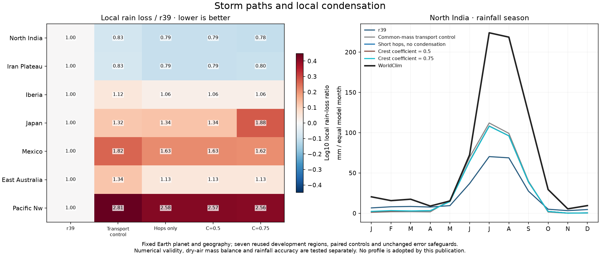
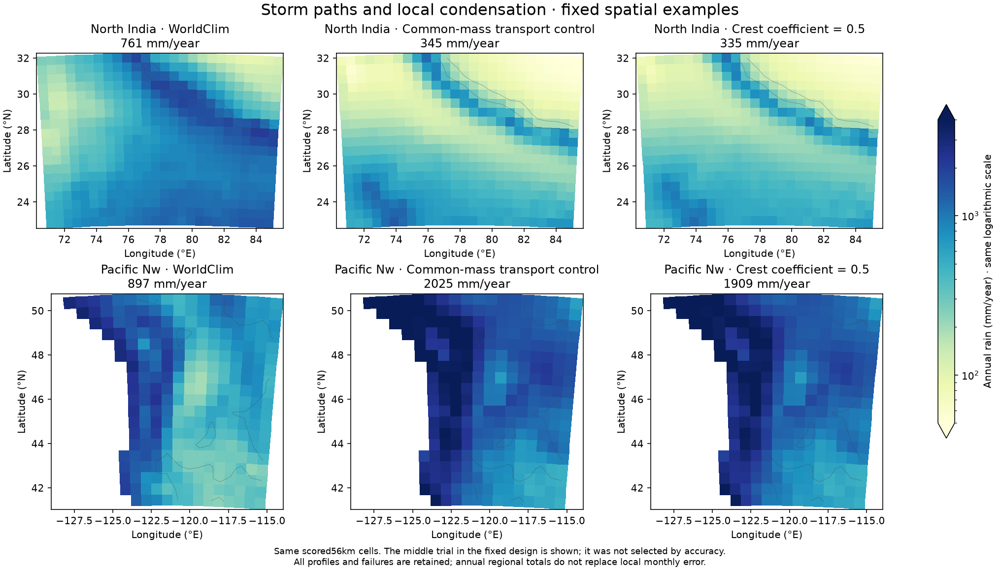

# Storm paths and local condensation on common-mass transport

This35-run campaign separates the geometry of unresolved storm transport from
local condensation, with shared winds and Earth planetary forcing fixed.
The committed plan is `calibration/storm_path_20261026/plan.json`, source395d51e,
output `output/storm_path_20261026/`. No source changes or new parameter values
are introduced after seeing the results. Original residual/error safeguards,
dry-mass and separate-branch speed checks remain mandatory.

First, sevenr39 controls and seven common-mass transport controls reproduce
every saved observation, state, budget and available native wind field exactly.
Three candidates then run on seven reused development regions: six short
conservative hops with essentially unlimited capacity (coefficient1e-6), then
fixed crest coefficients0.5 and0.75. The latter repeat established attribution
values on the newly corrected transport basis. Humidity ratio0.2,1km shear,
common hydrostatic mass, saturation, rain closure, surface wind and planetary
parameters remain fixed. They do not retune the failed shared-wind search.

Each hop redistributes vapor with nonnegative donor weights, then condenses
any excess above local capacity. Condensate stays at its formation cell and
is counted as rainfall exactly once. Water vapor plus condensate is conserved.
This is an unresolved closure, with no resolved cloud trajectory or latent
heating. Changing hop geometry can affect rainfall without any condensation.

## Completed results

All35 integrations pass strict numerical checks. No candidate passes accuracy
protections, so no full31/ocean/fine/established candidate stages run and no
normal atlas climate/economy packet is replaced.

| Profile | North India annual mm | NI monthly MAE mm | Seven-region S | Rain-loss ratio |
|---|---:|---:|---:|---:|
| reference | 256.3 | 50.01 | 1.0000 | 1.0000 |
| transport_control | 345.1 | 43.67 | 1.1535 | 1.3217 |
| hops_only | 335.0 | 42.12 | 1.1000 | 1.2182 |
| rainout050 | 334.9 | 42.12 | 1.0998 | 1.2180 |
| rainout075 | 336.0 | 42.18 | 1.1246 | 1.2696 |

The hops-only control has exactly zero recorded storm condensation at every
checked step in all seven regions. Moving from one broad exchange to six
shorter hops reduces aggregate rain-loss ratio from1.3217 to1.2182, but still
leaves it21.82% worse thanr39. The0.5 coefficient gives virtually the same
aggregate error;0.75 worsens it again. Iberia, Japan, Mexico and the Pacific
Northwest all retain local failures. These seven reused regions are not an
independent test set or updated global/city accuracy headline.

## Why the next structural experiment concerns vertical humidity

The previous campaign's signed equation budgets show the corrected transport
control's coastal excess is supported predominantly by mean-flow vapor import,
while unresolved storms export water. In the Pacific Northwest, annual mean
advection contributes2639mm and storm exchange exports708mm; model rain is
2025mm against897mm observed. These are diagnostic signed terms, not causal
shares of a nonlinear parameter change. Legacyr39 uses concentration advection
and is not a conservative vapor benchmark.

The two-branch model imposes an instantaneous upper/lower specific-humidity
ratio everywhere. A diagnosed dry upper return can therefore maintain moisture
convergence without independently evolving its humidity. The next isolated
operator solves two water reservoirs and transfers donor humidity with the
vertical air flux required by layer continuity. See
[TWO_RESERVOIR_20261026.md](TWO_RESERVOIR_20261026.md). Its manufactured example
is a transport consistency experiment, not an adopted rainfall improvement.

Shared-wind and storm-path pilots total105 new full strict climate integrations,
all passed, with28 exact controls. Current completed series721 attempts:
717passed and4 original numerical failures preserved. Earthr39 science and
published world Earthr38/Whittaker/free atlas packets stay unchanged.
