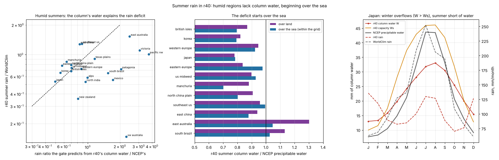

# Summer rain: where r40 loses it (no adoption), 30 October 2026

**Result so far.** r40's summer rain is 0.5–0.8× observed in most of the 31
regions. Splitting the rain into the model's own factors shows two different
problems. In the humid mid-latitudes (Japan, Korea, the British Isles, western
and eastern Europe, the US Midwest, Manchuria, the North China Plain) the rain
gate alone accounts for the deficit: their summer columns hold 10–22 % less
water than NCEP's, and the gate, which rises as (RH − 0.37)^1.5, turns that
into 30–50 % less rain. The deficit begins over the sea, where the column is
held at 75.5 % of saturation at the SST (0.70–0.80 of NCEP over the seas by
Japan, Korea, Manchuria and Britain; 0.99 over the Gulf of Mexico). In the
dry-summer regions (California, Chile, the Levant, Iberia, Morocco, the Great
Basin) the column sits near the gate's threshold and the large-scale term gives
almost nothing; the reanalysis is too coarse over their mountains to say more.
Existing settings (warm-sea humidity, land evaporation, soil depth, one-sided
sea uptake) move the humid group only by flooding East China, East Australia
and the south-east US, which are already too wet in summer. A new opt-in term
(e59, warmer air over a cooler sea holds more, except under the subtropical
highs' sinking) is screened below. A frozen refit with it, the sea's
column humidity and the rain residence time finds nothing better than r40
(best S 1.0008, three groups worse), and a slower sea dries the humid
regions instead. A cap on the eddies' humidity (e38b) with more land
water passes the development gate and the 28 km check (S 0.9946) but makes
the sealed six 1.35 % worse (the north-east US loses its eddy water) and is
not adopted; a version only for cold-air outbreaks (e60) passes the gate
(0.9942) but makes them 4 % worse (north-east US winter snow removed). r40
stays: the wet monsoon winters come from direction-blind eddy mixing, not
from the humidity the eddies carry.

## 1. The rain's factors (`scripts/rain_components.py`)

The rain rate is A × gate(RH) × instability / τ (+ convective closure,
× sub-cloud evaporation, + overflow above saturation), with the ascent
A = (background + storms + convergence + upslope + sub-grid hills) × damping.
The script records every factor at the scored land cells through the model's
own rain-step trace (`output/summer_rain_20261030/components_r40.json`).

Japan under r40, by month (model frame):

| | Jan | Apr | Jul | Oct |
|---|---:|---:|---:|---:|
| column water W (mm) | 13.0 | 19.8 | 31.8 | 25.4 |
| capacity Ws (mm) | 10.0 | 28.1 | 45.9 | 31.8 |
| RH = W / Ws | **1.30** | 0.71 | 0.69 | 0.80 |
| gate | 1.81 | 0.40 | 0.37 | 0.58 |
| storms | 3.66 | 3.57 | 1.54 | 2.46 |
| rain (mm/month) / WorldClim | 136 / 63 | 82 / 127 | 130 / 252 | 70 / 109 |

Japan's winter rain is mostly the overflow of a supersaturated column (water
mixed in from the warm seas onto cold land), its summer rain a gate held low
by a column of 31.8 mm against NCEP's ~40. With NCEP's water in r40's columns
the gate predicts the summer rain ratio to within 0.8–1.35 in the humid
group (Japan 1.08, Korea 1.19, British Isles 0.98, US Midwest 1.05, North
China Plain 1.13, eastern Europe 1.35, Manchuria 1.34, western Europe 0.83).
East China and the south-east US rain more than the gate predicts (1.5×)
through the warm-season instability and convective closure, which the
mid-latitudes barely reach (instability starts at 22 °C, the closure gives
~0.1 mm/day at their humidity).

Summer surface temperature does not explain the deficit: most regions are
within ±1.5 °C of WorldClim and the British Isles are 3.3 °C too cold yet
still at 0.71× in rain.

## 2. Over the sea (`scripts/compare_column_water.py`, sea cells)

| summer (JJA) | land W / NCEP | sea W / NCEP | sea W, NCEP (mm) | rain / observed |
|---|---:|---:|---|---:|
| Japan | 0.78 | 0.78 | 32.8, 41.8 | 0.53 |
| Korea | 0.82 | 0.79 | 33.6, 42.4 | 0.66 |
| Manchuria | 0.88 | 0.70 | 25.8, 36.7 | 0.85 |
| North China Plain | 0.91 | 0.80 | 35.7, 44.4 | 0.79 |
| British Isles | 0.87 | 0.79 | 17.0, 21.4 | 0.68 |
| western Europe | 0.95 | 0.92 | 20.7, 22.4 | 0.72 |
| US Midwest | 0.90 | 0.93 | 34.7, 37.4 | 0.73 |
| south-east US | 0.96 | 0.99 | 39.7, 39.9 | 1.29 |
| East China | 0.94 | 0.88 | 41.9, 47.7 | 1.28 |

r40's sea column is 0.755 × saturation at the SST: 38 mm at 25 °C, 45 at
28 °C, against roughly 43 and 52 observed over warm seas. Over the summer
marginal seas the air is warmer than the water (Japan's +1.1 K, off Iberia
+2.5 K), and the reanalysis column is ~0.9 of saturation at the SST there.

## 3. Existing settings, one at a time on r40

| 31 regions against r40 | T MAE | rain loss | S | training | former holdout | mid-latitude | dev12 |
|---|---:|---:|---:|---:|---:|---:|---:|
| warm-sea humidity (e40) 0.05 | +0.1 % | +0.5 % | 1.0030 | 1.009 | 0.998 | 0.998 | 1.003 |
| warm-sea humidity 0.10 | +0.2 % | +1.2 % | 1.0066 | 1.019 | 0.997 | 0.997 | 1.006 |
| land recycling 0.40 → 0.50 | −1.0 % | +1.9 % | 1.0046 | 1.021 | 0.998 | 0.995 | 1.004 |
| soil bucket 75 → 150 mm | +3.7 % | 0.0 % | 1.0182 | 1.018 | 0.997 | 1.032 | 1.018 |
| one-sided sea uptake (e11) 0.2 | +0.1 % | −0.1 % | 1.0000 | 1.002 | 0.998 | 0.998 | 1.000 |

Each helps the US Midwest, Japan or the Alps and wets East China, East
Australia and Victoria (or, for the deeper soil, cools and dries the
mid-latitude summers).

## 4. Warm air over a cooler sea (e59, opt-in)

`ocean_column_warm` is e58's other half: where the column temperature
(0.4 SST + 0.6 air over ~300 km) is warmer than the sea, the sea column
saturates part of the way toward it. Under the subtropical highs' sinking
(the model's own subsidence band, strongest on the eastern sides of ocean
basins and in summer) the warm air above the marine layer is dry desert air,
so the term is scaled by exp(−subsidence): off Iberia, Morocco and California
it nearly vanishes, around Japan, Korea and the Gulf it is whole. The
ungated first form made Iberia 10 % worse.

| 31 regions against r40 | T MAE | rain loss | S | training | former holdout | mid-latitude | dev12 |
|---|---:|---:|---:|---:|---:|---:|---:|
| e59 0.5 | +0.2 % | +0.1 % | 1.0015 | 1.004 | **0.996** | 1.001 | 1.002 |
| e59 1.0 | +0.4 % | +0.4 % | 1.0036 | 1.008 | **0.993** | 1.004 | 1.005 |
| (ungated 0.5) | +0.4 % | 0.0 % | 1.0018 | 1.007 | 0.992 | 1.003 | 1.002 |
| (ungated 1.0) | +0.8 % | +0.5 % | 1.0063 | 1.018 | 0.986 | 1.009 | 1.006 |

Anatolia, New Zealand, SW Australia, Japan, the Levant and Chile improve;
Manchuria, Iberia, Patagonia, the Cape and western and eastern Europe get
worse. Summer rain moves toward the observed in Manchuria, Europe, Korea and
Japan, but the term also wets spring and autumn, when the air is warmer than
the sea too, and those regions' annual totals were already high (Manchuria
680 against 582 mm, western Europe 924 against 875). At Japan's +1 K
air–sea contrast it adds ~6 % to the column, where NCEP implies ~20 %.

## 5. Frozen refit: no improvement on r40

`calibration/summer_refit_20261030/plan.json`, committed before any result:
ocean_column_warm [0, 1], ocean_column_air [0, 0.6], ocean_rh [0.70, 0.82]
and precip_tau_days [8.5, 12.5], every other r40 setting fixed, 40
evaluations against a fresh r40 run.

No candidate beat its own start (e59 0.3 on r40): the lowest S of the 40 is
0.9986 and the best worst group 1.0020; none reaches S ≤ 0.995. Validation
as declared (`output/summer_rain_20261030/refit/`): development S 1.0008,
training 1.0020, former holdout 0.9977, mid-latitude 1.0006, dev12 1.0014 →
**fails** (no 0.5 % gain, three groups worse); 28 km 0.9973; sealed six not
run. Nothing is adopted; r40 stays. The sea column's humidity, its two
temperature sides and the rain residence time cannot move summer rain
without moving the shoulder seasons and the already-wet subtropical east
coasts with it.

## 6. A slower sea (one more screen, not adopted)

The sea column relaxes to its target in evap_tau_days = 0.40 days, i.e. a
10 mm deficit evaporates at 25 mm/day where real seas give 3–6. A slower
sea would let columns keep the water they bring from warmer seas upstream:

| 31 regions against r40 | T MAE | rain loss | S | training | former holdout | mid-latitude | dev12 |
|---|---:|---:|---:|---:|---:|---:|---:|
| evap_tau_days 1.0 | −1.0 % | +2.1 % | 1.0055 | 0.989 | 1.041 | 1.001 | 1.004 |
| evap_tau_days 2.5 | −1.4 % | +9.3 % | 1.0397 | 0.993 | 1.111 | 1.054 | 1.037 |

Temperature and the dry west coasts (Iberia, the Cape, California, the Great
Basin, East Australia, Iran) improve, but the humid regions lose water
instead of keeping it (Japan 1.10 → 1.29, the British Isles 1.11 → 1.37,
the Levant, Anatolia, South Brazil): in r40 the sea's fast uptake into dry
air matters more than any upstream memory.

## Interim conclusions (after §6)

* The humid summer deficit is real and measurable: 10–22 % too little column
  water, beginning over the sea, amplified ~3× by the rain gate.
* Every lever that adds water to the sea column also adds it in spring and
  autumn and to the subtropical east coasts, which are already too wet in
  summer (East China, East Australia, south-east US 1.3–1.5×); every lever
  that slows the sea dries the humid regions. The model has one column of
  water per cell, so a seasonal rain error cannot be fixed by the sea alone.
* What the summer seems to need is rain-making that responds to the season
  and not only to column humidity: the instability boost starts at 22 °C and
  the convective closure gives ~0.1 mm/day at mid-latitude summer humidity,
  so mid-latitude summer convection is nearly absent; and the overflow of
  supersaturated winter columns (Japan's winter rain) is the mirror error.
  Both are the next things to test, against r40.

## 7. Winter overflow: eddies that keep their humidity (e38b) with more land water

Japan's winter rain is mostly overflow: eddies mix warm-sea water into cold
land columns beyond their capacity (January RH 1.3) and the excess rains at
once. e38b (`eddy_rh_cap`, an older opt-in term, off in r40) lets air the
eddies move onto colder ground keep at most its relative humidity.

| 31 regions against r40 | T MAE | rain loss | S | training | former holdout | mid-latitude | dev12 |
|---|---:|---:|---:|---:|---:|---:|---:|
| eddy_rh_cap 0.5 | −0.1 % | −0.2 % | 0.9984 | 1.010 | 1.009 | 1.027 | **0.977** |
| eddy_rh_cap 1.0 | +0.5 % | +11.9 % | 1.0620 | 1.072 | 1.041 | 1.177 | 1.027 |
| cap 0.3, land_recycling 0.45 | **−0.65 %** | **−1.15 %** | **0.9910** | 1.009 | 1.000 | 0.989 | 0.979 |
| cap 0.4, land_recycling 0.5, τ 9.5 | −0.4 % | −1.1 % | 0.9924 | 1.025 | 0.991 | 0.988 | 0.976 |

At 0.5 the cap fixes the winter-wet regions that bind r40's training group
(region scores: Great Basin 0.83, Iran 0.85, East Australia 0.90,
California 0.91, Cape 0.91; Korea's winter 229 → 105 mm against 94,
Japan's 380 → 226 against 192) but it removes water in every season, and
the interiors that live on eddy water dry out (US Midwest 1.46, Anatolia,
the Levant, Central Asia, the Alps). More land recycling does the opposite
(§3). Together the two improve both temperature and rain; only the
training group is still worse (Levant, Central Asia, East China, south-east
US).

A frozen search (`calibration/eddy_cap_refit_20261030/plan.json`, committed
before any result: eddy_rh_cap [0, 0.6], land_recycling [0.35, 0.55],
precip_tau_days [8.5, 12.5], ocean_column_warm [0, 1]; 48 evaluations from
cap 0.3 / recycling 0.45) finds one candidate (19th) that clears every group:
eddy_rh_cap 0.176, land_recycling 0.388 (r40 0.399), precip_tau_days 9.92
(r40 10.05), ocean_column_warm 0.208.

| check against r40 | result |
|---|---|
| development gate, 31 regions | S **0.9946** (needs ≤ 0.995); T +0.30 %, rain −1.39 %; training 0.9995, former holdout 0.9982, mid-latitude 0.9970, dev12 0.9885 → passes |
| paired 28 km | S 0.9981 → passes |
| sealed six, run once | S **1.0135** → **worse**: north-east US rain loss 0.173 → 0.220 (+27 %), Caucasus 0.619 → 0.660; Tasmania and SE Africa better |

**Not adopted.** The development gain is the smallest the policy allows
(0.54 %), and the six regions never used for tuning get 1.35 % worse. Every
earlier adoption (r30–r40) improved them (S 0.946–0.995). Policy v2 lists
the sealed six as a once-per-milestone record rather than an adoption rule,
so this is a judgment, recorded here: a sealed loss this size on top of a
marginal development gain reads as overfitting. It is also consistent
with the development set itself. The two worst development regions were the
US Midwest (1.054) and the south-east US (1.034), and the north-east US is
their neighbour: the cap takes the eddy water that eastern North America's
rain lives on, and the gate's group averages hid it. r40 stays. The sealed
six have now been seen once by this candidate; that is reported here and
counts against their independence for the next milestone.

What this leaves: capping the eddies' humidity is the first mechanism that
fixes the winter-wet coasts (Great Basin, Iran, California, Cape, East
Australia, Manchuria) without new physics, but as built it caps every season
and every direction. A cap that acts only where eddies carry sea air onto
much colder land (the winter monsoon coasts), leaving warm-season and
continental transport alone, is the next step.

## 8. A cap only for cold-air outbreaks (e60, opt-in)

The cap binds wherever a column holds less than its eddy surroundings: on the
winter monsoon coasts, but also on every mountain in every season and at the
cold edge of each grid. `eddy_cap_contrast_k` keeps it only where the
column's sea-level-equivalent air is colder than the eddies' surroundings
(G(Tsl) − Tsl over the eddy scale, ~850 km), in full at that many K. The sea-
level equivalent removes height, so mountains alone do not trigger it, and
warm summer land never does.

| 31 regions against r40 | T MAE | rain loss | S | training | former holdout | mid-latitude | dev12 |
|---|---:|---:|---:|---:|---:|---:|---:|
| e38b 0.5 (everywhere, §7) | −0.1 % | −0.2 % | 0.9984 | 1.010 | 1.009 | 1.027 | 0.977 |
| e60: cap 0.5, full at 10 K | 0.0 % | −0.2 % | 0.9987 | 0.9995 | 0.9996 | 0.996 | 0.999 |
| cap 0.5, 5 K | 0.0 % | −0.4 % | 0.9977 | 0.999 | 0.999 | 0.994 | 0.997 |
| cap 1.0, 5 K | −0.1 % | −0.7 % | 0.9962 | 0.998 | 0.999 | 0.992 | 0.995 |
| cap 1.0, 2.5 K | −0.15 % | −0.8 % | **0.9952** | 0.997 | 0.999 | 0.994 | 0.993 |
| cap 1.0, 5 K, land_recycling 0.45 | −0.8 % | 0.0 % | 0.9959 | 1.007 | 0.996 | 0.983 | 0.995 |
| cap 1.0, 2.5 K, land_recycling 0.45 | −0.8 % | −0.3 % | 0.9946 | 1.005 | 0.996 | 0.984 | 0.992 |

Every group improves with e60 alone; the interiors' losses fall from 10–20 %
to 0.4–5 % (the US Midwest is still the worst, 1.05 at 2.5 K), and Manchuria,
Korea, East Australia, the Great Basin and the Cape improve. Its gain is
smaller than the ungated cap's on the Great Basin and California, part of
whose earlier gain came from capping their mountains.

**Caveat.** e60 was designed after the sealed six had shown the ungated cap
drying the north-east US. For this mechanism the sealed six are therefore
not a fully blind test, and any result on them is reported with that caveat.

A frozen search (`calibration/cold_cap_refit_20261031/plan.json`, committed
before any result: eddy_rh_cap [0.3, 1], eddy_cap_contrast_k [1.5, 10],
precip_tau_days [9, 11.5], land_recycling [0.35, 0.5]; 40 evaluations from
cap 1.0 at 2.5 K) selects cap 0.79 in full at 1.5 K, precip_tau_days 10.20,
land_recycling 0.430.

| check against r40 | result |
|---|---|
| development gate, 31 regions | S **0.9942**; T −0.66 %, rain −0.51 %; training 0.9991, former holdout 0.9997, mid-latitude 0.9913, dev12 0.9909 → passes |
| paired 28 km | S 0.9972 → passes |
| sealed six | S **1.0406** → **worse**: north-east US rain loss 0.173 → 0.282 (winter 44 → 12 mm a month against 77), Tasmania 1.06, Caucasus 1.05, Norway 1.04 |

**Not adopted** (the plan required the sealed six not to get worse). The
north-east US shows why the cap is the wrong mechanism, not just badly
tuned: its winter precipitation is sea air pushed onto cold land (coastal
storms), exactly what the cap removes, and in nature the water that
"condenses on the way" falls there as snow and rain instead of vanishing.
The model's overflow of a supersaturated column is that precipitation. What
is wrong on the winter monsoon coasts (Korea, Japan, Manchuria) is rather
that the eddy mixing is isotropic: it brings sea air onshore against an
offshore winter monsoon as readily as it does under onshore storms. A
direction-aware eddy transport (eddies weakened against a strong offshore
mean flow) is the structural fix; capping the humidity is not.

The sealed six have now been run for three candidates (r40, the eddy-cap
refit and this one), two of them for the same mechanism. They should be
replaced by a newly declared sealed set before the next adoption.

## Conclusions

* r40 stays. Four frozen searches after it (summer sea moisture, the eddy
  cap, the cold-air cap) and two screens (slower sea, warm-sea humidity,
  land water) found nothing that improves the 31 regions and the regions
  never used for tuning together.
* The humid summer deficit (columns 10–22 % short, from the sea) and the
  wet monsoon winters (eddies bringing sea air onshore against the winter
  monsoon) are two faces of one structural limit: one column of water per
  cell, moved by an isotropic eddy mixing and a relaxation to the sea's
  target, with no notion of the season's flow direction for the eddies.
* Next: direction-aware eddy moisture transport; a fresh sealed set; and,
  downstream, retraining the Earth corrections on r40.

## 9. Eddies that draw from upwind (e61, opt-in, not adopted)

§8 traced the wet monsoon winters to isotropic eddy mixing: it pulls the warm
seas' water onto Korea and Japan against an offshore winter monsoon as
readily as it does under onshore storms. `eddy_upwind_days` centres each
cell's mixing source upwind along the eddy-scale mean wind (that many days of
travel, at most one kernel width). r40's cells reproduce bit for bit with it
off.

| 31 regions against r40 | T MAE | rain loss | S | training | former holdout | mid-latitude | dev12 |
|---|---:|---:|---:|---:|---:|---:|---:|
| e61 0.5 day | −0.2 % | +2.3 % | 1.0106 | 1.017 | 1.000 | 1.024 | 1.007 |
| e61 1 day | −0.3 % | +6.4 % | 1.0304 | 1.040 | 1.009 | 1.065 | 1.022 |
| e61 2 days | −0.3 % | +12.4 % | 1.0604 | 1.076 | 1.031 | 1.116 | 1.045 |
| e61 0.3 day + land friction (e57) 0.3 | −0.5 % | +1.1 % | 1.0026 | 1.020 | 0.988 | 0.988 | 1.005 |
| cold_high_storms 0.13 → 0.25 (e48) | +0.1 % | −0.4 % | 0.9983 | 1.000 | 1.002 | 0.991 | 0.999 |
| cold_high_storms 0.40 | +0.1 % | −0.6 % | 0.9978 | 1.000 | 1.003 | 0.989 | 0.998 |

At 1 day the East Asian winters come right or overshoot (winter rain Korea
229 → 52 mm against 94, Japan 380 → 150 against 192, Manchuria 41 → 9
against 19, North China Plain 79 → 37 against 26) and their summers gain a
little. But the onshore westerlies of the west coasts now draw their eddy
water from far out at sea on top of the mean flow, and their winters flood
(western Europe 250 → 357 against 222, California 256 → 360 against 166,
Great Basin 216 → 298 against 110, eastern Europe 129 → 184 against 113).
Those westerlies are r40's over-land surface winds, 2–5× the reanalysis
(§10 of the physics report), so any transport that follows the wind inherits
that error; slowing them over land (e57) starves the interiors instead. The
structural step both need is a separate transport wind (the ~850 hPa flow,
little slowed by the ground) beside the surface wind that carries heat.
Strengthening the existing cold-high damping of the storms (e48) is a small,
clean gain (Manchuria, North China Plain, Korea, US Midwest) but costs Japan;
it is a candidate knob for a future refit, not a mechanism by itself.

## Reproduce

```sh
python -I scripts/rain_components.py --params calibration/local_accuracy_20261023/r40_params.json --out output/summer_rain_20261030/components_r40.json
python -I scripts/compare_column_water.py --params calibration/local_accuracy_20261023/r40_params.json --regions japan korea western_europe british_isles us_midwest eastern_europe manchuria north_china_plain east_china southeast_us east_australia south_brazil --out output/summer_rain_20261030/column_water_r40_humid.json
python -I scripts/benchmark_local.py --fit calibration/local_accuracy_20261023/r40_params.json --regions dev31 --set '{"ocean_column_warm": 0.5}' --out output/summer_rain_20261030/ocw05
python -I scripts/gate_calibrate.py --plan calibration/summer_refit_20261030/plan.json --out calibration/summer_refit_20261030/search --hours 3
OUT=output/summer_rain_20261030/refit REF_NAME=r40 REF_FIT=calibration/local_accuracy_20261023/r40_params.json BEST=calibration/summer_refit_20261030/search/best_params.json bash scripts/validate_monsoon_refit.sh
python -I scripts/physics_gap_figures.py summer output/summer_rain_20261030/components_r40.json output/summer_rain_20261030/column_water_r40_humid.json
python -I scripts/benchmark_local.py --fit calibration/local_accuracy_20261023/r40_params.json --regions dev31 --set '{"eddy_rh_cap": 0.3, "land_recycling": 0.45}' --out output/summer_rain_20261030/rhcap03_lr045
python -I scripts/gate_calibrate.py --plan calibration/eddy_cap_refit_20261030/plan.json --out calibration/eddy_cap_refit_20261030/search --hours 3
OUT=output/summer_rain_20261030/eddy_cap_refit REF_NAME=r40 REF_FIT=calibration/local_accuracy_20261023/r40_params.json BEST=calibration/eddy_cap_refit_20261030/search/best_params.json bash scripts/validate_monsoon_refit.sh
python -I scripts/benchmark_local.py --fit calibration/local_accuracy_20261023/r40_params.json --regions dev31 --set '{"eddy_rh_cap": 1.0, "eddy_cap_contrast_k": 2.5}' --out output/summer_rain_20261030/cold10k25
python -I scripts/benchmark_local.py --fit calibration/local_accuracy_20261023/r40_params.json --regions dev31 --set '{"eddy_upwind_days": 1.0}' --out output/eddy_upwind_20261031/up10
python -I scripts/gate_calibrate.py --plan calibration/cold_cap_refit_20261031/plan.json --out calibration/cold_cap_refit_20261031/search --hours 3
OUT=output/summer_rain_20261030/cold_cap_refit REF_NAME=r40 REF_FIT=calibration/local_accuracy_20261023/r40_params.json BEST=calibration/cold_cap_refit_20261031/search/best_params.json bash scripts/validate_monsoon_refit.sh
```


